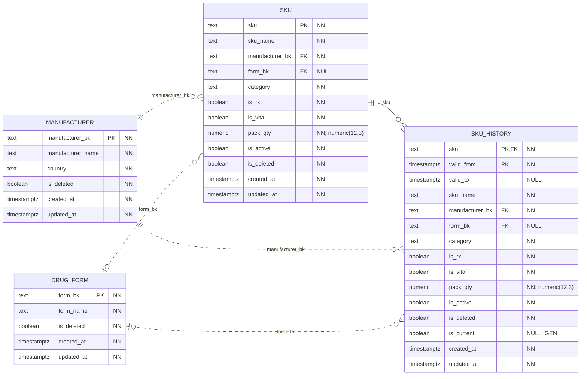
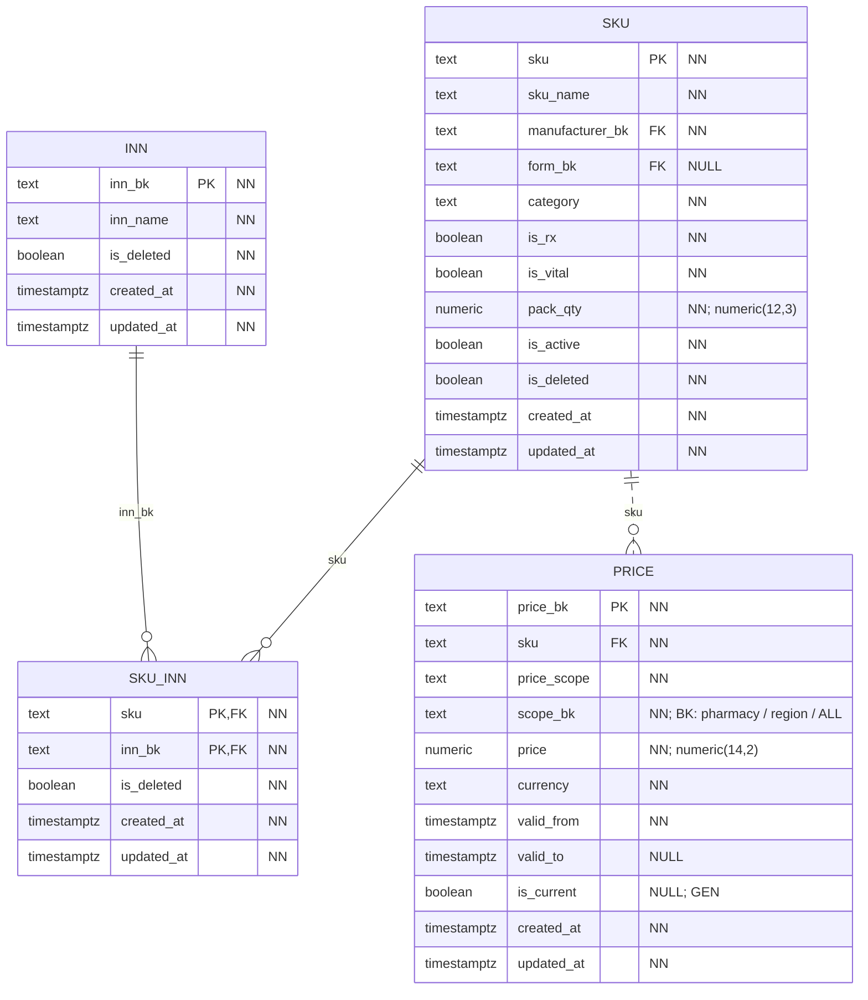

# Каталог

Физическая схема БД `catalog_service_db`. Модель разделена на блоки; повторяющиеся таблицы показаны полностью в каждом из них.

`PK` — первичный ключ, `FK` — внешний ключ в той же БД. Несколько полей с `PK` образуют один составной ключ. `NN` — `NOT NULL` (включая поля PK), `NULL` — ограничение `NOT NULL` в DDL не задано. Точность `numeric(p,s)` указана в комментарии к полю.

Все поля таблиц приведены явно, включая `created_at` и `updated_at`. У обоих тип `timestamptz`, обязательность NN и `DEFAULT clock_timestamp()`; `updated_at` меняется автоматически триггером `core.touch_row`. `GEN` — вычисляемое поле. Общие технические таблицы каждой БД показаны [отдельно](core.md).

Сплошная линия — FK входит в PK дочерней таблицы; пунктир — не входит. На стороне родителя указано «ровно один» или «ноль/один» по обязательности FK, на стороне дочерних строк — допустимое число ссылок. FK сам по себе не требует, чтобы у родителя уже были дочерние строки. Дополнительные требования триггеров описаны ниже.

Метки `BK` у полей обозначают логические межсервисные ссылки. Их адресаты описаны после диаграмм.

## Товар и история атрибутов

## Действующие вещества и цены

## Все физические FK

| Дочерняя таблица и поля | Родительская таблица и поля | Обязательность |
|---|---|---|
| `catalog.price(sku)` | `catalog.sku(sku)` | NN |
| `catalog.sku(manufacturer_bk)` | `catalog.manufacturer(manufacturer_bk)` | NN |
| `catalog.sku(form_bk)` | `catalog.drug_form(form_bk)` | NULL допускается |
| `catalog.sku_history(sku)` | `catalog.sku(sku)` | NN |
| `catalog.sku_history(manufacturer_bk)` | `catalog.manufacturer(manufacturer_bk)` | NN |
| `catalog.sku_history(form_bk)` | `catalog.drug_form(form_bk)` | NULL допускается |
| `catalog.sku_inn(sku)` | `catalog.sku(sku)` | NN |
| `catalog.sku_inn(inn_bk)` | `catalog.inn(inn_bk)` | NN |

## Межсервисные и полиморфные ссылки

| Поле | Логический адресат | Условие |
|---|---|---|
| `catalog.price.scope_bk` | `pos.pharmacy.pharmacy_bk / код региона / ALL` | Зависит от price_scope; отдельного справочника регионов нет. |

## Ограничения и пояснения

У SKU может быть несколько МНН; связь M:N хранится в `sku_inn` с составным PK. Отсутствие строк `sku_inn` допускается для нелекарственных товаров.

`sku_history` ссылается не только на SKU, но и на производителя и лекарственную форму. `form_bk` допускает NULL в обеих таблицах. Поля `is_current` вычисляются из `valid_to IS NULL`; `NOT NULL` у них формально не задан, хотя это выражение всегда возвращает true или false.

История SKU и цен имеет не больше одной текущей версии на свой ключ. Для цены ключ области — `(sku, price_scope, scope_bk)`; пересечение интервалов запрещает EXCLUDE. Узкая область цены имеет приоритет: аптека → регион → сеть.

Межсервисные потребители SKU — POS и WMS; первичным владельцем остаётся каталог. Ссылка `pos.price_reference.price_bk` ведёт к `catalog.price.price_bk`.
