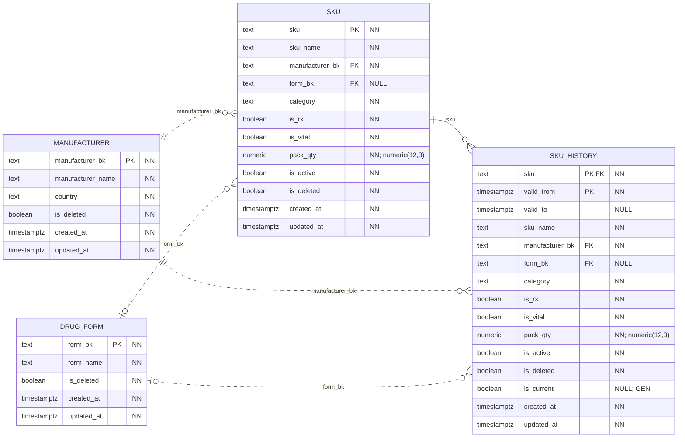
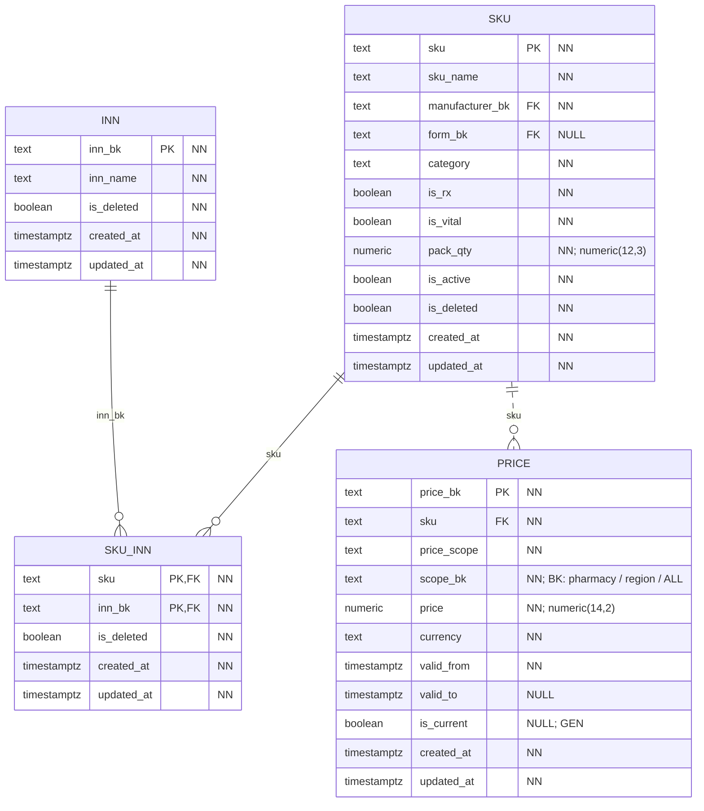

# Каталог: товары и цены

База `catalog_service_db` хранит товарную номенклатуру: названия товаров, производителей, лекарственные формы, действующие вещества и цены. Каждый товар имеет постоянный код SKU. Этот же код используют кассовая система POS и складская система WMS.

[Обозначения на схемах](core.md#как-читать-схемы) и [технические поля](core.md#даты-создания-и-изменения) общие для всех сервисов.

## Товары и история изменений

Таблица `sku` содержит текущее описание товара. Производитель выбирается из `manufacturer` и обязателен для каждого товара. Лекарственная форма хранится в `drug_form`; если она не задана, поле `form_bk` остаётся пустым.

Название, категория и признак рецептурности могут меняться. Чтобы сохранить прежние значения, в `sku_history` записывается история описания товара. Каждая версия действует с `valid_from` до `valid_to`; пустая дата окончания означает текущую версию. У одного SKU может быть не больше одной текущей версии.

Версия истории определяется парой `(sku, valid_from)`. В ней сохраняются собственные ссылки на производителя и лекарственную форму, поэтому можно узнать, какие значения были указаны в тот период.

## Действующие вещества и цены

Справочник `inn` хранит МНН — международные непатентованные наименования действующих веществ. Один SKU может содержать несколько веществ, а одно вещество — входить в состав разных товаров. Для этой связи используется таблица `sku_inn`. Её первичный ключ состоит из двух полей: `(sku, inn_bk)`. У нелекарственных товаров строк в этой таблице может не быть.

Таблица `price` хранит версии цен. У каждой записи есть сумма, валюта, период действия и область: вся сеть, регион или отдельная аптека. При выборе цены приоритет имеет аптека, затем регион, затем вся сеть.

Для одного товара в одной области периоды цен не пересекаются. Это ограничение задаётся для сочетания `(sku, price_scope, scope_bk)`. Например, две цены одного SKU для одной аптеки не могут действовать одновременно. Цена для региона при этом может существовать в те же даты.

В `sku_history` и `price` поле `is_current` рассчитывает PostgreSQL: оно равно `true`, если `valid_to` не заполнено. Метка `GEN` означает вычисляемое поле. Рядом указано `NULL`, поскольку в SQL для этих полей не задано отдельное ограничение `NOT NULL`; само выражение `valid_to IS NULL` всегда возвращает `true` или `false`.

## Как каталог связан с другими системами

POS и WMS используют коды из `catalog.sku.sku`. В POS также хранится копия версии цены: поле `pos.price_reference.price_bk` соответствует `catalog.price.price_bk`. Эти связи поддерживаются по кодам, без внешних ключей между базами.

Смысл `price.scope_bk` зависит от `price_scope`:

| Область цены | Значение `price_scope` | Что хранится в `scope_bk` |
|---|---|---|
| Вся сеть | `chain` | Значение `ALL` |
| Регион | `region` | Код региона |
| Аптека | `pharmacy` | Код аптеки `pos.pharmacy.pharmacy_bk` |

Отдельной таблицы регионов в проекте нет. Для региональной цены используется тот же код региона, который указан у аптеки.
