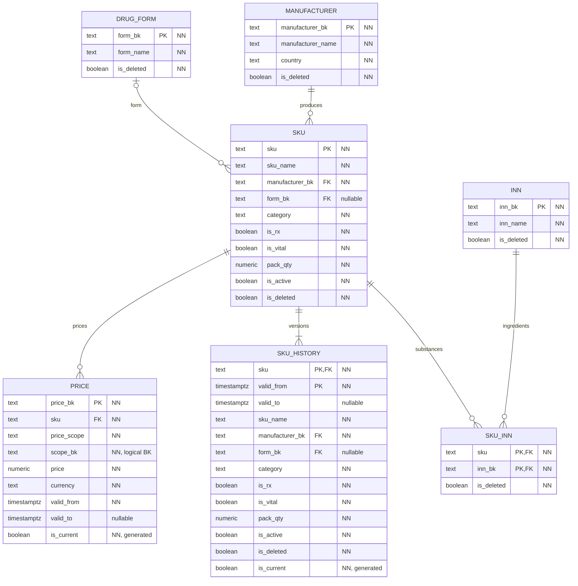

# Каталог

`PK` — первичный ключ, `FK` — ссылка внутри каталога, `NN` — NOT NULL. Во всех таблицах есть обязательные `created_at`, `updated_at`.

`SKU` логически используется в POS и WMS. `PRICE.scope_bk` содержит `ALL`, код региона или `POS.pharmacy.pharmacy_bk`, в зависимости от `price_scope`. Между базами нет FK.

Для одного SKU и одной области цены интервалы `[valid_from, valid_to)` не пересекаются. Текущая версия определяется через `valid_to IS NULL`; время чтения не влияет на контракт. Функция `catalog.price_at` выбирает цену в порядке аптека → регион → сеть.
