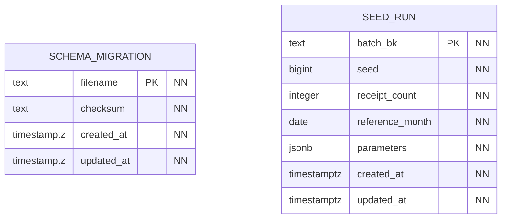

# Общие таблицы и обозначения

В каждой из четырёх баз есть схема `core` со служебными таблицами. Они нужны для применения миграций и загрузки тестовых данных. Каждый сервис ведёт свой учёт этих действий в собственной базе.

## Учёт миграций и загрузок

Таблица `schema_migration` хранит имя применённого файла миграции и его контрольную сумму. По ней скрипт определяет, какие миграции уже выполнены, и замечает, если содержимое применённого файла изменилось.

В `seed_run` записываются загруженные порции данных. Для каждой порции сохраняются её код, начальное значение генератора (`seed`), число документов, расчётный месяц и дополнительные параметры. При повторном запуске с тем же кодом и параметрами генератор пропускает уже выполненную загрузку. Это помогает не создавать дубли.

## Даты создания и изменения

Во всех таблицах на схемах есть два обязательных поля:

- `created_at` — когда строка была создана;
- `updated_at` — когда она в последний раз изменилась.

Оба поля имеют тип `timestamptz`. При добавлении строки PostgreSQL подставляет текущее время через `DEFAULT clock_timestamp()`. При обновлении триггер `core.touch_row` сохраняет прежний `created_at` и автоматически меняет `updated_at`.

Первичные ключи нельзя менять, а строки нельзя физически удалять. Эти правила обеспечивают общие защитные триггеры. В справочниках вместо удаления используется признак состояния записи.

## Как читать схемы

Внутри каждой таблицы перечислены её поля, типы и ограничения:

- `PK` — первичный ключ. Если метка стоит у нескольких полей, они вместе образуют один ключ. Например, позиция документа определяется кодом документа и номером строки.
- `FK` — внешний ключ, то есть проверяемая базой ссылка на другую таблицу этого же сервиса.
- `NN` — поле обязательно: пустое значение запрещено ограничением `NOT NULL` или первичным ключом.
- `NULL` — отдельного ограничения `NOT NULL` у поля нет. Для некоторых полей заполнение зависит от типа операции; такие условия описаны рядом со схемой.
- `BK` — business key, постоянный код объекта. По таким кодам связываются данные разных сервисов. Между их базами физических FK нет.
- `GEN` — значение рассчитывает PostgreSQL по выражению, заданному в таблице.

У полей `numeric` в комментарии указана точность. Например, `numeric(14,2)` хранит до 14 цифр, из них две — после запятой.

На концах линий кружок означает, что связь может отсутствовать, короткий штрих — одну строку, а развилка — несколько строк. Эти символы читаются в сочетании: кружок с развилкой означает от нуля до многих строк, кружок со штрихом — от нуля до одной, два штриха — ровно одну строку.

Сплошная линия используется, когда поля внешнего ключа входят в первичный ключ ссылающейся таблицы. Например, код документа входит в ключ его позиции. Остальные FK показаны пунктиром. Оба вида линий обозначают связи внутри одной базы.

Линия FK сама по себе не требует, чтобы у основной записи уже были связанные строки. Например, требование иметь хотя бы одну позицию и оплату в чеке проверяется отдельно. Такие правила описаны в пояснениях к соответствующему сервису.
