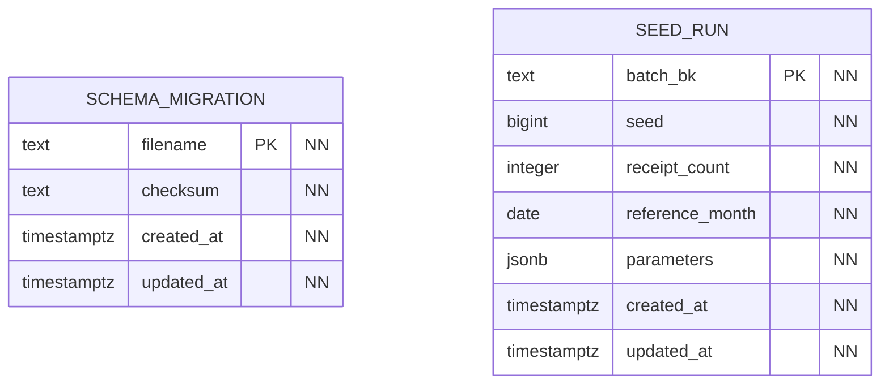

# Общие технические таблицы

Эти две таблицы из `migrations/000_common.sql` создаются отдельно в каждой из четырёх БД. Всего получается восемь физических таблиц. Они хранят состояние миграций и генератора данных.

`NN` — NOT NULL. В каждой таблице явно показаны оба технических времени. `schema_migration` хранит имена и контрольные суммы применённых миграций; `seed_run` — параметры загруженных порций.

`updated_at` поддерживается триггером `core.touch_row`; изменение PK и физическое удаление запрещены общими защитными триггерами.
