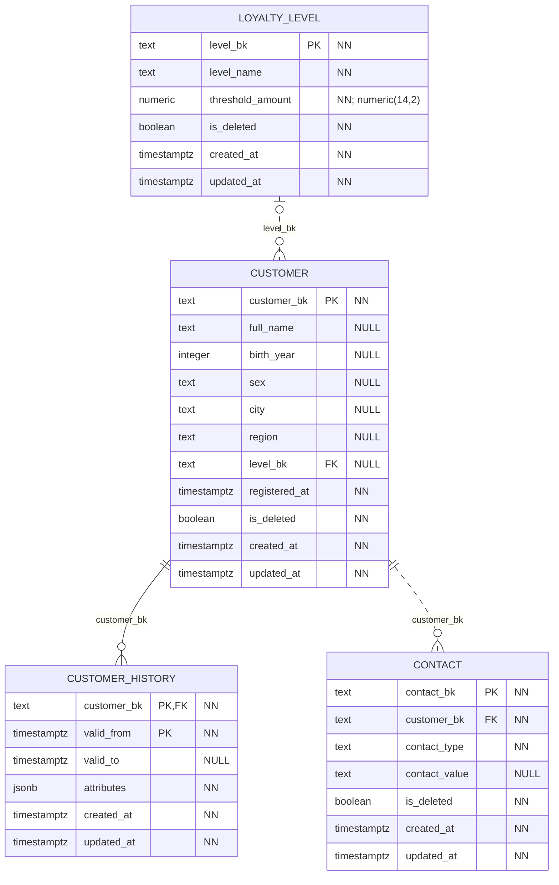
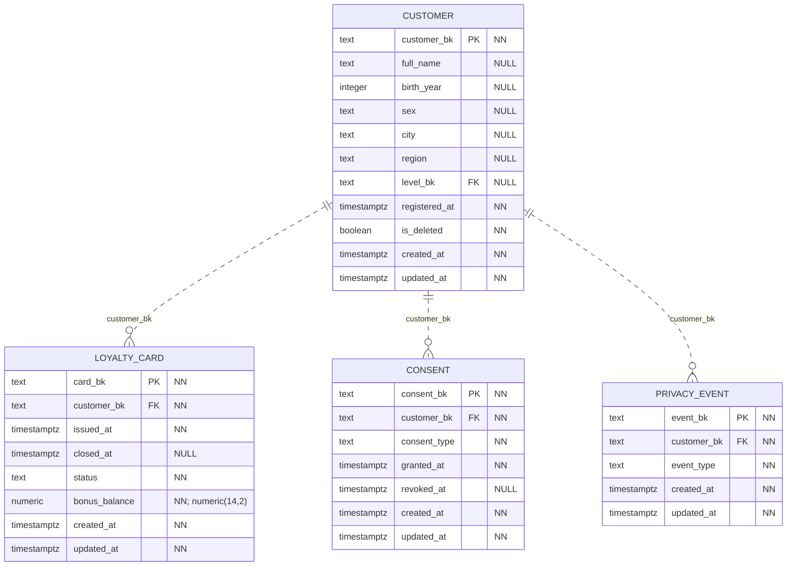

# CRM: клиенты и программа лояльности

База `crm_service_db` хранит данные о клиентах, их контактах, картах лояльности и согласиях. По этим данным можно связать покупки одного клиента и определить его уровень в программе лояльности.

[Обозначения на схемах](core.md#как-читать-схемы) и [технические поля](core.md#даты-создания-и-изменения) общие для всех сервисов.

## Клиенты, контакты и история

Основная таблица — `customer`. У каждого клиента есть постоянный код `customer_bk`. Он сохраняется при изменении анкеты и используется в других системах. Поле `level_bk` связывает клиента со справочником уровней `loyalty_level`. Если уровень ещё не назначен, это поле остаётся пустым.

Контакты хранятся отдельно в `contact`: у одного клиента может быть несколько телефонов или адресов электронной почты. Каждая запись контакта относится к одному клиенту.

В `customer_history` сохраняются изменения атрибутов клиента, например города, региона и уровня лояльности. Значения записываются в поле `attributes`, а период их действия — в `valid_from` и `valid_to`. Пустой `valid_to` означает текущую версию. Для одного клиента допускается не больше одной такой версии. Первичный ключ состоит из кода клиента и даты начала версии: `(customer_bk, valid_from)`.

## Карты и согласия

Таблица `loyalty_card` хранит выданные карты. При перевыпуске старая карта остаётся в истории, а новая получает собственный код. У клиента может быть много карт за всё время, но активной — только одна.

В `consent` записываются согласия на обработку персональных данных и маркетинговые сообщения. Для каждого согласия известны тип, дата выдачи и дата отзыва. У одного клиента может быть только одно действующее согласие каждого типа. Старые записи сохраняются, поэтому можно восстановить, какое согласие действовало в нужный момент.

Таблица `privacy_event` фиксирует факт обезличивания клиента. Это событие понадобится при загрузке в DWH, чтобы убрать персональные данные из аналитики.

## Что происходит при обезличивании

При установке `customer.is_deleted = true` PostgreSQL очищает персональные поля клиента, значения его контактов и содержимое старых версий анкеты. Открытые карты закрываются, действующие согласия отзываются. В `privacy_event` появляется запись об обезличивании.

Строка клиента и его код сохраняются, поэтому старые продажи по-прежнему ссылаются на ту же запись. При этом представления `contract`, через которые данные будут забираться в DWH, больше не выдают обезличенного клиента и его карты.

## Как CRM связана с POS

В POS поля `receipt.customer_bk` и `prescription.customer_bk` содержат код клиента из `crm.customer`. По нему покупку или рецепт можно связать с CRM при загрузке в хранилище.

Это ссылки между разными базами, поэтому физических внешних ключей для них нет. Оба поля могут быть пустыми: покупка и рецепт допускаются без привязки к клиенту.
