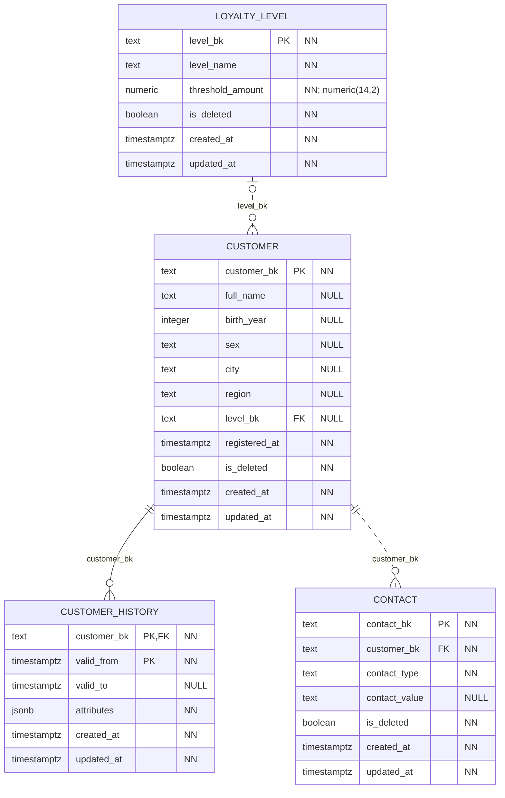
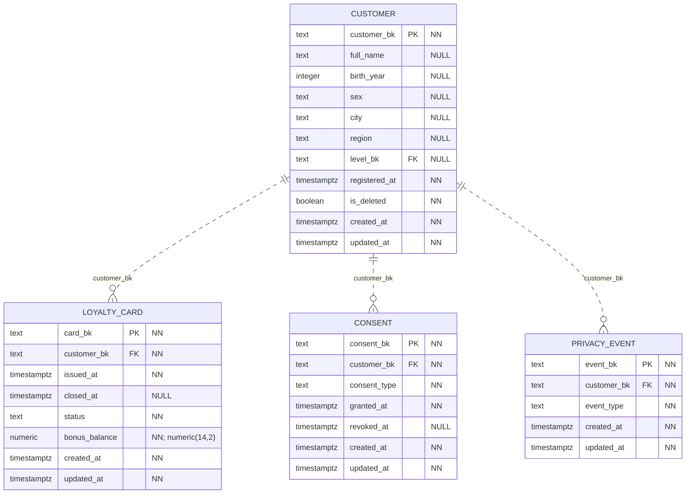

# CRM

Физическая схема БД `crm_service_db`. Модель разделена на блоки; повторяющиеся таблицы показаны полностью в каждом из них.

`PK` — первичный ключ, `FK` — внешний ключ в той же БД. Несколько полей с `PK` образуют один составной ключ. `NN` — `NOT NULL` (включая поля PK), `NULL` — ограничение `NOT NULL` в DDL не задано. Точность `numeric(p,s)` указана в комментарии к полю.

Все поля таблиц приведены явно, включая `created_at` и `updated_at`. У обоих тип `timestamptz`, обязательность NN и `DEFAULT clock_timestamp()`; `updated_at` меняется автоматически триггером `core.touch_row`. `GEN` — вычисляемое поле. Общие технические таблицы каждой БД показаны [отдельно](core.md).

Сплошная линия — FK входит в PK дочерней таблицы; пунктир — не входит. На стороне родителя указано «ровно один» или «ноль/один» по обязательности FK, на стороне дочерних строк — допустимое число ссылок. FK сам по себе не требует, чтобы у родителя уже были дочерние строки. Дополнительные требования триггеров описаны ниже.

Метки `BK` у полей обозначают логические межсервисные ссылки. Их адресаты описаны после диаграмм.

## Клиент, уровень и история

## Карты, согласия и обезличивание

## Все физические FK

| Дочерняя таблица и поля | Родительская таблица и поля | Обязательность |
|---|---|---|
| `crm.consent(customer_bk)` | `crm.customer(customer_bk)` | NN |
| `crm.contact(customer_bk)` | `crm.customer(customer_bk)` | NN |
| `crm.customer(level_bk)` | `crm.loyalty_level(level_bk)` | NULL допускается |
| `crm.customer_history(customer_bk)` | `crm.customer(customer_bk)` | NN |
| `crm.loyalty_card(customer_bk)` | `crm.customer(customer_bk)` | NN |
| `crm.privacy_event(customer_bk)` | `crm.customer(customer_bk)` | NN |

## Ограничения и пояснения

У клиента не больше одной активной карты и одного действующего согласия каждого типа. Эти ограничения заданы частичными уникальными индексами. История клиента имеет составной PK `(customer_bk, valid_from)`; открытая версия только одна.

Обезличивание сохраняет строку клиента, но очищает персональные атрибуты, контакты и старые версии, закрывает карты и согласия. `privacy_event` передаёт событие будущему DWH. Удалённый клиент и его карты скрываются из контракта.

Обратная межсервисная ссылка: `pos.receipt.customer_bk` и `pos.prescription.customer_bk` используют `crm.customer.customer_bk`; в POS они допускают NULL.
