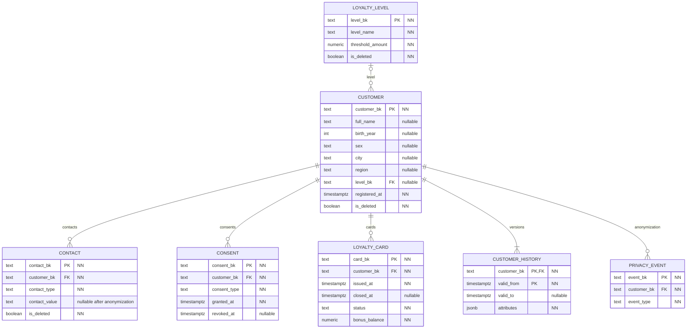

# CRM

`PK` — первичный ключ, `FK` — ссылка внутри сервиса, `UK` — уникальность, `NN` — NOT NULL. Технические `created_at` и `updated_at` обязательны во всех таблицах.

Межсервисная ссылка: `POS.receipt.customer_bk` логически ссылается на `CRM.customer.customer_bk`; физического FK между базами нет. Покупка без карты допускает NULL.

У клиента не больше одной активной карты и одного действующего согласия каждого типа. История города и уровня хранится интервалами. Обезличивание очищает контакты и историю, закрывает карты и согласия, создаёт событие для последующей обработки в DWH. Удалённый клиент и его карты скрыты из контракта.
