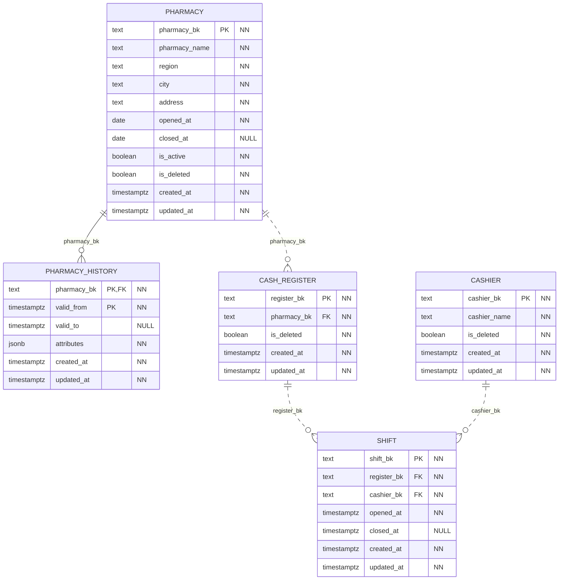
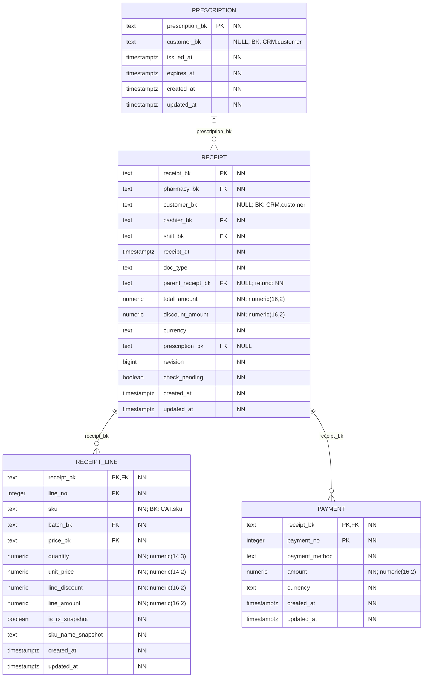
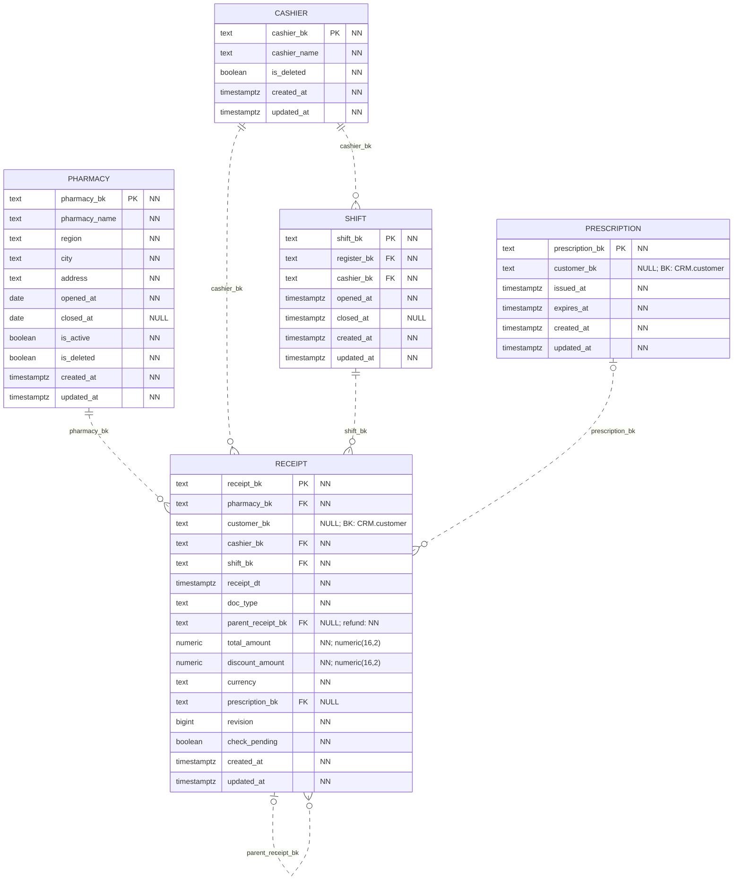
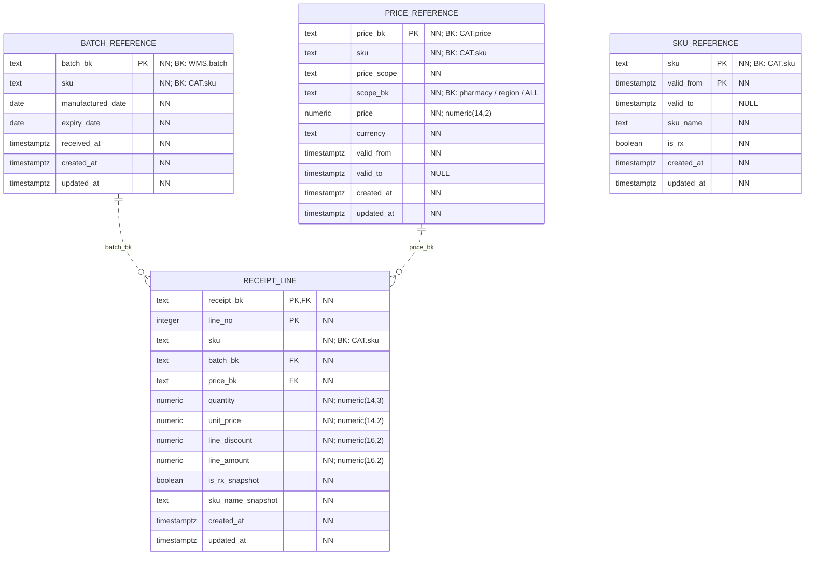

# POS

Физическая схема БД `pos_service_db`. Модель разделена на блоки; повторяющиеся таблицы показаны полностью в каждом из них.

`PK` — первичный ключ, `FK` — внешний ключ в той же БД. Несколько полей с `PK` образуют один составной ключ. `NN` — `NOT NULL` (включая поля PK), `NULL` — ограничение `NOT NULL` в DDL не задано. Точность `numeric(p,s)` указана в комментарии к полю.

Все поля таблиц приведены явно, включая `created_at` и `updated_at`. У обоих тип `timestamptz`, обязательность NN и `DEFAULT clock_timestamp()`; `updated_at` меняется автоматически триггером `core.touch_row`. `GEN` — вычисляемое поле. Общие технические таблицы каждой БД показаны [отдельно](core.md).

Сплошная линия — FK входит в PK дочерней таблицы; пунктир — не входит. На стороне родителя указано «ровно один» или «ноль/один» по обязательности FK, на стороне дочерних строк — допустимое число ссылок. FK сам по себе не требует, чтобы у родителя уже были дочерние строки. Дополнительные требования триггеров описаны ниже.

Метки `BK` у полей обозначают логические межсервисные ссылки. Их адресаты описаны после диаграмм.

## Аптеки, кассы и смены

## Документы, позиции и оплаты

## Ссылки заголовка документа

## Локальные версии каталога и партий

## Все физические FK

| Дочерняя таблица и поля | Родительская таблица и поля | Обязательность |
|---|---|---|
| `pos.cash_register(pharmacy_bk)` | `pos.pharmacy(pharmacy_bk)` | NN |
| `pos.payment(receipt_bk)` | `pos.receipt(receipt_bk)` | NN |
| `pos.pharmacy_history(pharmacy_bk)` | `pos.pharmacy(pharmacy_bk)` | NN |
| `pos.receipt(pharmacy_bk)` | `pos.pharmacy(pharmacy_bk)` | NN |
| `pos.receipt(cashier_bk)` | `pos.cashier(cashier_bk)` | NN |
| `pos.receipt(shift_bk)` | `pos.shift(shift_bk)` | NN |
| `pos.receipt(parent_receipt_bk)` | `pos.receipt(receipt_bk)` | NULL допускается |
| `pos.receipt(prescription_bk)` | `pos.prescription(prescription_bk)` | NULL допускается |
| `pos.receipt_line(receipt_bk)` | `pos.receipt(receipt_bk)` | NN |
| `pos.receipt_line(batch_bk)` | `pos.batch_reference(batch_bk)` | NN |
| `pos.receipt_line(price_bk)` | `pos.price_reference(price_bk)` | NN |
| `pos.shift(register_bk)` | `pos.cash_register(register_bk)` | NN |
| `pos.shift(cashier_bk)` | `pos.cashier(cashier_bk)` | NN |

## Межсервисные и полиморфные ссылки

| Поле | Логический адресат | Условие |
|---|---|---|
| `pos.receipt.customer_bk` | `crm.customer.customer_bk` | Покупка без карты допускает NULL. |
| `pos.prescription.customer_bk` | `crm.customer.customer_bk` | NULL означает рецепт без привязки к клиенту. |
| `pos.batch_reference.batch_bk` | `wms.batch.batch_bk` | Локальная копия партии. |
| `pos.batch_reference.sku` | `catalog.sku.sku` | SKU партии из WMS. |
| `pos.sku_reference.sku` | `catalog.sku.sku` | Версии SKU в локальной копии POS. |
| `pos.price_reference.price_bk` | `catalog.price.price_bk` | Копия версии цены каталога. |
| `pos.price_reference.sku` | `catalog.sku.sku` | SKU версии цены. |
| `pos.receipt_line.sku` | `catalog.sku.sku` | Версия SKU проверяется триггером на дату продажи. |
| `pos.price_reference.scope_bk` | `pos.pharmacy.pharmacy_bk / код региона / ALL` | Область локальной версии цены. |

## Ограничения и пояснения

`receipt.currency` обязательна, денежные поля имеют фиксированную точность. Документ связан с аптекой, кассиром и сменой отдельными FK. Триггер дополнительно проверяет согласованность этих ссылок и открытость смены.

`parent_receipt_bk` — настоящий FK на ту же таблицу `receipt`. Для продажи он NULL, для возврата обязателен. `prescription_bk` допускает NULL в общей модели, но для рецептурной позиции рецепт обязателен. Совокупный объём возвратов проверяется относительно исходной продажи.

`batch_reference`, `sku_reference` и `price_reference` — таблицы внутри POS. Физические FK позиции ведут к локальным партиям и ценам. У `receipt_line.sku` нет FK к `sku_reference`: подходящая версия выбирается по SKU и времени и проверяется триггером. Между `batch_reference.sku`, `price_reference.sku` и `sku_reference` физического FK также нет.

Позиция сохраняет цену, название и рецептурность на момент продажи. Суммы позиций и оплат проверяются отложенными constraint triggers при COMMIT. Поля `revision` и `check_pending` служат для сериализации возвратов и однократной проверки документа; приложение не может сбрасывать флаг проверки.
