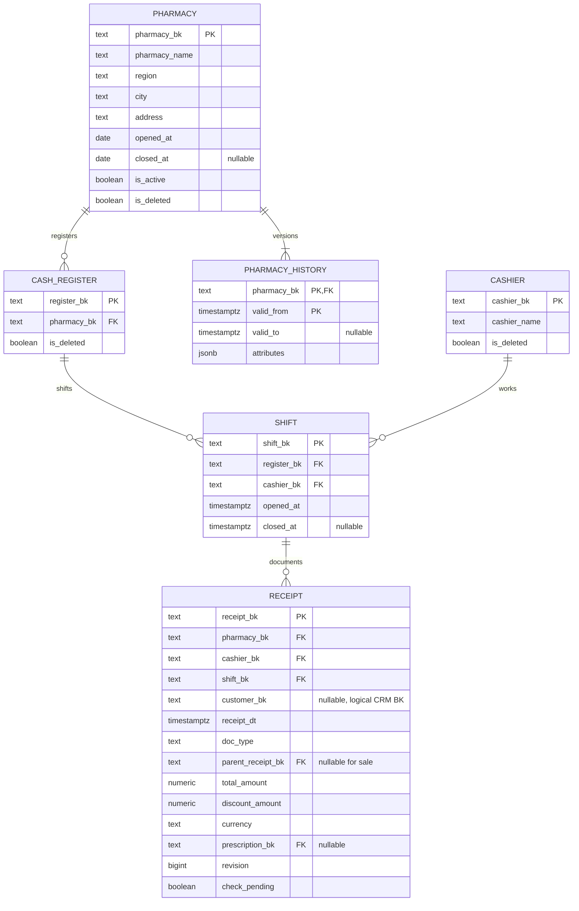
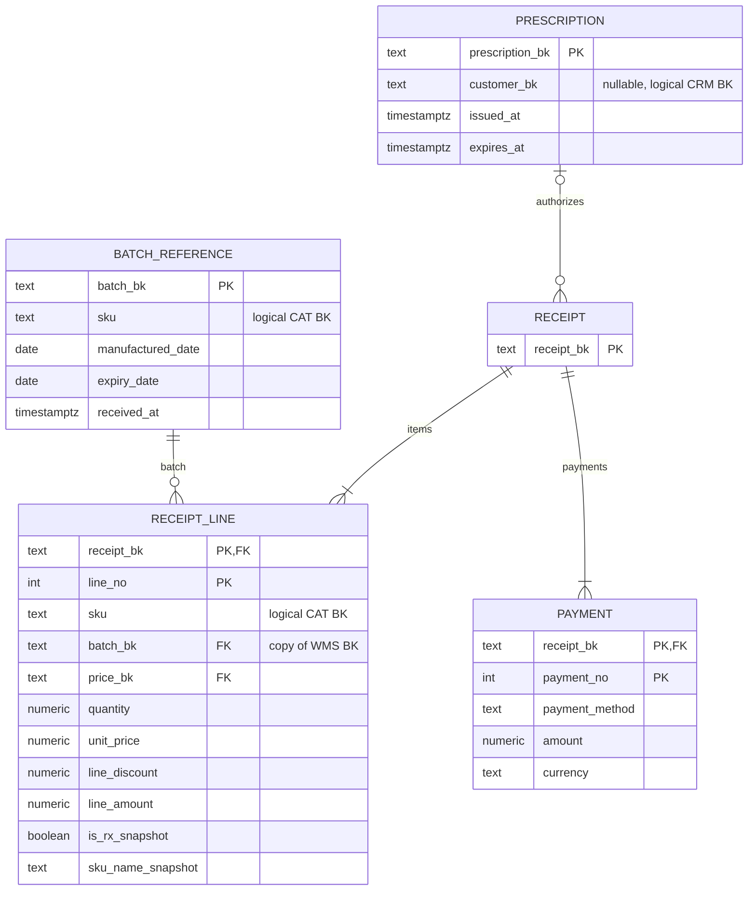
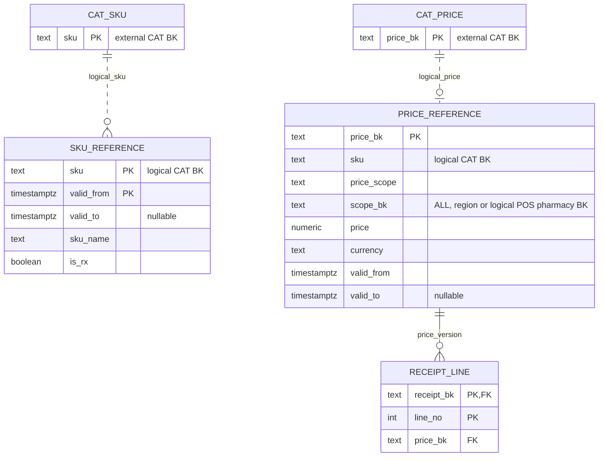

# POS

`PK` — первичный ключ, `FK` — связь внутри POS. Поля обязательны, кроме помеченных `nullable`. Во всех таблицах есть обязательные технические поля `created_at`, `updated_at`.

Локальные версии каталога и связь с позицией:

Пунктир обозначает логический BK между сервисами. Физический FK price_bk ведёт к локальной PRICE_REFERENCE; версия SKU выбирается по SKU и времени продажи.

Локальные ссылки `batch_reference`, `sku_reference`, `price_reference` наполняются из WMS и каталога приложением. Физические FK ведут только к этим копиям внутри POS. Первичные владельцы BK остаются в исходных сервисах.

Позиция хранит исторические цену, название и рецептурность. Изменение каталога не пересчитывает старые документы. И суммы позиций, и суммы оплат проверяются отложенными constraint triggers при завершении транзакции. Возврат ссылается на продажу; изменение счётчика `revision` исходной продажи сериализует конкурентные возвраты. Внутренний флаг проверки приложение менять не может.
