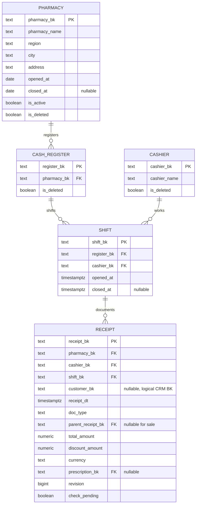
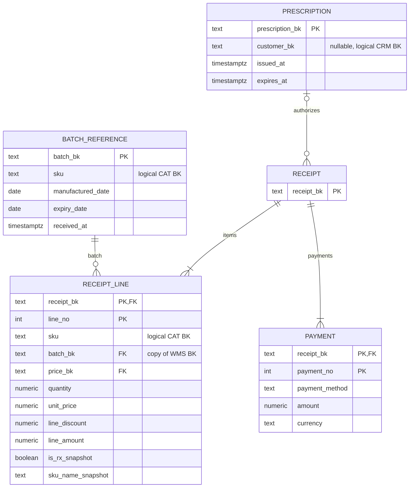

# POS

`PK` — первичный ключ, `FK` — связь внутри POS. Поля обязательны, кроме помеченных `nullable`. Во всех таблицах есть обязательные технические поля `created_at`, `updated_at`.

Остальные таблицы:

| Таблица | Ключ | Обязательные поля | Необязательные поля |
|---|---|---|---|
| `pharmacy_history` | `(pharmacy_bk text FK, valid_from timestamptz)` PK | `attributes jsonb` | `valid_to timestamptz` |
| `sku_reference` | `(sku text, valid_from timestamptz)` PK | `sku_name text`, `is_rx boolean` | `valid_to timestamptz` |
| `price_reference` | `price_bk text` PK | `sku text`, `price_scope text`, `scope_bk text`, `price numeric(14,2)`, `currency text`, `valid_from timestamptz` | `valid_to timestamptz` |

Локальные ссылки `batch_reference`, `sku_reference`, `price_reference` наполняются из WMS и каталога приложением. Физические FK ведут только к этим копиям внутри POS. Первичные владельцы BK остаются в исходных сервисах.

Позиция хранит исторические цену, название и рецептурность. Изменение каталога не пересчитывает старые документы. И суммы позиций, и суммы оплат проверяются отложенными constraint triggers при завершении транзакции. Возврат ссылается на продажу; изменение счётчика `revision` исходной продажи сериализует конкурентные возвраты. Внутренний флаг проверки приложение менять не может.
