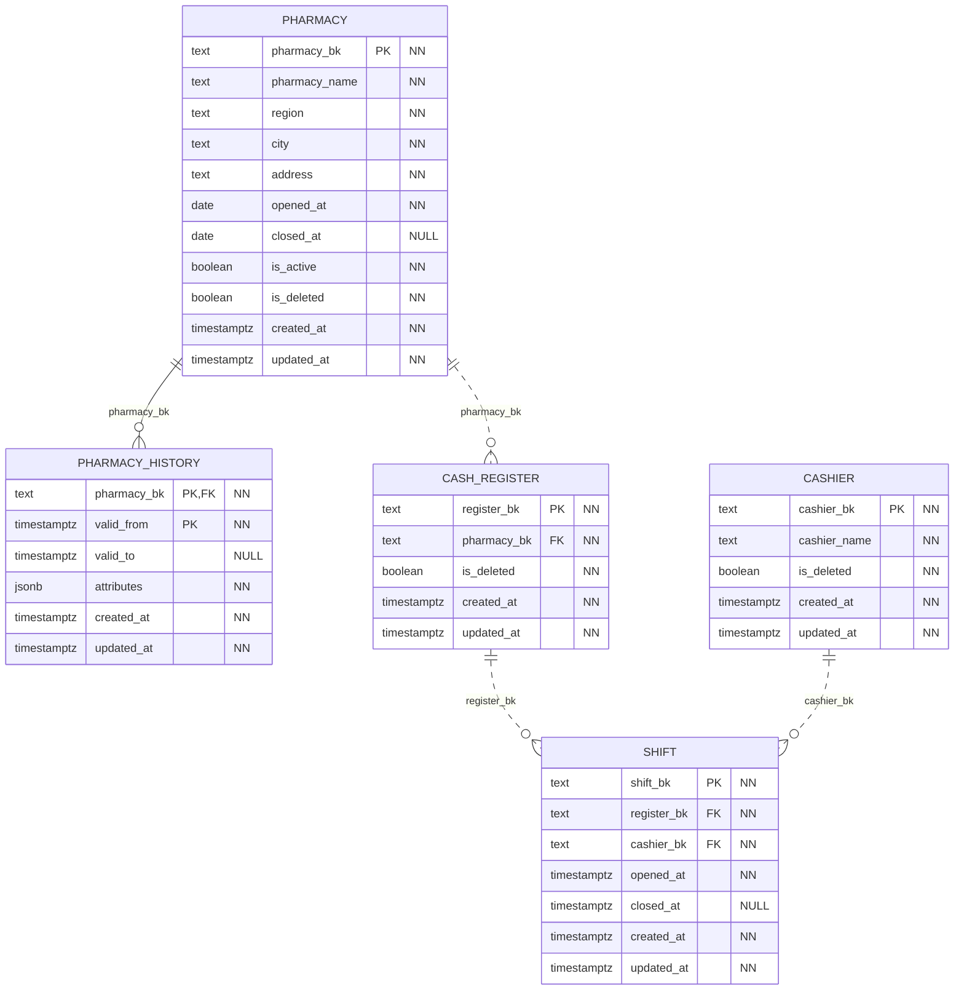
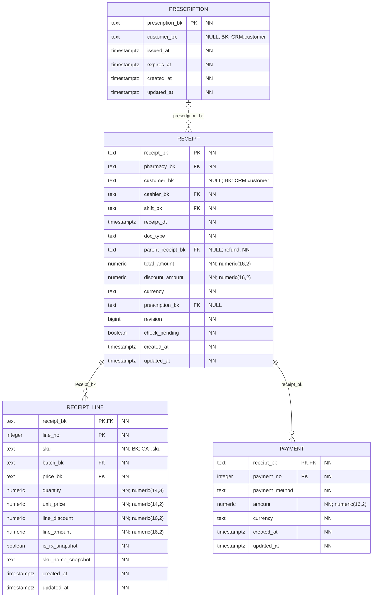
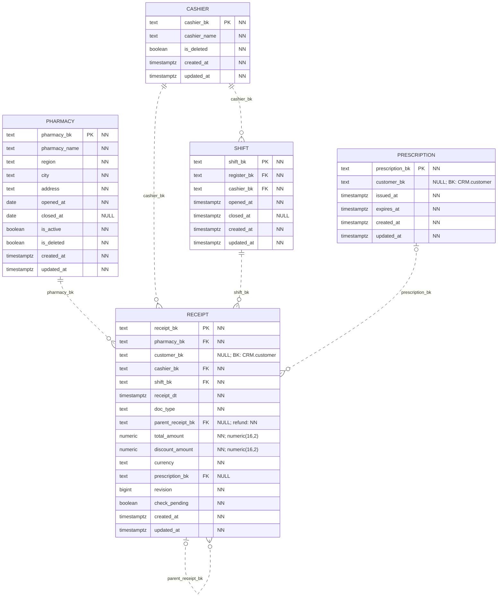
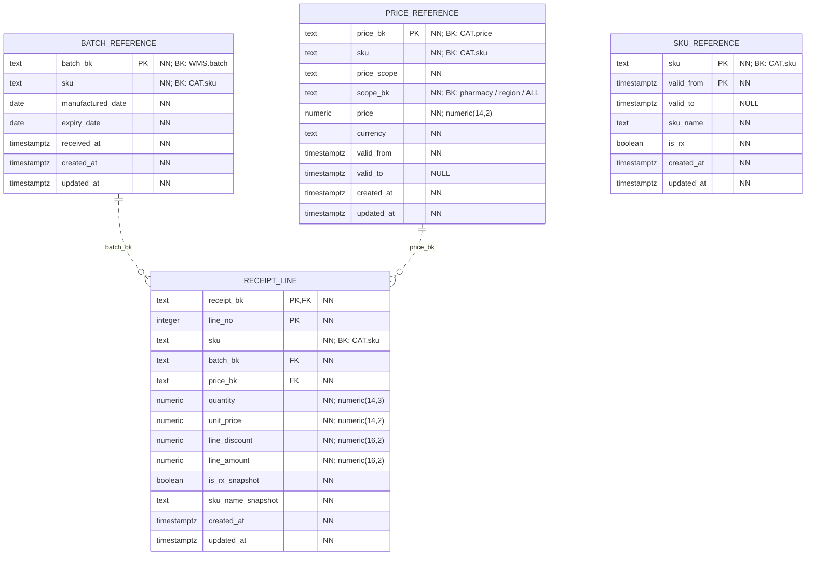

# POS: продажи и возвраты

База `pos_service_db` хранит аптеки, кассы, смены и кассовые документы. По ней можно восстановить, где и когда продали товар, из какой партии его выдали, сколько он стоил и как покупатель оплатил покупку.

[Обозначения на схемах](core.md#как-читать-схемы) и [технические поля](core.md#даты-создания-и-изменения) общие для всех сервисов.

## Аптеки, кассы и смены

Таблица `pharmacy` описывает аптеку, включая её адрес и регион. Изменения этих данных сохраняются в `pharmacy_history`. История нужна, например, чтобы при проверке старого чека использовать регион аптеки на дату продажи.

Каждая касса из `cash_register` принадлежит одной аптеке. Смена в таблице `shift` связана с кассой и кассиром из `cashier`. У смены есть время открытия и закрытия; пока она открыта, `closed_at` остаётся пустым. На одной кассе одновременно может быть открыта только одна смена.

## Чек, товары и оплата

Таблица `receipt` хранит общие сведения о документе: его номер, дату, тип, аптеку, клиента и итоговую сумму. Тип `sale` означает продажу, `refund` — возврат.

Товары записываются в `receipt_line`. У каждой позиции есть номер внутри документа, SKU, партия, количество, цена и скидка. Код документа вместе с номером позиции образует первичный ключ `(receipt_bk, line_no)`.

Таблица `payment` позволяет оплатить один документ несколькими способами, например картой и бонусами. Каждая часть оплаты получает свой номер внутри документа.

В документе должна быть хотя бы одна позиция и одна оплата. Сумма позиций и сумма оплат должны совпадать с итогом документа, а скидки позиций — с общей скидкой. Проверки выполняются перед завершением транзакции: приложение успевает добавить чек, его товары и оплаты, после чего PostgreSQL проверяет их вместе.

Все суммы хранятся в `numeric` с фиксированным числом знаков после запятой. Валюта обязательна и должна совпадать у документа и его оплат.

## Связи чека и правила возврата

Документ связан с аптекой, кассиром и сменой. База проверяет, что кассир работает в указанной смене, касса принадлежит этой аптеке, а дата документа попадает во время работы смены.

У возврата поле `parent_receipt_bk` обязательно: оно указывает на исходную продажу в той же таблице `receipt`. У обычной продажи это поле пустое. Возвращаемая позиция должна соответствовать исходной по товару, партии, цене и сохранённым атрибутам. Все возвраты по одной продаже учитываются вместе: вернуть больше проданного количества или суммы нельзя.

Таблица `prescription` хранит рецепт. Ссылка на него в чеке может быть пустой, если рецептурных товаров нет. Для продажи рецептурного товара рецепт обязателен и должен действовать на дату продажи. Если рецепт выдан конкретному клиенту, этот же клиент должен быть указан в документе.

Поле `revision` помогает проверять одновременные возвраты по одной продаже последовательно. Флаг `check_pending` показывает, что после изменения документа нужно ещё раз проверить его суммы. Этими полями управляет база данных; приложение не может самостоятельно снять флаг проверки.

## Копии товаров, цен и партий

Данные других сервисов хранятся в POS в трёх таблицах: `sku_reference`, `price_reference` и `batch_reference`. Это местные копии нужных версий товаров, цен и партий. Благодаря им POS может проверить позицию чека в своей базе.

Внешние ключи позиции ведут к местным таблицам партий и цен. Для описания SKU одного кода недостаточно: нужна ещё версия, действовавшая в момент продажи. Поэтому подходящую строку из `sku_reference` выбирает и проверяет триггер по SKU и дате. Прямого FK от `receipt_line.sku` к этой таблице нет. Поля `sku` в `batch_reference` и `price_reference` также не имеют FK на `sku_reference`.

В позиции чека отдельно сохраняются цена, название товара и признак рецептурности на момент продажи. Эти значения остаются в старом документе после изменения каталога. При возврате используются значения из исходной продажи.

## Связи с CRM, каталогом и WMS

Между базами используются постоянные коды. Физических внешних ключей между сервисами нет.

| Что связываем | Поле в POS | Откуда берётся код |
|---|---|---|
| Клиента покупки | `receipt.customer_bk` | `crm.customer.customer_bk` |
| Клиента рецепта | `prescription.customer_bk` | `crm.customer.customer_bk` |
| Партию | `batch_reference.batch_bk` | `wms.batch.batch_bk` |
| Товар | `sku` в таблицах `receipt_line`, `sku_reference`, `price_reference` и `batch_reference` | `catalog.sku.sku` |
| Версию цены | `price_reference.price_bk` | `catalog.price.price_bk` |

Клиент в покупке и рецепте может быть не указан. Область цены в `price_reference.scope_bk` хранится так же, как в каталоге: код аптеки, код региона или `ALL` для всей сети.
