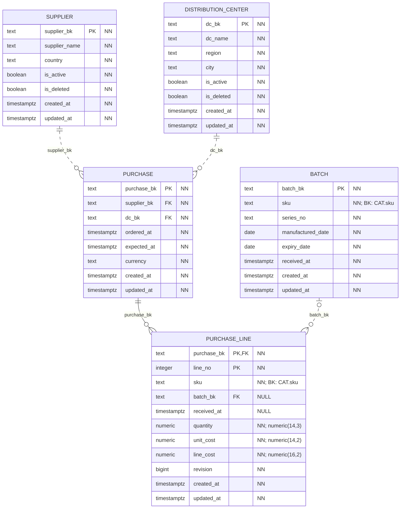
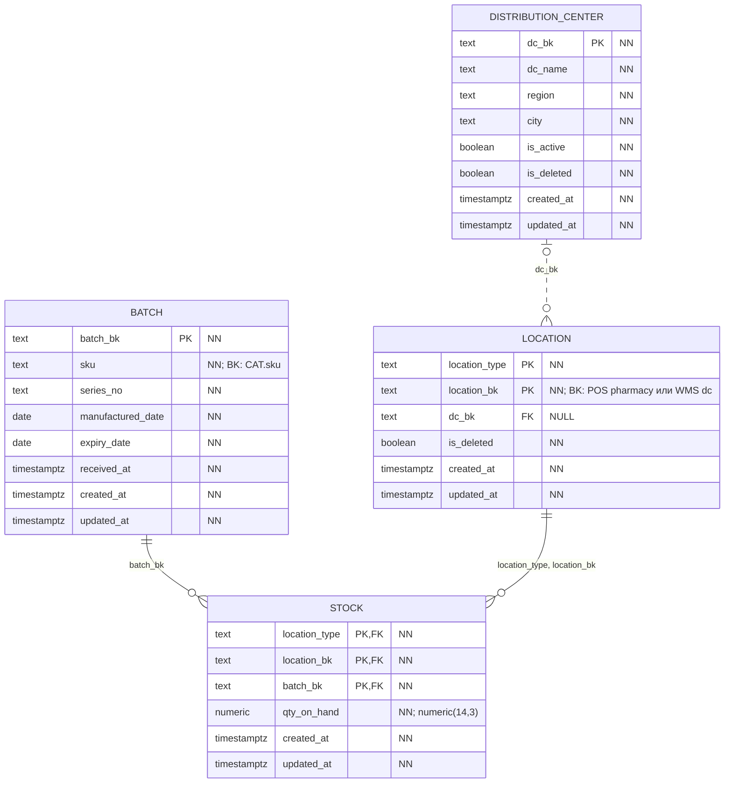
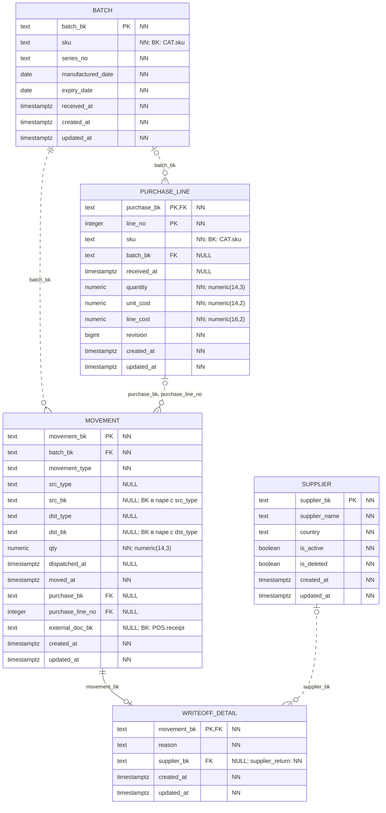

# WMS

Физическая схема БД `wms_service_db`. Модель разделена на блоки; повторяющиеся таблицы показаны полностью в каждом из них.

`PK` — первичный ключ, `FK` — внешний ключ в той же БД. Несколько полей с `PK` образуют один составной ключ. `NN` — `NOT NULL` (включая поля PK), `NULL` — ограничение `NOT NULL` в DDL не задано. Точность `numeric(p,s)` указана в комментарии к полю.

Все поля таблиц приведены явно, включая `created_at` и `updated_at`. У обоих тип `timestamptz`, обязательность NN и `DEFAULT clock_timestamp()`; `updated_at` меняется автоматически триггером `core.touch_row`. `GEN` — вычисляемое поле. Общие технические таблицы каждой БД показаны [отдельно](core.md).

Сплошная линия — FK входит в PK дочерней таблицы; пунктир — не входит. На стороне родителя указано «ровно один» или «ноль/один» по обязательности FK, на стороне дочерних строк — допустимое число ссылок. FK сам по себе не требует, чтобы у родителя уже были дочерние строки. Дополнительные требования триггеров описаны ниже.

Метки `BK` у полей обозначают логические межсервисные ссылки. Их адресаты описаны после диаграмм.

## Закупки и партии

## Локации и остатки

## Журнал и причины исходящих операций

## Все физические FK

| Дочерняя таблица и поля | Родительская таблица и поля | Обязательность |
|---|---|---|
| `wms.location(dc_bk)` | `wms.distribution_center(dc_bk)` | NULL допускается |
| `wms.movement(batch_bk)` | `wms.batch(batch_bk)` | NN |
| `wms.movement(purchase_bk, purchase_line_no)` | `wms.purchase_line(purchase_bk, line_no)` | NULL допускается |
| `wms.purchase(supplier_bk)` | `wms.supplier(supplier_bk)` | NN |
| `wms.purchase(dc_bk)` | `wms.distribution_center(dc_bk)` | NN |
| `wms.purchase_line(purchase_bk)` | `wms.purchase(purchase_bk)` | NN |
| `wms.purchase_line(batch_bk)` | `wms.batch(batch_bk)` | NULL допускается |
| `wms.stock(batch_bk)` | `wms.batch(batch_bk)` | NN |
| `wms.stock(location_type, location_bk)` | `wms.location(location_type, location_bk)` | NN |
| `wms.writeoff_detail(movement_bk)` | `wms.movement(movement_bk)` | NN |
| `wms.writeoff_detail(supplier_bk)` | `wms.supplier(supplier_bk)` | NULL допускается |

## Межсервисные и полиморфные ссылки

| Поле | Логический адресат | Условие |
|---|---|---|
| `wms.batch.sku` | `catalog.sku.sku` | Первичный владелец SKU — каталог. |
| `wms.purchase_line.sku` | `catalog.sku.sku` | Закупаемый SKU. |
| `wms.location.location_bk` | `pos.pharmacy.pharmacy_bk для pharmacy` | Для dc совпадает с dc_bk; ключ локации составной. |
| `wms.movement.external_doc_bk` | `pos.receipt.receipt_bk` | Для продаж и возвратов покупателей; для остальных операций может быть NULL. |

## Ограничения и пояснения

`UNIQUE (sku, series_no)` относится к паре полей партии. Ни SKU, ни номер серии по отдельности не объявлены уникальными.

Связь `movement` → `purchase_line` составная: `(purchase_bk, purchase_line_no)` → `(purchase_bk, line_no)`. Оба поля могут быть NULL для операций без закупки; CHECK запрещает заполнить только одно из них. У приёмки ссылка обязательна по типу движения.

Остаток имеет составной PK `(location_type, location_bk, batch_bk)`. Ссылка на локацию тоже составная: `(location_type, location_bk)` → `location`. `location.dc_bk` допускает NULL в общей схеме: он заполнен для РЦ и отсутствует для аптеки.

`src_type/src_bk` и `dst_type/dst_bk` проверяются как пары; физического FK на `location` у этих полей нет. Допустимые направления заданы CHECK; существование внутренних локаций проверяется при создании остатка триггером. `dispatched_at` допускает NULL в DDL. Генератор заполняет время отгрузки для поставок и перемещений; отдельного NOT NULL или условного ограничения для transfer в схеме нет.

Для любого `writeoff` к COMMIT требуется ровно одна строка `writeoff_detail`, а для других типов движения объяснение запрещено. `supplier_bk` обязателен только при `reason = supplier_return`; получатель проверяется по ранее принятой партии. Брак и просрочка различаются причинами; просроченное списание возможно только после `expiry_date`.

Остатки меняются триггером в той же транзакции, что и движение. CHECK не допускает отрицательного значения. Приложению запрещено напрямую менять остатки; исправление оформляется компенсирующим движением.
