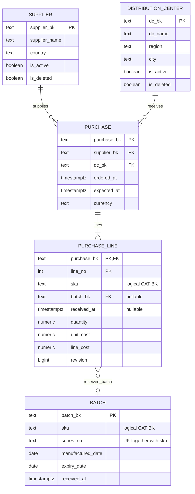
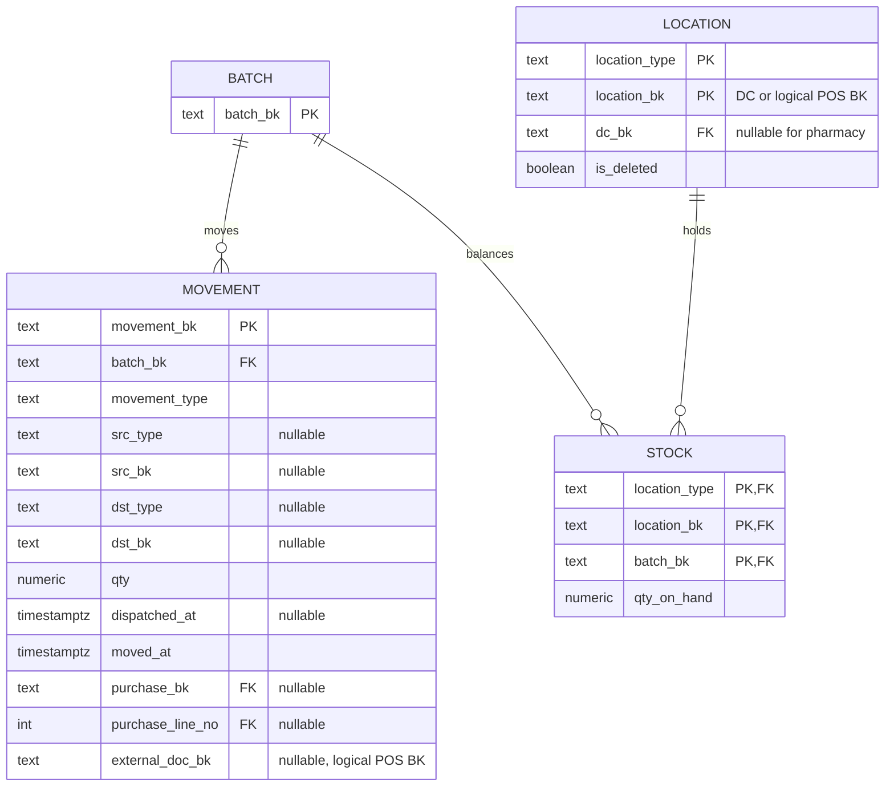
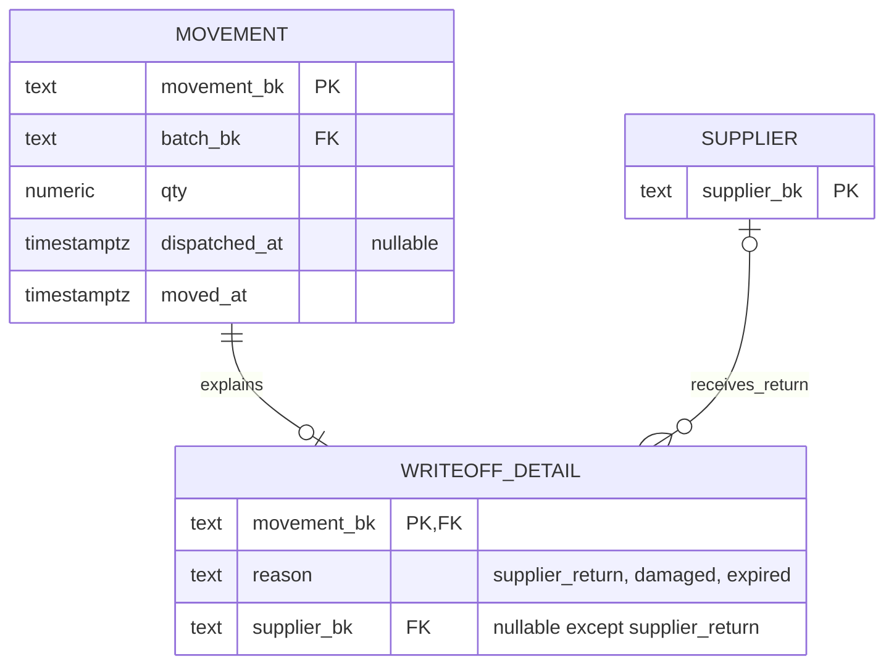

# WMS

Все показанные поля обязательны, кроме помеченных `nullable`. Во всех таблицах обязательны `created_at`, `updated_at`. Ссылки FK существуют только внутри WMS.

Остаток меняет триггер журнала в той же транзакции, что и движение. Строки локаций блокируются в одном порядке, списание проверяется через `CHECK (qty_on_hand >= 0)`. Приложение не получает прямых прав изменения остатков. Исправление движения — новое компенсирующее движение. `external_doc_bk` связывает списание или возврат с кассовым документом POS без межбазового FK.

## Возвраты поставщикам и списания

Для writeoff объяснение обязательно к COMMIT. Внешний получатель возврата хранится в writeoff_detail.supplier_bk; в фиксированном контракте это исходящий writeoff с dst_type/dst_bk = NULL. Возврат покупателя остаётся отдельным типом return и направлением в аптеку. Причины damaged и expired различаются; expired допускается только после expiry_date. Объяснение и движение неизменяемы, технические поля обязательны.
