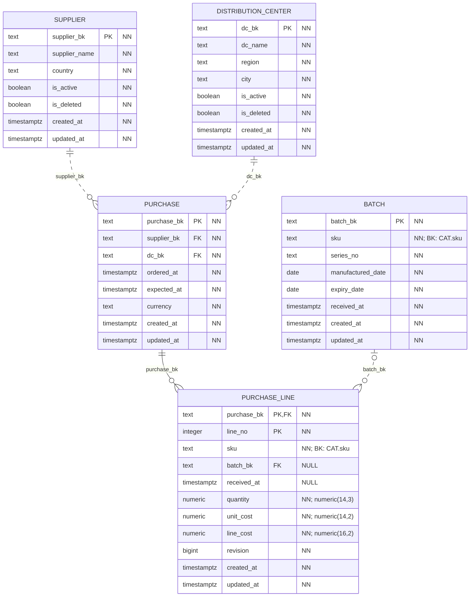
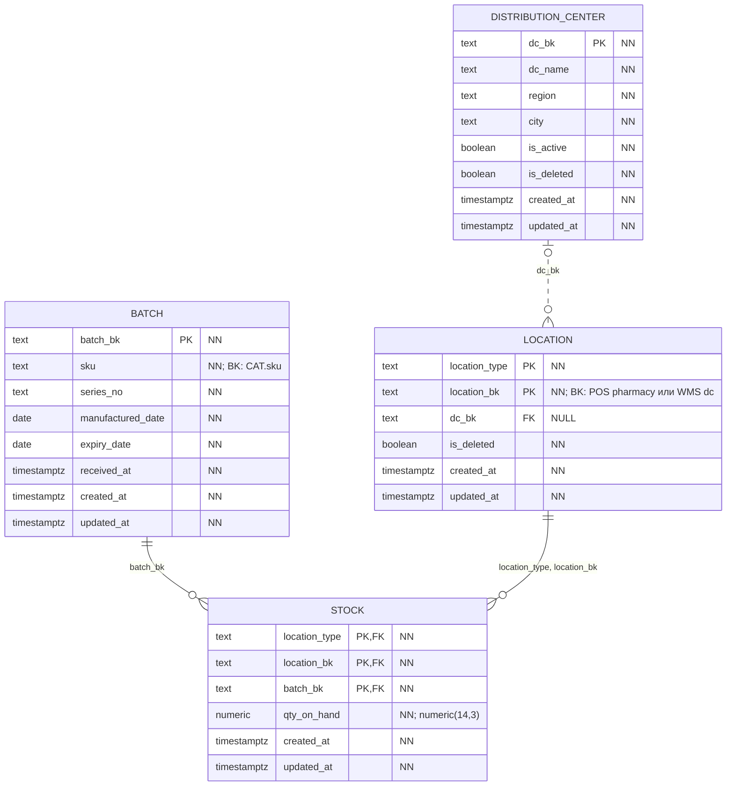
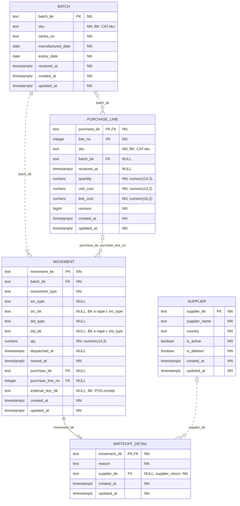

# WMS: закупки и складской учёт

База `wms_service_db` хранит поставщиков, закупки, партии товаров, движения и остатки. Товар учитывается по партиям, поэтому можно проследить его путь от поставщика до аптеки и проверить срок годности.

[Обозначения на схемах](core.md#как-читать-схемы) и [технические поля](core.md#даты-создания-и-изменения) общие для всех сервисов.

## Закупки и партии

Заказ поставщику хранится в `purchase`. Он связан с поставщиком из `supplier` и распределительным центром из `distribution_center`, который должен принять товар. В заказе указаны даты оформления и ожидаемой поставки, а также валюта.

Позиции заказа хранятся в `purchase_line`: что заказали, в каком количестве и по какой закупочной цене. Позиция определяется номером заказа и номером строки — `(purchase_bk, line_no)`.

Таблица `batch` описывает партию товара: SKU, номер серии производителя, даты производства, годности и приёмки. Номер серии уникален в пределах SKU. Это означает, что повторить пару `(sku, series_no)` нельзя, но одинаковые номера серий у разных товаров допустимы.

До приёмки поля `batch_bk` и `received_at` в позиции заказа могут быть пустыми. Когда товар принят, они заполняются вместе и связывают позицию с конкретной партией. База проверяет соответствие SKU и срока годности.

## Где хранится товар и как устроен остаток

Таблица `location` объединяет два вида мест хранения: распределительные центры (`dc`) и аптеки (`pharmacy`). Место определяется парой `(location_type, location_bk)`. У записи распределительного центра заполнен `dc_bk`, который ссылается на `distribution_center`; у записи аптеки это поле пустое.

Таблица `stock` хранит количество одной партии в одном месте. Поэтому её первичный ключ состоит из трёх полей: `(location_type, location_bk, batch_bk)`. Первые два поля вместе ссылаются на `location`, а третье — на `batch`.

Остатки меняются автоматически при записи движения. Если товара не хватает, PostgreSQL отклоняет операцию: отрицательный остаток запрещён. Приложение не может напрямую исправить количество в `stock`; изменение оформляется отдельным движением.

## Движения, возвраты поставщику и списания

В `movement` записывается каждая операция с партией: приёмка, перемещение, продажа, возврат покупателя или списание. В записи указаны партия, количество, отправитель, получатель и время операции.

Приёмка обязательно связана с позицией закупки. Внешний ключ состоит из двух полей: `(purchase_bk, purchase_line_no)` ссылается на `(purchase_bk, line_no)` в `purchase_line`. У операций без закупки оба поля могут быть пустыми. Заполнить только одно из них нельзя.

Поля `src_type` и `dst_type` задают тип отправителя и получателя, а `src_bk` и `dst_bk` — их коды. Для мест хранения эти коды проверяются при обновлении остатка. Прямых FK от этих полей к `location` нет.

Время отгрузки записывается в `dispatched_at`, а время приёмки или завершения операции — в `moved_at`. Для поставок и перемещений генератор заполняет оба поля, чтобы по ним можно было посчитать время в пути. Сама таблица при этом допускает пустой `dispatched_at`.

Возврат поставщику и списания оформляются движением типа `writeoff`. Причина хранится в `writeoff_detail`:

| Причина | Значение `reason` | Дополнительное условие |
|---|---|---|
| Возврат поставщику | `supplier_return` | Указан поставщик, от которого ранее приняли эту партию |
| Брак | `damaged` | Поставщик в этой записи не указывается |
| Истёкший срок годности | `expired` | Дата списания позже даты годности партии; поставщик не указывается |

Для каждого движения `writeoff` нужна ровно одна запись с причиной. Для других типов движения такая запись запрещена. База проверяет это перед завершением транзакции, поэтому движение и его причину можно добавить вместе.

## Связи с каталогом и POS

| Что связываем | Поле в WMS | Откуда берётся код |
|---|---|---|
| Товар партии | `batch.sku` | `catalog.sku.sku` |
| Товар в закупке | `purchase_line.sku` | `catalog.sku.sku` |
| Аптеку как место хранения | `location.location_bk` при `location_type = pharmacy` | `pos.pharmacy.pharmacy_bk` |
| Продажу или возврат покупателя | `movement.external_doc_bk` | `pos.receipt.receipt_bk` |

Это связи по постоянным кодам между разными базами. Для них нет физических внешних ключей. У движений продажи и возврата покупателя `external_doc_bk` обязателен; у остальных операций он может быть пустым.
