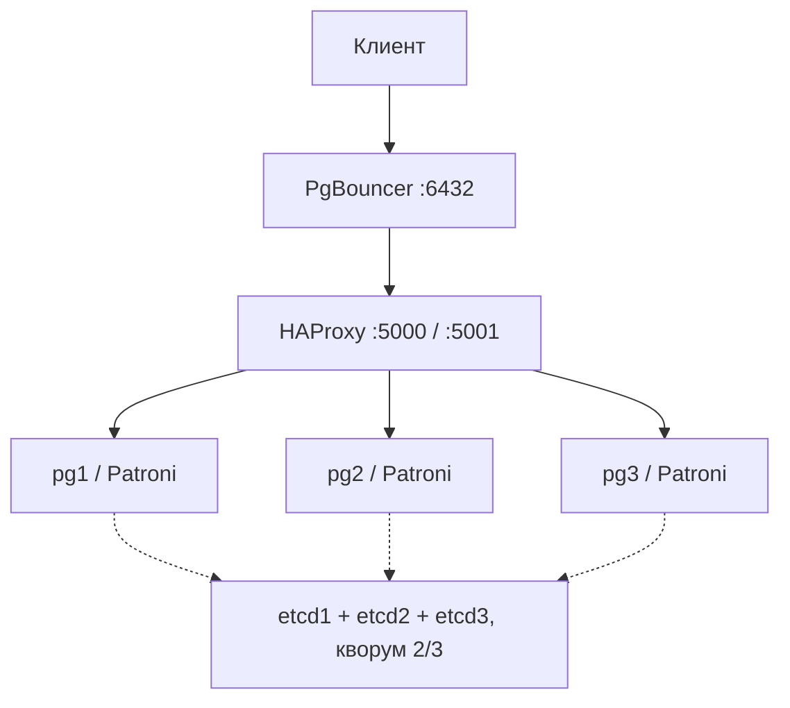

# Журнал отказоустойчивости

Эксперименты выполнены 20 октября 2026 года в [GitHub Actions](https://github.com/alexey077/dwh/actions/runs/39422163373). Проверялся код `66cc8f8`. До и после отказов официальный чекер прошёл 139 из 139 проверок.

Полный исходный журнал с необрезанными фрагментами вывода сохранён [отдельно](experiments/20261020T122916Z-ci-complete.md). Здесь оставлены результаты и короткие фрагменты, по которым видно поведение стенда.

Для воспроизведения всех этапов:

```bash
./scripts/verify.sh --full
```

Нагрузка записи: четыре клиента, INSERT и COMMIT, пауза после успешной записи 20 мс. RTO измеряется между последним подтверждением старого лидера и первым подтверждением нового. Потери считаются только среди подтверждённых клиенту транзакций.

## 0. Стенд

| Параметр | Значение |
|---|---|
| ОС скрипта | Linux-6.17.0-1022-azure-x86_64-with-glibc2.39 |
| Docker Compose | Docker Compose version v2.38.2 |
| Ресурсы Docker | CPU=4 RAM=16766414848 OS=Ubuntu 24.04.5 LTS ARCH=x86_64 Docker=28.0.4 Storage=overlay2 |
| PostgreSQL | PostgreSQL 18.6 (Debian 18.6-1.pgdg13+2) on x86_64-pc-linux-gnu, compiled by gcc (Debian 14.2.0-19) 14.2.0, 64-bit |
| Patroni | {"version": "4.1.5", "scope": "apteka108", "name": "pg1"} |
| Диск проекта: всего / свободно, байт | 154894188544 / 89148792832 |



Нагрузка записи: 4 клиента, INSERT + COMMIT и пауза после успеха 20 мс.


## Э1. Нагрузка без отказов (async)

Этап общего сценария:

```bash
.venv/bin/python scripts/experiments.py --seconds 60 --event-window 90
```

| Метрика | Значение |
|---|---|
| Подтверждено транзакций | 10919 |
| Ошибок | 0 |
| Длительность, с | 60.018 |
| Транзакций в секунду | 181.929 |
| Медианная задержка, мс | 1.728 |
| p95 задержки, мс | 2.571 |

Без отказов асинхронный кластер обработал 181,929 транзакции в секунду без ошибок. Это исходный уровень для сравнения с синхронным режимом.

<details>
<summary>Фрагмент исходного вывода</summary>

```text
$ docker compose version
Docker Compose version v2.38.2
…
{"at": "2026-10-20T12:30:17.169718+00:00", "monotonic": 483.56754562, "duration_ms": 1.6413249999800428, "ok": true, "key": "Э1. Async baseline-508652eaea404c1a810071b57c1e36c2", "node": "172.18.0.6", "error": ""}
{"at": "2026-10-20T12:30:17.170522+00:00", "monotonic": 483.568350242, "duration_ms": 1.9232789999819033, "ok": true, "key": "Э1. Async baseline-b9d9174eac2744949fef7101c0be8649", "node": "172.18.0.6", "error": ""}
```

</details>


## Э2. Аварийная потеря лидера

Этап общего сценария:

```bash
.venv/bin/python scripts/experiments.py --seconds 60 --event-window 90
```

| Метрика | Значение |
|---|---|
| Подтверждено транзакций | 10215 |
| Ошибок | 278 |
| Длительность, с | 90.02 |
| Транзакций в секунду | 113.475 |
| Медианная задержка, мс | 1.784 |
| p95 задержки, мс | 2.543 |
| Последний ACK старого лидера (UTC) | 2026-10-20T12:30:27.555054+00:00 |
| Первый ACK нового лидера (UTC) | 2026-10-20T12:31:01.357936+00:00 |
| Пауза записи (RTO), с | 33.803 |
| Ошибок за паузу | 278 |
| Старый лидер | pg2 |
| Новый лидер | pg3 |
| Потеряно подтверждённых транзакций | 0 |

После аварийного завершения лидера Patroni выбрал новый узел. Пауза между подтверждёнными записями составила 33,803 с; клиенту потребовалось переподключение.

<details>
<summary>Фрагмент исходного вывода</summary>

```text
$ docker compose ps -q pg2
fb3cfdcb0c4489161f1d8bf4ec7b3fac691d20ec5266546d28ebf6d796d24719
…
$ docker kill --signal=KILL fb3cfdcb0c4489161f1d8bf4ec7b3fac691d20ec5266546d28ebf6d796d24719
…
pg3-1  | 2026-10-20 12:30:27.587 UTC [394] FATAL:  streaming replication receiver "apteka108" could not connect to the primary server: connection to server at "pg2" (172.18.0.6), port 5432 failed: Connection refused
…
pg3-1  | 2026-10-20 12:30:32.602 UTC [402] FATAL:  streaming replication receiver "apteka108" could not connect to the primary server: could not translate host name "pg2" to address: Temporary failure in name resolution
…
pg3-1  | 2026-10-20 12:30:37.590 UTC [409] FATAL:  streaming replication receiver "apteka108" could not connect to the primary server: could not translate host name "pg2" to address: Temporary failure in name resolution
…
pg3-1  | 2026-10-20 12:30:42.595 UTC [416] FATAL:  streaming replication receiver "apteka108" could not connect to the primary server: could not translate host name "pg2" to address: Temporary failure in name resolution
…
pg3-1  | 2026-10-20 12:30:47.599 UTC [424] FATAL:  streaming replication receiver "apteka108" could not connect to the primary server: could not translate host name "pg2" to address: Temporary failure in name resolution
…
pg3-1  | 2026-10-20 12:30:52.600 UTC [432] FATAL:  streaming replication receiver "apteka108" could not connect to the primary server: could not translate host name "pg2" to address: Temporary failure in name resolution
…
pg3-1  | 2026-10-20 12:30:57,564 INFO: promoted self to leader by acquiring session lock
…
{"at": "2026-10-20T12:31:01.375815+00:00", "monotonic": 527.773642905, "duration_ms": 3.4012039999424815, "ok": true, "key": "Э2. Аварийная потеря лидера-7bb4d686d0df4c3a88c12fb95402b73c", "node": "172.18.0.5", "error": ""}
{"at": "2026-10-20T12:31:01.376686+00:00", "monotonic": 527.774513358, "duration_ms": 4.081508000012946, "ok": true, "key": "Э2. Аварийная потеря лидера-9312cab81b3d4734a448a575ec92139b", "node": "172.18.0.5", "error": ""}
```

</details>


## Э3. Возврат узла

Этап общего сценария:

```bash
.venv/bin/python scripts/experiments.py --seconds 60 --event-window 90
```

| Метрика | Значение |
|---|---|
| Время возврата и догона, с | 8.913 |
| Роль после возврата | replica |
| WAL от начала текущего приёма, байт | 115280 |
| pg_rewind найден в логе | True |

Старый лидер вернулся как реплика. В логах есть успешный pg_rewind; пересоздавать кластер вручную не потребовалось.

<details>
<summary>Фрагмент исходного вывода</summary>

```text
$ docker compose start pg2
Container apteka108-hw1-etcd1-1  Waiting
…
pg2-1  | 2026-10-20 12:31:50,655 INFO: running pg_rewind from pg3
pg2-1  | 2026-10-20 12:31:50,682 INFO: running pg_rewind from dbname=postgres user=postgres host=pg3 port=5432 target_session_attrs=read-write
pg2-1  | 2026-10-20 12:31:53,320 INFO: pg_rewind exit code=0
…
pg2-1  | 2026-10-20 12:31:55.023 UTC [73] LOG:  started streaming WAL from primary at 0/18000000 on timeline 3
…
pg2-1  | localhost:5432 - accepting connections
pg2-1  | 2026-10-20 12:31:55,777 INFO: no action. I am (pg2), a secondary, and following a leader (pg3)
```

</details>


## Э4. Плановое переключение

Этап общего сценария:

```bash
.venv/bin/python scripts/experiments.py --seconds 60 --event-window 90
```

| Метрика | Значение |
|---|---|
| Подтверждено транзакций | 15568 |
| Ошибок | 0 |
| Длительность, с | 90.007 |
| Транзакций в секунду | 172.965 |
| Медианная задержка, мс | 1.739 |
| p95 задержки, мс | 2.517 |
| Последний ACK старого лидера (UTC) | 2026-10-20T12:32:07.206369+00:00 |
| Первый ACK нового лидера (UTC) | 2026-10-20T12:32:11.645924+00:00 |
| Пауза записи (RTO), с | 4.44 |
| Ошибок за паузу | 0 |

Плановая передача роли заняла 4,440 с по подтверждениям клиента. Она заметно короче аварийного переключения, поскольку не требует ждать истечения лидерской аренды.

<details>
<summary>Фрагмент исходного вывода</summary>

```text
$ docker compose ps -q pg3
b01e5ecb71c37645ce307db951803481073bcaec23f5e6f19cd9e2b312e3e330
…
POST /switchover {"leader": "pg3", "candidate": "pg1"}
…
{"at": "2026-10-20T12:32:11.653851+00:00", "monotonic": 598.051678433, "duration_ms": 4427.790079000033, "ok": true, "key": "E4-c4c45278751d4a83b484bdcc013a9bee", "node": "172.18.0.7", "error": ""}
{"at": "2026-10-20T12:32:11.654749+00:00", "monotonic": 598.052576399, "duration_ms": 4428.205778000006, "ok": true, "key": "E4-37c378eddaf64fffa8a567d39f069f67", "node": "172.18.0.7", "error": ""}
```

</details>


## Э5.1. Нагрузка в синхронном режиме

Этап общего сценария:

```bash
.venv/bin/python scripts/experiments.py --seconds 60 --event-window 90
```

| Метрика | Значение |
|---|---|
| Подтверждено транзакций | 10789 |
| Ошибок | 0 |
| Длительность, с | 60.022 |
| Транзакций в секунду | 179.751 |
| Медианная задержка, мс | 2.045 |
| p95 задержки, мс | 2.634 |

При синхронной записи кластер обработал 179,751 транзакции в секунду без ошибок. p95 составил 2,634 мс против 2,571 мс в async.

<details>
<summary>Фрагмент исходного вывода</summary>

```text
PATCH /config {"synchronous_mode": true, "synchronous_mode_strict": true, "synchronous_node_count": 1}
{"at": "2026-10-20T12:33:28.535338+00:00", "monotonic": 674.933164102, "duration_ms": 5.95250699996086, "ok": true, "key": "Э5. Sync baseline-e361ba667a964e1eaa4d88974c50e3f6", "node": "172.18.0.7", "error": ""}
…
{"at": "2026-10-20T12:34:28.530573+00:00", "monotonic": 734.928400064, "duration_ms": 2.1815850000166392, "ok": true, "key": "Э5. Sync baseline-b960d526b9b94b95804aeba654b5c8e1", "node": "172.18.0.7", "error": ""}
{"at": "2026-10-20T12:34:28.530692+00:00", "monotonic": 734.928519945, "duration_ms": 2.4901679998947657, "ok": true, "key": "Э5. Sync baseline-4a9f0e73b622466390a18f900d2f7f39", "node": "172.18.0.7", "error": ""}
```

</details>


## Э5.2. Авария в синхронном режиме

Этап общего сценария:

```bash
.venv/bin/python scripts/experiments.py --seconds 60 --event-window 90
```

| Метрика | Значение |
|---|---|
| Подтверждено транзакций | 10052 |
| Ошибок | 304 |
| Длительность, с | 90.02 |
| Транзакций в секунду | 111.664 |
| Медианная задержка, мс | 2.05 |
| p95 задержки, мс | 2.608 |
| Последний ACK старого лидера (UTC) | 2026-10-20T12:34:38.938411+00:00 |
| Первый ACK нового лидера (UTC) | 2026-10-20T12:35:13.033771+00:00 |
| Пауза записи (RTO), с | 34.095 |
| Ошибок за паузу | 304 |
| Старый лидер | pg1 |
| Новый лидер | pg2 |
| Потеряно подтверждённых транзакций | 0 |

После аварии в синхронном режиме запись возобновилась через 34,095 с. Подтверждённые клиенту транзакции сохранились.

<details>
<summary>Фрагмент исходного вывода</summary>

```text
$ docker compose ps -q pg1
a66e888fc0ef2f715d3f497de0488ca97fb9bab7a42da589b2156fac14d4d515
…
$ docker kill --signal=KILL a66e888fc0ef2f715d3f497de0488ca97fb9bab7a42da589b2156fac14d4d515
…
pg2-1  | 2026-10-20 12:34:38.948 UTC [326] FATAL:  streaming replication receiver "apteka108" could not connect to the primary server: connection to server at "pg1" (172.18.0.7), port 5432 failed: Connection refused
…
pg2-1  | 2026-10-20 12:34:43.947 UTC [334] FATAL:  streaming replication receiver "apteka108" could not connect to the primary server: could not translate host name "pg1" to address: Temporary failure in name resolution
…
pg2-1  | 2026-10-20 12:34:48.951 UTC [342] FATAL:  streaming replication receiver "apteka108" could not connect to the primary server: could not translate host name "pg1" to address: Temporary failure in name resolution
…
pg2-1  | 2026-10-20 12:34:53.951 UTC [350] FATAL:  streaming replication receiver "apteka108" could not connect to the primary server: could not translate host name "pg1" to address: Temporary failure in name resolution
…
pg2-1  | 2026-10-20 12:34:58.955 UTC [358] FATAL:  streaming replication receiver "apteka108" could not connect to the primary server: could not translate host name "pg1" to address: Temporary failure in name resolution
…
pg2-1  | 2026-10-20 12:35:03.956 UTC [366] FATAL:  streaming replication receiver "apteka108" could not connect to the primary server: could not translate host name "pg1" to address: Temporary failure in name resolution
…
pg2-1  | 2026-10-20 12:35:08.956 UTC [376] FATAL:  streaming replication receiver "apteka108" could not connect to the primary server: could not translate host name "pg1" to address: Temporary failure in name resolution
…
pg2-1  | 2026-10-20 12:35:09.832 UTC [49] LOG:  parameter "synchronous_standby_names" changed to "*"
pg2-1  | 2026-10-20 12:35:09.838 UTC [379] FATAL:  streaming replication receiver "apteka108" could not connect to the primary server: could not translate host name "pg1" to address: Temporary failure in name resolution
…
{"at": "2026-10-20T12:35:13.050241+00:00", "monotonic": 779.448069101, "duration_ms": 2.9941310000367594, "ok": true, "key": "Э5. Sync failover-3aef71596b6147408c8a37b965db10c9", "node": "172.18.0.6", "error": ""}
{"at": "2026-10-20T12:35:13.051173+00:00", "monotonic": 779.449000889, "duration_ms": 3.4770139999409366, "ok": true, "key": "Э5. Sync failover-75561ab224394037b2a33d3a2855dfa0", "node": "172.18.0.6", "error": ""}
```

</details>


## Э5.3. Возврат узла

Этап общего сценария:

```bash
.venv/bin/python scripts/experiments.py --seconds 60 --event-window 90
```

| Метрика | Значение |
|---|---|
| Время возврата и догона, с | 4.909 |
| Роль после возврата | replica |
| WAL от начала текущего приёма, байт | 15807752 |
| pg_rewind найден в логе | True |

Старый синхронный лидер вернулся репликой за 4,909 с. В исходном логе подтверждён успешный pg_rewind.

<details>
<summary>Фрагмент исходного вывода</summary>

```text
$ docker compose start pg1
Container apteka108-hw1-etcd2-1  Waiting
…
pg1-1  | 2026-10-20 12:36:00,656 INFO: running pg_rewind from pg2
pg1-1  | 2026-10-20 12:36:00,684 INFO: running pg_rewind from dbname=postgres user=postgres host=pg2 port=5432 target_session_attrs=read-write
pg1-1  | 2026-10-20 12:36:02,466 INFO: pg_rewind exit code=0
…
pg1-1  | 2026-10-20 12:36:02.889 UTC [59] LOG:  started streaming WAL from primary at 0/18000000 on timeline 5
…
pg1-1  | localhost:5432 - accepting connections
pg1-1  | 2026-10-20 12:36:03,905 INFO: no action. I am (pg1), a secondary, and following a leader (pg2)
```

</details>


## Э5.4. Сравнение async и sync

Этап общего сценария:

```bash
.venv/bin/python scripts/experiments.py --seconds 60 --event-window 90
```

| Метрика | Значение |
|---|---|
| TPS async | 181.929 |
| TPS sync | 179.751 |
| p95 async, мс | 2.571 |
| p95 sync, мс | 2.634 |
| RTO async, с | 33.803 |
| RTO sync, с | 34.095 |
| Потеряно подтверждений async | 0 |
| Потеряно подтверждений sync | 0 |

В sync ответ клиенту требует подтверждения одной реплики. Пропускная способность снизилась с 181,929 до 179,751 TPS. Потерь в этих двух опытах не было; один опыт не гарантирует отсутствие потерь в async при другой аварии.

Сырые подтверждения async и sync приведены в разделах выше.

## Э6. Кворум etcd

Этап общего сценария:
```bash
.venv/bin/python scripts/experiments.py --seconds 60 --event-window 90
```

| Метрика | Значение |
|---|---|
| Подтверждено при потере одного etcd | 1822 |
| Ошибок при потере одного etcd | 0 |
| Время до ошибки записи после потери второго etcd, с | 23.839 |
| Чтение с реплики доступно | True |

С одним недоступным etcd запись продолжалась. После потери второго узла кворум исчез: запись остановилась, но чтение с реплики сохранилось. После возврата etcd кластер восстановился.

<details>
<summary>Фрагмент исходного вывода</summary>

```text
$ docker compose stop etcd1
Container apteka108-hw1-etcd1-1  Stopping
…
$ docker compose stop etcd2
…
$ docker compose start etcd2 etcd1
…
{"at": "2026-10-20T12:36:15.397665+00:00", "monotonic": 841.795492123, "duration_ms": 1.7405130000724967, "ok": true, "key": "E6-one-etcd-52a4e91ee1dc4225a1ea3bd542d8f5d1", "node": "172.18.0.6", "error": ""}
{"at": "2026-10-20T12:36:15.398893+00:00", "monotonic": 841.796720774, "duration_ms": 1.6178800000261617, "ok": true, "key": "E6-one-etcd-a0c9c6f6f09346429fc12275575625e8", "node": "172.18.0.6", "error": ""}
```

</details>


## Э7. Наплыв подключений

Этап общего сценария:

```bash
.venv/bin/python scripts/experiments.py --seconds 60 --event-window 90
```

| Метрика | Значение |
|---|---|
| Напрямую, 40 клиентов: ошибок | 0 |
| Напрямую, 40 клиентов: медиана подключения, мс | 69.027 |
| Напрямую, 80 клиентов: ошибок | 2 |
| Напрямую, 80 клиентов: медиана подключения, мс | 128.03 |
| Напрямую, 160 клиентов: ошибок | 82 |
| Напрямую, 160 клиентов: медиана подключения, мс | 181.439 |
| Через пул, 40 клиентов: ошибок | 0 |
| Через пул, 40 клиентов: медиана подключения, мс | 10.501 |
| Через пул, 80 клиентов: ошибок | 0 |
| Через пул, 80 клиентов: медиана подключения, мс | 12.178 |
| Через пул, 160 клиентов: ошибок | 0 |
| Через пул, 160 клиентов: медиана подключения, мс | 17.879 |
| Первое число клиентов с ошибкой напрямую | 80 |
| Первое число клиентов с ошибкой через пул | не наблюдалось до 160 |

При 160 клиентах прямые подключения дали 82 ошибки, через PgBouncer — ни одной. Пул позволил обслужить клиентов без увеличения числа серверных соединений.

<details>
<summary>Фрагмент исходного вывода</summary>

```text
{"route": "direct", "clients": 40, "ok": 40, "errors": 0, "first_error": null}
{"route": "direct", "clients": 80, "ok": 78, "errors": 2, "first_error": "connection to server at \"localhost\" (::1), port 5433 failed: Connection refused"}
…
{"route": "pool", "clients": 80, "ok": 80, "errors": 0, "first_error": null}
{"route": "pool", "clients": 160, "ok": 160, "errors": 0, "first_error": null}
```

</details>


## Итоговая таблица

| Отказ | Кто восстанавливает | Измеренная цена |
|---|---|---|
| Наплыв 160 клиентов | PgBouncer | ошибок напрямую: 82; через пул: 0 |
| Потеря лидера | Patroni и кворум etcd | RTO: 33.803 с; ошибок в окне: 278 |
| Плановая смена лидера | Patroni и HAProxy | RTO: 4.44 с |
| Подтверждённые транзакции | Репликация | потеря async: 0; sync: 0 |
| Потеря одного etcd | Кворум 2/3 | ошибок записи: 0 |
| Логическое удаление | Резервная копия и восстановление | Не измерялось; бэкапы в этот стенд не включены |
| Отказ целого ЦОД | Отдельная площадка | Не моделировался |

Аварийная пауза оказалась примерно в 7,6 раза длиннее плановой.


## Ограничения

Репликация не восстанавливает случайное логическое удаление и не заменяет резервные копии. В этом стенде HAProxy и PgBouncer по одному экземпляру; отказ целого узла Docker или ЦОД отдельно не моделируется.


## Пояснения к измерениям

Аварийный RTO включает обнаружение отказа, ожидание лидерского TTL, promotion и восстановление клиентского маршрута. При switchover лидер передаёт роль сам. RTO между ACK включает дискретность нагрузки.

Async и sync проверялись последовательно на разных лидерах. По одному прогону нельзя оценить влияние режима на задержки независимо от нагрузки и состояния узла. Нулевая потеря async в одном опыте не гарантирует сохранность последнего WAL при другой аварии.

WAL при rejoin отсчитывается от start LSN текущего receiver, это не полный объём pg_rewind; способ восстановления подтверждают строки Patroni. В Э6 время включает остановку второго etcd и проверку чтения. В Э7 время подключения не включает всё ожидание выполнения транзакции.
