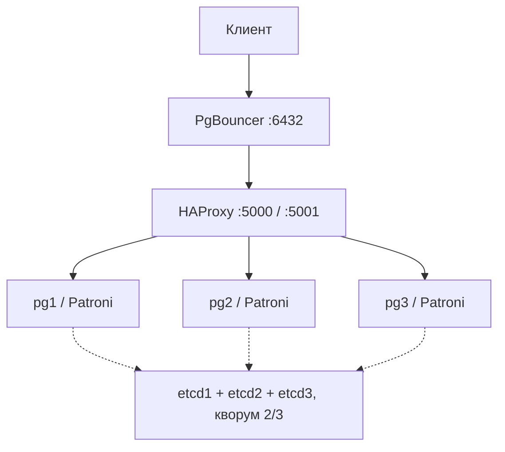

# Журнал отказоустойчивости

Измерения получены на реальном Docker-стенде [GitHub Actions](https://github.com/alexey077/dwh/actions/runs/39422163373), код `66cc8f89ea3e07a0dd0d5989388e00926ca067a9`. Полная проверка из пустых томов завершилась 20.10.2026 успешно; оба исходных отчёта чекера — 139/139 и 21/21. JSON и полные Docker-логи находятся в артефакте `hw1-runtime-evidence` (ID 12264742254, SHA256 ZIP `77d914ba97dc40437787b58aaed1029687130f0534a5171952aa5bbde7a99537`). [Исходный Markdown сборщика без дополнений](experiments/20261020T122916Z-ci-complete.md).

Время формирования: 2026-10-20T12:37:13.939704+00:00

Топология: 3 PostgreSQL 18 под Patroni 4.1.5, 3 etcd, HAProxy и PgBouncer. Режим в начале экспериментов — async. Параметры Patroni: ttl=30, loop_wait=10, retry_timeout=10.

RTO — интервал между последним подтверждением старого лидера и первым подтверждением нового. Он включает дискретность нагрузки. Потеря проверяется только для транзакций, подтверждённых клиенту.

## 0. Стенд

| Параметр | Значение |
|---|---|
| ОС скрипта | Linux-6.17.0-1022-azure-x86_64-with-glibc2.39 |
| Docker Compose | Docker Compose version v2.38.2 |
| Ресурсы Docker | CPU=4 RAM=16766414848 OS=Ubuntu 24.04.5 LTS ARCH=x86_64 Docker=28.0.4 Storage=overlay2 |
| PostgreSQL | PostgreSQL 18.6 (Debian 18.6-1.pgdg13+2) on x86_64-pc-linux-gnu, compiled by gcc (Debian 14.2.0-19) 14.2.0, 64-bit |
| Patroni | {"version": "4.1.5", "scope": "apteka108", "name": "pg1"} |
| Диск проекта: всего / свободно, байт | 154894188544 / 89148792832 |



Нагрузка записи: 4 клиента, INSERT + COMMIT и пауза после успеха 20 мс.

## Э1. Async baseline

Команда воспроизведения полного сценария; ниже приведён соответствующий этап:

```bash
.venv/bin/python scripts/experiments.py --seconds 60 --event-window 90
```

| Метрика | Значение |
|---|---|
| acknowledged | 10919 |
| errors | 0 |
| seconds | 60.018 |
| tps | 181.929 |
| median_ms | 1.728 |
| p95_ms | 2.571 |

Измерены подтверждённые записи и задержки в указанном режиме.

```text
$ docker compose version
Docker Compose version v2.38.2
$ docker info --format 'CPU={{.NCPU}} RAM={{.MemTotal}} OS={{.OperatingSystem}} ARCH={{.Architecture}} Docker={{.ServerVersion}} Storage={{.Driver}}'
CPU=4 RAM=16766414848 OS=Ubuntu 24.04.5 LTS ARCH=x86_64 Docker=28.0.4 Storage=overlay2
SELECT version(): PostgreSQL 18.6 (Debian 18.6-1.pgdg13+2) on x86_64-pc-linux-gnu, compiled by gcc (Debian 14.2.0-19) 14.2.0, 64-bit
Patroni: {"version": "4.1.5", "scope": "apteka108", "name": "pg1"}
{"at": "2026-10-20T12:29:17.197069+00:00", "monotonic": 423.594891475, "duration_ms": 24.019144000021697, "ok": true, "key": "Э1. Async baseline-dec1327c6a29425eac226c6ee1b2235c", "node": "172.18.0.6", "error": ""}
{"at": "2026-10-20T12:29:17.197795+00:00", "monotonic": 423.595620666, "duration_ms": 24.390101999983926, "ok": true, "key": "Э1. Async baseline-a1e8769134f643c694bffb6cd4a279f8", "node": "172.18.0.6", "error": ""}
{"at": "2026-10-20T12:29:17.199532+00:00", "monotonic": 423.597359433, "duration_ms": 24.570601999982955, "ok": true, "key": "Э1. Async baseline-19bbc186ea944c9798e4cb291214b496", "node": "172.18.0.6", "error": ""}
{"at": "2026-10-20T12:29:17.207893+00:00", "monotonic": 423.605719668, "duration_ms": 34.08407099999522, "ok": true, "key": "Э1. Async baseline-5079c245f7774fa8915a7653c2fff974", "node": "172.18.0.6", "error": ""}
{"at": "2026-10-20T12:29:17.219064+00:00", "monotonic": 423.616891722, "duration_ms": 1.841175999970801, "ok": true, "key": "Э1. Async baseline-fa37e3471572452ea59ec6c3a52d3ed5", "node": "172.18.0.6", "error": ""}
{"at": "2026-10-20T12:29:17.220390+00:00", "monotonic": 423.61821735, "duration_ms": 2.4503470000354355, "ok": true, "key": "Э1. Async baseline-d63b6d8de43f42c48b982f8379dfb715", "node": "172.18.0.6", "error": ""}
{"at": "2026-10-20T12:30:17.147961+00:00", "monotonic": 483.545788989, "duration_ms": 1.951705999999831, "ok": true, "key": "Э1. Async baseline-b6a47029d4184015830fd230c15f5818", "node": "172.18.0.6", "error": ""}
{"at": "2026-10-20T12:30:17.148461+00:00", "monotonic": 483.546288418, "duration_ms": 1.841686000034315, "ok": true, "key": "Э1. Async baseline-80d74e948f6249a59bddde12cbbb2df5", "node": "172.18.0.6", "error": ""}
{"at": "2026-10-20T12:30:17.168000+00:00", "monotonic": 483.565828336, "duration_ms": 1.682021999954486, "ok": true, "key": "Э1. Async baseline-d1e1e15c3616477a827091d8ef8216b5", "node": "172.18.0.6", "error": ""}
{"at": "2026-10-20T12:30:17.169368+00:00", "monotonic": 483.567196257, "duration_ms": 1.9204629999762801, "ok": true, "key": "Э1. Async baseline-8bc42cf72cd94da69afb5464457ce484", "node": "172.18.0.6", "error": ""}
{"at": "2026-10-20T12:30:17.169718+00:00", "monotonic": 483.56754562, "duration_ms": 1.6413249999800428, "ok": true, "key": "Э1. Async baseline-508652eaea404c1a810071b57c1e36c2", "node": "172.18.0.6", "error": ""}
{"at": "2026-10-20T12:30:17.170522+00:00", "monotonic": 483.568350242, "duration_ms": 1.9232789999819033, "ok": true, "key": "Э1. Async baseline-b9d9174eac2744949fef7101c0be8649", "node": "172.18.0.6", "error": ""}
```

## Э2. Аварийная потеря лидера

Команда воспроизведения полного сценария; ниже приведён соответствующий этап:

```bash
.venv/bin/python scripts/experiments.py --seconds 60 --event-window 90
```

| Метрика | Значение |
|---|---|
| acknowledged | 10215 |
| errors | 278 |
| seconds | 90.02 |
| tps | 113.475 |
| median_ms | 1.784 |
| p95_ms | 2.543 |
| last_old_ack | 2026-10-20T12:30:27.555054+00:00 |
| first_new_ack | 2026-10-20T12:31:01.357936+00:00 |
| rto_seconds | 33.803 |
| errors_in_gap | 278 |
| old_leader | pg2 |
| new_leader | pg3 |
| lost_acknowledged | 0 |

Новым лидером стал pg3. Потери подтверждённых транзакций сверены по probe_bk.

```text
$ docker compose ps -q pg2
fb3cfdcb0c4489161f1d8bf4ec7b3fac691d20ec5266546d28ebf6d796d24719
$ docker inspect --format '{{range .NetworkSettings.Networks}}{{.IPAddress}}{{end}}' fb3cfdcb0c4489161f1d8bf4ec7b3fac691d20ec5266546d28ebf6d796d24719
172.18.0.6
$ docker compose ps -q pg2
fb3cfdcb0c4489161f1d8bf4ec7b3fac691d20ec5266546d28ebf6d796d24719
$ docker inspect --format '{{json .HostConfig.RestartPolicy}}' fb3cfdcb0c4489161f1d8bf4ec7b3fac691d20ec5266546d28ebf6d796d24719
{"Name":"unless-stopped","MaximumRetryCount":0}
$ docker update --restart=no fb3cfdcb0c4489161f1d8bf4ec7b3fac691d20ec5266546d28ebf6d796d24719
fb3cfdcb0c4489161f1d8bf4ec7b3fac691d20ec5266546d28ebf6d796d24719
$ docker kill --signal=KILL fb3cfdcb0c4489161f1d8bf4ec7b3fac691d20ec5266546d28ebf6d796d24719
fb3cfdcb0c4489161f1d8bf4ec7b3fac691d20ec5266546d28ebf6d796d24719
$ docker compose ps -q pg3
b01e5ecb71c37645ce307db951803481073bcaec23f5e6f19cd9e2b312e3e330
$ docker inspect --format '{{range .NetworkSettings.Networks}}{{.IPAddress}}{{end}}' b01e5ecb71c37645ce307db951803481073bcaec23f5e6f19cd9e2b312e3e330
172.18.0.5
Leader addresses: pg2=172.18.0.6, pg3=172.18.0.5
$ docker compose logs --no-color --tail 50 pg3
pg3-1  | 2026-10-20 12:29:07,740 INFO: no action. I am (pg3), a secondary, and following a leader (pg2)
pg3-1  | 2026-10-20 12:29:17,194 INFO: no action. I am (pg3), a secondary, and following a leader (pg2)
pg3-1  | 2026-10-20 12:29:17,201 INFO: No PostgreSQL configuration items changed, nothing to reload.
pg3-1  | 2026-10-20 12:29:27,323 INFO: no action. I am (pg3), a secondary, and following a leader (pg2)
pg3-1  | 2026-10-20 12:29:37,322 INFO: no action. I am (pg3), a secondary, and following a leader (pg2)
pg3-1  | 2026-10-20 12:29:47,322 INFO: no action. I am (pg3), a secondary, and following a leader (pg2)
pg3-1  | 2026-10-20 12:29:57,321 INFO: no action. I am (pg3), a secondary, and following a leader (pg2)
pg3-1  | 2026-10-20 12:30:07,322 INFO: no action. I am (pg3), a secondary, and following a leader (pg2)
pg3-1  | 2026-10-20 12:30:17,325 INFO: no action. I am (pg3), a secondary, and following a leader (pg2)
pg3-1  | 2026-10-20 12:30:27,324 INFO: no action. I am (pg3), a secondary, and following a leader (pg2)
pg3-1  | 2026-10-20 12:30:27.581 UTC [53] FATAL:  could not receive data from WAL stream: server closed the connection unexpectedly
pg3-1  | 		This probably means the server terminated abnormally
pg3-1  | 		before or while processing the request.
pg3-1  | 2026-10-20 12:30:27.582 UTC [40] LOG:  invalid record length at 0/17A398C0: expected at least 24, got 0
pg3-1  | 2026-10-20 12:30:27.587 UTC [394] FATAL:  streaming replication receiver "apteka108" could not connect to the primary server: connection to server at "pg2" (172.18.0.6), port 5432 failed: Connection refused
pg3-1  | 		Is the server running on that host and accepting TCP/IP connections?
pg3-1  | 2026-10-20 12:30:27.587 UTC [40] LOG:  waiting for WAL to become available at 0/17A398D8
pg3-1  | 2026-10-20 12:30:32.602 UTC [402] FATAL:  streaming replication receiver "apteka108" could not connect to the primary server: could not translate host name "pg2" to address: Temporary failure in name resolution
pg3-1  | 2026-10-20 12:30:32.602 UTC [40] LOG:  waiting for WAL to become available at 0/17A398D8
pg3-1  | 2026-10-20 12:30:37.590 UTC [409] FATAL:  streaming replication receiver "apteka108" could not connect to the primary server: could not translate host name "pg2" to address: Temporary failure in name resolution
pg3-1  | 2026-10-20 12:30:37.590 UTC [40] LOG:  waiting for WAL to become available at 0/17A398D8
pg3-1  | 2026-10-20 12:30:37,821 INFO: no action. I am (pg3), a secondary, and following a leader (pg2)
pg3-1  | 2026-10-20 12:30:42.595 UTC [416] FATAL:  streaming replication receiver "apteka108" could not connect to the primary server: could not translate host name "pg2" to address: Temporary failure in name resolution
pg3-1  | 2026-10-20 12:30:42.595 UTC [40] LOG:  waiting for WAL to become available at 0/17A398D8
pg3-1  | 2026-10-20 12:30:47.599 UTC [424] FATAL:  streaming replication receiver "apteka108" could not connect to the primary server: could not translate host name "pg2" to address: Temporary failure in name resolution
pg3-1  | 2026-10-20 12:30:47.600 UTC [40] LOG:  waiting for WAL to become available at 0/17A398D8
pg3-1  | 2026-10-20 12:30:47,780 INFO: no action. I am (pg3), a secondary, and following a leader (pg2)
pg3-1  | 2026-10-20 12:30:52.600 UTC [432] FATAL:  streaming replication receiver "apteka108" could not connect to the primary server: could not translate host name "pg2" to address: Temporary failure in name resolution
pg3-1  | 2026-10-20 12:30:52.600 UTC [40] LOG:  waiting for WAL to become available at 0/17A398D8
pg3-1  | 2026-10-20 12:30:57,431 WARNING: failed to resolve host pg2: [Errno -3] Temporary failure in name resolution
pg3-1  | 2026-10-20 12:30:57,431 WARNING: Request failed to pg2: GET http://pg2:8008/patroni (HTTPConnectionPool(host='pg2', port=8008): Max retries exceeded with url: /patroni (Caused by NewConnectionError("HTTPConnection(host='pg2', port=8008): Failed to establish a new connection: getaddrinfo returns an empty list")))
pg3-1  | 2026-10-20 12:30:57,435 INFO: Got response from pg1 http://pg1:8008/patroni: {"state": "running", "postmaster_start_time": "2026-10-20 12:29:13.905589+00:00", "role": "replica", "server_version": 180006, "xlog": {"received_location": 396597440, "replayed_location": 396597440, "replayed_timestamp": "2026-10-20 12:30:27.554220+00:00", "paused": false}, "timeline": 2, "cluster_unlocked": true, "dcs_last_seen": 1792499457, "database_system_identifier": "7698725375244029985", "patroni": {"version": "4.1.5", "scope": "apteka108", "name": "pg1"}}
pg3-1  | 2026-10-20 12:30:57,564 INFO: promoted self to leader by acquiring session lock
pg3-1  | server promoting
pg3-1  | 2026-10-20 12:30:57.565 UTC [40] LOG:  received promote request
pg3-1  | 2026-10-20 12:30:57.565 UTC [40] LOG:  redo done at 0/17A39890 system usage: CPU: user: 2.25 s, system: 0.70 s, elapsed: 262.65 s
pg3-1  | 2026-10-20 12:30:57.565 UTC [40] LOG:  last completed transaction was at log time 2026-10-20 12:30:27.55422+00
pg3-1  | 2026-10-20 12:30:57.568 UTC [40] LOG:  selected new timeline ID: 3
pg3-1  | 2026-10-20 12:30:57.588 UTC [40] LOG:  archive recovery complete
pg3-1  | 2026-10-20 12:30:57.590 UTC [37] LOG:  checkpoint starting: force
pg3-1  | 2026-10-20 12:30:57.597 UTC [33] LOG:  database system is ready to accept connections
pg3-1  | 2026-10-20 12:30:58.738 UTC [37] LOG:  checkpoint complete: wrote 9606 buffers (58.6%), wrote 8 SLRU buffers; 0 WAL file(s) added, 0 removed, 14 recycled; write=1.133 s, sync=0.009 s, total=1.149 s; sync files=1465, longest=0.001 s, average=0.001 s; distance=354534 kB, estimate=354534 kB; lsn=0/17A39988, redo lsn=0/17A398F8
pg3-1  | 2026-10-20 12:30:58.738 UTC [37] LOG:  checkpoint starting: immediate force wait
pg3-1  | 2026-10-20 12:30:58,740 INFO: no action. I am (pg3), the leader with the lock
pg3-1  | 2026-10-20 12:30:58.741 UTC [37] LOG:  checkpoint complete: wrote 0 buffers (0.0%), wrote 0 SLRU buffers; 0 WAL file(s) added, 0 removed, 0 recycled; write=0.001 s, sync=0.001 s, total=0.003 s; sync files=0, longest=0.000 s, average=0.000 s; distance=0 kB, estimate=319080 kB; lsn=0/17A39A58, redo lsn=0/17A39A00
pg3-1  | 2026-10-20 12:30:58,870 INFO: no action. I am (pg3), the leader with the lock
pg3-1  | 2026-10-20 12:31:08,869 INFO: no action. I am (pg3), the leader with the lock
pg3-1  | 2026-10-20 12:31:18,872 INFO: no action. I am (pg3), the leader with the lock
pg3-1  | 2026-10-20 12:31:28,870 INFO: no action. I am (pg3), the leader with the lock
pg3-1  | 2026-10-20 12:31:38,911 INFO: no action. I am (pg3), the leader with the lock
{"at": "2026-10-20T12:30:27.552580+00:00", "monotonic": 493.950406029, "duration_ms": 2.879067000037594, "ok": true, "key": "Э2. Аварийная потеря лидера-a691dae33e1b4eb98723f474b420dd35", "node": "172.18.0.6", "error": ""}
{"at": "2026-10-20T12:30:27.554171+00:00", "monotonic": 493.951998173, "duration_ms": 2.7238679999754822, "ok": true, "key": "Э2. Аварийная потеря лидера-3444afe5bba6479f9a778bef8e0d8016", "node": "172.18.0.6", "error": ""}
{"at": "2026-10-20T12:30:27.555023+00:00", "monotonic": 493.952847779, "duration_ms": 3.792533000023468, "ok": true, "key": "Э2. Аварийная потеря лидера-b10d854dd7bc495ca58aa95b8fb9d887", "node": "172.18.0.6", "error": ""}
{"at": "2026-10-20T12:30:27.555054+00:00", "monotonic": 493.952881071, "duration_ms": 2.770744999963881, "ok": true, "key": "Э2. Аварийная потеря лидера-6d747401d5004a2da5b775ef68fa5e20", "node": "172.18.0.6", "error": ""}
{"at": "2026-10-20T12:30:27.580949+00:00", "monotonic": 493.978774874, "duration_ms": 6.605527000033362, "ok": false, "key": "Э2. Аварийная потеря лидера-d99c81aaf08e4910b7175bd2385d0a39", "node": "", "error": "server closed the connection unexpectedly"}
{"at": "2026-10-20T12:30:27.582953+00:00", "monotonic": 493.980777073, "duration_ms": 9.605210000017905, "ok": false, "key": "Э2. Аварийная потеря лидера-7bcdeadff23b4f0dbd510d76ff3b7273", "node": "", "error": "server closed the connection unexpectedly"}
{"at": "2026-10-20T12:30:57.629571+00:00", "monotonic": 524.027395733, "duration_ms": 30054.41162500006, "ok": false, "key": "Э2. Аварийная потеря лидера-fdfa64e6af8345bbb434d67cb3560763", "node": "", "error": "server closed the connection unexpectedly"}
{"at": "2026-10-20T12:30:57.629850+00:00", "monotonic": 524.027678331, "duration_ms": 30054.641173999924, "ok": false, "key": "Э2. Аварийная потеря лидера-3c124f09e9f148ef8afb85e2d4924e5c", "node": "", "error": "server closed the connection unexpectedly"}
{"at": "2026-10-20T12:31:01.357936+00:00", "monotonic": 527.755763701, "duration_ms": 4.371665000007852, "ok": true, "key": "Э2. Аварийная потеря лидера-5b4bdc408b4d48988e3879918e9e8876", "node": "172.18.0.5", "error": ""}
{"at": "2026-10-20T12:31:01.364694+00:00", "monotonic": 527.762521556, "duration_ms": 10.480886999971517, "ok": true, "key": "Э2. Аварийная потеря лидера-d39a54eb5f814d4f9eb575d88a581e71", "node": "172.18.0.5", "error": ""}
{"at": "2026-10-20T12:31:01.375815+00:00", "monotonic": 527.773642905, "duration_ms": 3.4012039999424815, "ok": true, "key": "Э2. Аварийная потеря лидера-7bb4d686d0df4c3a88c12fb95402b73c", "node": "172.18.0.5", "error": ""}
{"at": "2026-10-20T12:31:01.376686+00:00", "monotonic": 527.774513358, "duration_ms": 4.081508000012946, "ok": true, "key": "Э2. Аварийная потеря лидера-9312cab81b3d4734a448a575ec92139b", "node": "172.18.0.5", "error": ""}
```

## Э3. Возврат узла

Команда воспроизведения полного сценария; ниже приведён соответствующий этап:

```bash
.venv/bin/python scripts/experiments.py --seconds 60 --event-window 90
```

| Метрика | Значение |
|---|---|
| seconds_until_caught_up | 8.913 |
| role | replica |
| wal_since_receiver_start_bytes | 115280 |
| pg_rewind_call_in_log | True |

Узел вернулся репликой. Объём WAL посчитан от start LSN текущего WAL receiver; метод восстановления виден в сыром логе.

```text
$ docker compose start pg2
Container apteka108-hw1-etcd1-1  Waiting
 Container apteka108-hw1-etcd2-1  Waiting
 Container apteka108-hw1-etcd3-1  Waiting
 Container apteka108-hw1-etcd2-1  Healthy
 Container apteka108-hw1-etcd1-1  Healthy
 Container apteka108-hw1-etcd3-1  Healthy
 Container apteka108-hw1-pg2-1  Starting
 Container apteka108-hw1-pg2-1  Started
$ docker compose logs --no-color --since 2026-10-20T12:31:47.877336+00:00 pg2
pg2-1  | 2026-10-20 12:31:48,875 INFO: Using default value thread_stack_size = 524288
pg2-1  | 2026-10-20 12:31:48,884 INFO: Patroni global thread_pool_size = 5
pg2-1  | 2026-10-20 12:31:48,968 INFO: Selected new etcd server http://etcd2:2379
pg2-1  | 2026-10-20 12:31:48,972 INFO: No PostgreSQL configuration items changed, nothing to reload.
pg2-1  | 2026-10-20 12:31:48,975 INFO: REST API thread_pool_size = 5
pg2-1  | 2026-10-20 12:31:49,020 WARNING: Postgresql is not running.
pg2-1  | 2026-10-20 12:31:49,020 INFO: Lock owner: pg3; I am pg2
pg2-1  | 2026-10-20 12:31:49,021 INFO: pg_controldata:
pg2-1  |   pg_control version number: 1800
pg2-1  |   Catalog version number: 202506291
pg2-1  |   Database system identifier: 7698725375244029985
pg2-1  |   Database cluster state: in production
pg2-1  |   pg_control last modified: Tue Oct 20 12:26:58 2026
pg2-1  |   Latest checkpoint location: 0/5FBBAD8
pg2-1  |   Latest checkpoint's REDO location: 0/5FBBA80
pg2-1  |   Latest checkpoint's REDO WAL file: 000000020000000000000005
pg2-1  |   Latest checkpoint's TimeLineID: 2
pg2-1  |   Latest checkpoint's PrevTimeLineID: 2
pg2-1  |   Latest checkpoint's full_page_writes: on
pg2-1  |   Latest checkpoint's NextXID: 0:809
pg2-1  |   Latest checkpoint's NextOID: 26578
pg2-1  |   Latest checkpoint's NextMultiXactId: 2
pg2-1  |   Latest checkpoint's NextMultiOffset: 3
pg2-1  |   Latest checkpoint's oldestXID: 745
pg2-1  |   Latest checkpoint's oldestXID's DB: 1
pg2-1  |   Latest checkpoint's oldestActiveXID: 808
pg2-1  |   Latest checkpoint's oldestMultiXid: 1
pg2-1  |   Latest checkpoint's oldestMulti's DB: 1
pg2-1  |   Latest checkpoint's oldestCommitTsXid: 0
pg2-1  |   Latest checkpoint's newestCommitTsXid: 0
pg2-1  |   Time of latest checkpoint: Tue Oct 20 12:26:58 2026
pg2-1  |   Fake LSN counter for unlogged rels: 0/3E8
pg2-1  |   Minimum recovery ending location: 0/0
pg2-1  |   Min recovery ending loc's timeline: 0
pg2-1  |   Backup start location: 0/0
pg2-1  |   Backup end location: 0/0
pg2-1  |   End-of-backup record required: no
pg2-1  |   wal_level setting: logical
pg2-1  |   wal_log_hints setting: on
pg2-1  |   max_connections setting: 80
pg2-1  |   max_worker_processes setting: 8
pg2-1  |   max_wal_senders setting: 10
pg2-1  |   max_prepared_xacts setting: 0
pg2-1  |   max_locks_per_xact setting: 64
pg2-1  |   track_commit_timestamp setting: off
pg2-1  |   Maximum data alignment: 8
pg2-1  |   Database block size: 8192
pg2-1  |   Blocks per segment of large relation: 131072
pg2-1  |   WAL block size: 8192
pg2-1  |   Bytes per WAL segment: 16777216
pg2-1  |   Maximum length of identifiers: 64
pg2-1  |   Maximum columns in an index: 32
pg2-1  |   Maximum size of a TOAST chunk: 1996
pg2-1  |   Size of a large-object chunk: 2048
pg2-1  |   Date/time type storage: 64-bit integers
pg2-1  |   Float8 argument passing: by value
pg2-1  |   Data page checksum version: 1
pg2-1  |   Default char data signedness: signed
pg2-1  |   Mock authentication nonce: fb7a9779ee2cdc29ef21a05bfd70a09eed17fed74ca7cb8bd84d024b3661facf
pg2-1  | 
pg2-1  | 2026-10-20 12:31:49,068 INFO: doing crash recovery in a single user mode
pg2-1  | 2026-10-20 12:31:50,587 WARNING: Postgresql is not running.
pg2-1  | 2026-10-20 12:31:50,587 INFO: Lock owner: pg3; I am pg2
pg2-1  | 2026-10-20 12:31:50,588 INFO: pg_controldata:
pg2-1  |   pg_control version number: 1800
pg2-1  |   Catalog version number: 202506291
pg2-1  |   Database system identifier: 7698725375244029985
pg2-1  |   Database cluster state: shut down
pg2-1  |   pg_control last modified: Tue Oct 20 12:31:50 2026
pg2-1  |   Latest checkpoint location: 0/18000028
pg2-1  |   Latest checkpoint's REDO location: 0/18000028
pg2-1  |   Latest checkpoint's REDO WAL file: 000000020000000000000018
pg2-1  |   Latest checkpoint's TimeLineID: 2
pg2-1  |   Latest checkpoint's PrevTimeLineID: 2
pg2-1  |   Latest checkpoint's full_page_writes: on
pg2-1  |   Latest checkpoint's NextXID: 0:13682
pg2-1  |   Latest checkpoint's NextOID: 26578
pg2-1  |   Latest checkpoint's NextMultiXactId: 2
pg2-1  |   Latest checkpoint's NextMultiOffset: 3
pg2-1  |   Latest checkpoint's oldestXID: 745
pg2-1  |   Latest checkpoint's oldestXID's DB: 1
pg2-1  |   Latest checkpoint's oldestActiveXID: 0
pg2-1  |   Latest checkpoint's oldestMultiXid: 1
pg2-1  |   Latest checkpoint's oldestMulti's DB: 1
pg2-1  |   Latest checkpoint's oldestCommitTsXid: 0
pg2-1  |   Latest checkpoint's newestCommitTsXid: 0
pg2-1  |   Time of latest checkpoint: Tue Oct 20 12:31:50 2026
pg2-1  |   Fake LSN counter for unlogged rels: 0/3E8
pg2-1  |   Minimum recovery ending location: 0/0
pg2-1  |   Min recovery ending loc's timeline: 0
pg2-1  |   Backup start location: 0/0
pg2-1  |   Backup end location: 0/0
pg2-1  |   End-of-backup record required: no
pg2-1  |   wal_level setting: logical
pg2-1  |   wal_log_hints setting: on
pg2-1  |   max_connections setting: 80
pg2-1  |   max_worker_processes setting: 8
pg2-1  |   max_wal_senders setting: 10
pg2-1  |   max_prepared_xacts setting: 0
pg2-1  |   max_locks_per_xact setting: 64
pg2-1  |   track_commit_timestamp setting: off
pg2-1  |   Maximum data alignment: 8
pg2-1  |   Database block size: 8192
pg2-1  |   Blocks per segment of large relation: 131072
pg2-1  |   WAL block size: 8192
pg2-1  |   Bytes per WAL segment: 16777216
pg2-1  |   Maximum length of identifiers: 64
pg2-1  |   Maximum columns in an index: 32
pg2-1  |   Maximum size of a TOAST chunk: 1996
pg2-1  |   Size of a large-object chunk: 2048
pg2-1  |   Date/time type storage: 64-bit integers
pg2-1  |   Float8 argument passing: by value
pg2-1  |   Data page checksum version: 1
pg2-1  |   Default char data signedness: signed
pg2-1  |   Mock authentication nonce: fb7a9779ee2cdc29ef21a05bfd70a09eed17fed74ca7cb8bd84d024b3661facf
pg2-1  | 
pg2-1  | 2026-10-20 12:31:50,589 INFO: Lock owner: pg3; I am pg2
pg2-1  | 2026-10-20 12:31:50,594 INFO: Local timeline=2 lsn=0/18000028
pg2-1  | 2026-10-20 12:31:50,608 INFO: primary_timeline=3
pg2-1  | 2026-10-20 12:31:50,608 INFO: primary: history=1	0/5437D58	no recovery target specified
pg2-1  | 2	0/17A398C0	no recovery target specified
pg2-1  | 2026-10-20 12:31:50,655 INFO: running pg_rewind from pg3
pg2-1  | 2026-10-20 12:31:50,682 INFO: running pg_rewind from dbname=postgres user=postgres host=pg3 port=5432 target_session_attrs=read-write
pg2-1  | 2026-10-20 12:31:53,320 INFO: pg_rewind exit code=0
pg2-1  | 2026-10-20 12:31:53,320 INFO:  stdout=
pg2-1  | 2026-10-20 12:31:53,320 INFO:  stderr=pg_rewind: servers diverged at WAL location 0/17A398C0 on timeline 2
pg2-1  | pg_rewind: rewinding from last common checkpoint at 0/5FBBAD8 on timeline 2
pg2-1  | pg_rewind: Done!
pg2-1  | 
pg2-1  | 2026-10-20 12:31:53,321 WARNING: Postgresql is not running.
pg2-1  | 2026-10-20 12:31:53,321 INFO: Lock owner: pg3; I am pg2
pg2-1  | 2026-10-20 12:31:53,322 INFO: pg_controldata:
pg2-1  |   pg_control version number: 1800
pg2-1  |   Catalog version number: 202506291
pg2-1  |   Database system identifier: 7698725375244029985
pg2-1  |   Database cluster state: in archive recovery
pg2-1  |   pg_control last modified: Tue Oct 20 12:31:52 2026
pg2-1  |   Latest checkpoint location: 0/17A39A58
pg2-1  |   Latest checkpoint's REDO location: 0/17A39A00
pg2-1  |   Latest checkpoint's REDO WAL file: 000000030000000000000017
pg2-1  |   Latest checkpoint's TimeLineID: 3
pg2-1  |   Latest checkpoint's PrevTimeLineID: 3
pg2-1  |   Latest checkpoint's full_page_writes: on
pg2-1  |   Latest checkpoint's NextXID: 0:13682
pg2-1  |   Latest checkpoint's NextOID: 26578
pg2-1  |   Latest checkpoint's NextMultiXactId: 2
pg2-1  |   Latest checkpoint's NextMultiOffset: 3
pg2-1  |   Latest checkpoint's oldestXID: 745
pg2-1  |   Latest checkpoint's oldestXID's DB: 1
pg2-1  |   Latest checkpoint's oldestActiveXID: 13682
pg2-1  |   Latest checkpoint's oldestMultiXid: 1
pg2-1  |   Latest checkpoint's oldestMulti's DB: 1
pg2-1  |   Latest checkpoint's oldestCommitTsXid: 0
pg2-1  |   Latest checkpoint's newestCommitTsXid: 0
pg2-1  |   Time of latest checkpoint: Tue Oct 20 12:30:58 2026
pg2-1  |   Fake LSN counter for unlogged rels: 0/3E8
pg2-1  |   Minimum recovery ending location: 0/1801C250
pg2-1  |   Min recovery ending loc's timeline: 3
pg2-1  |   Backup start location: 0/0
pg2-1  |   Backup end location: 0/0
pg2-1  |   End-of-backup record required: no
pg2-1  |   wal_level setting: logical
pg2-1  |   wal_log_hints setting: on
pg2-1  |   max_connections setting: 80
pg2-1  |   max_worker_processes setting: 8
pg2-1  |   max_wal_senders setting: 10
pg2-1  |   max_prepared_xacts setting: 0
pg2-1  |   max_locks_per_xact setting: 64
pg2-1  |   track_commit_timestamp setting: off
pg2-1  |   Maximum data alignment: 8
pg2-1  |   Database block size: 8192
pg2-1  |   Blocks per segment of large relation: 131072
pg2-1  |   WAL block size: 8192
pg2-1  |   Bytes per WAL segment: 16777216
pg2-1  |   Maximum length of identifiers: 64
pg2-1  |   Maximum columns in an index: 32
pg2-1  |   Maximum size of a TOAST chunk: 1996
pg2-1  |   Size of a large-object chunk: 2048
pg2-1  |   Date/time type storage: 64-bit integers
pg2-1  |   Float8 argument passing: by value
pg2-1  |   Data page checksum version: 1
pg2-1  |   Default char data signedness: signed
pg2-1  |   Mock authentication nonce: fb7a9779ee2cdc29ef21a05bfd70a09eed17fed74ca7cb8bd84d024b3661facf
pg2-1  | 
pg2-1  | 2026-10-20 12:31:53,323 INFO: Lock owner: pg3; I am pg2
pg2-1  | 2026-10-20 12:31:53,365 INFO: starting as a secondary
pg2-1  | 2026-10-20 12:31:53,643 INFO: establishing a new patroni heartbeat connection to postgres
pg2-1  | 2026-10-20 12:31:53.649 UTC [49] LOG:  starting PostgreSQL 18.6 (Debian 18.6-1.pgdg13+2) on x86_64-pc-linux-gnu, compiled by gcc (Debian 14.2.0-19) 14.2.0, 64-bit
pg2-1  | 2026-10-20 12:31:53.649 UTC [49] LOG:  listening on IPv4 address "0.0.0.0", port 5432
pg2-1  | 2026-10-20 12:31:53.651 UTC [49] LOG:  listening on Unix socket "/var/run/postgresql/.s.PGSQL.5432"
pg2-1  | 2026-10-20 12:31:53.656 UTC [61] LOG:  database system was interrupted while in recovery at log time 2026-10-20 12:30:58 UTC
pg2-1  | 2026-10-20 12:31:53.656 UTC [61] HINT:  If this has occurred more than once some data might be corrupted and you might need to choose an earlier recovery target.
pg2-1  | 2026-10-20 12:31:53,656 INFO: postmaster pid=49
pg2-1  | 2026-10-20 12:31:53,659 INFO: establishing a new patroni heartbeat connection to postgres
pg2-1  | 2026-10-20 12:31:53.661 UTC [63] FATAL:  the database system is starting up
pg2-1  | 2026-10-20 12:31:53.663 UTC [64] FATAL:  the database system is starting up
pg2-1  | localhost:5432 - rejecting connections
pg2-1  | 2026-10-20 12:31:53.670 UTC [66] FATAL:  the database system is starting up
pg2-1  | localhost:5432 - rejecting connections
pg2-1  | 2026-10-20 12:31:53.687 UTC [61] LOG:  starting backup recovery with redo LSN 0/5FBBA80, checkpoint LSN 0/5FBBAD8, on timeline ID 2
pg2-1  | 2026-10-20 12:31:53.687 UTC [61] LOG:  entering standby mode
pg2-1  | 2026-10-20 12:31:53.689 UTC [61] LOG:  redo starts at 0/5FBBA80
pg2-1  | 2026-10-20 12:31:53.690 UTC [61] WARNING:  could not open directory "base/18736": No such file or directory
pg2-1  | 2026-10-20 12:31:53.690 UTC [61] CONTEXT:  WAL redo at 0/5FBBB50 for Database/DROP: dir 1663/18736
pg2-1  | 2026-10-20 12:31:53.690 UTC [61] WARNING:  some useless files may be left behind in old database directory "base/18736"
pg2-1  | 2026-10-20 12:31:53.690 UTC [61] CONTEXT:  WAL redo at 0/5FBBB50 for Database/DROP: dir 1663/18736
pg2-1  | 2026-10-20 12:31:53,968 INFO: establishing a new patroni heartbeat connection to postgres
pg2-1  | 2026-10-20 12:31:53.970 UTC [67] FATAL:  the database system is not yet accepting connections
pg2-1  | 2026-10-20 12:31:53.970 UTC [67] DETAIL:  Consistent recovery state has not been yet reached.
pg2-1  | 2026-10-20 12:31:54,563 INFO: establishing a new patroni heartbeat connection to postgres
pg2-1  | 2026-10-20 12:31:54.565 UTC [68] FATAL:  the database system is not yet accepting connections
pg2-1  | 2026-10-20 12:31:54.565 UTC [68] DETAIL:  Consistent recovery state has not been yet reached.
pg2-1  | 2026-10-20 12:31:54,565 INFO: establishing a new patroni heartbeat connection to postgres
pg2-1  | 2026-10-20 12:31:54.567 UTC [69] FATAL:  the database system is not yet accepting connections
pg2-1  | 2026-10-20 12:31:54.567 UTC [69] DETAIL:  Consistent recovery state has not been yet reached.
pg2-1  | 2026-10-20 12:31:54,648 INFO: establishing a new patroni heartbeat connection to postgres
pg2-1  | 2026-10-20 12:31:54.650 UTC [70] FATAL:  the database system is not yet accepting connections
pg2-1  | 2026-10-20 12:31:54.650 UTC [70] DETAIL:  Consistent recovery state has not been yet reached.
pg2-1  | 2026-10-20 12:31:54.675 UTC [72] FATAL:  the database system is not yet accepting connections
pg2-1  | 2026-10-20 12:31:54.675 UTC [72] DETAIL:  Consistent recovery state has not been yet reached.
pg2-1  | localhost:5432 - rejecting connections
pg2-1  | 2026-10-20 12:31:55.014 UTC [61] LOG:  completed backup recovery with redo LSN 0/5FBBA80 and end LSN 0/1801C250
pg2-1  | 2026-10-20 12:31:55.014 UTC [61] LOG:  consistent recovery state reached at 0/1801C250
pg2-1  | 2026-10-20 12:31:55.014 UTC [61] LOG:  invalid record length at 0/1801C250: expected at least 24, got 0
pg2-1  | 2026-10-20 12:31:55.014 UTC [49] LOG:  database system is ready to accept read-only connections
pg2-1  | 2026-10-20 12:31:55.023 UTC [73] LOG:  started streaming WAL from primary at 0/18000000 on timeline 3
pg2-1  | 2026-10-20 12:31:55,331 INFO: establishing a new patroni heartbeat connection to postgres
pg2-1  | 2026-10-20 12:31:55,337 INFO: establishing a new patroni restapi connection to postgres
pg2-1  | localhost:5432 - accepting connections
pg2-1  | 2026-10-20 12:31:55,777 INFO: no action. I am (pg2), a secondary, and following a leader (pg3)
```

## Э4. Плановое переключение

Команда воспроизведения полного сценария; ниже приведён соответствующий этап:

```bash
.venv/bin/python scripts/experiments.py --seconds 60 --event-window 90
```

| Метрика | Значение |
|---|---|
| acknowledged | 15568 |
| errors | 0 |
| seconds | 90.007 |
| tps | 172.965 |
| median_ms | 1.739 |
| p95_ms | 2.517 |
| last_old_ack | 2026-10-20T12:32:07.206369+00:00 |
| first_new_ack | 2026-10-20T12:32:11.645924+00:00 |
| rto_seconds | 4.44 |
| errors_in_gap | 0 |

Измерен перерыв между подтверждениями при плановой смене лидера.

```text
$ docker compose ps -q pg3
b01e5ecb71c37645ce307db951803481073bcaec23f5e6f19cd9e2b312e3e330
$ docker inspect --format '{{range .NetworkSettings.Networks}}{{.IPAddress}}{{end}}' b01e5ecb71c37645ce307db951803481073bcaec23f5e6f19cd9e2b312e3e330
172.18.0.5
$ docker compose ps -q pg1
a66e888fc0ef2f715d3f497de0488ca97fb9bab7a42da589b2156fac14d4d515
$ docker inspect --format '{{range .NetworkSettings.Networks}}{{.IPAddress}}{{end}}' a66e888fc0ef2f715d3f497de0488ca97fb9bab7a42da589b2156fac14d4d515
172.18.0.7
POST /switchover {"leader": "pg3", "candidate": "pg1"}
{"response": "Successfully switched over to \"pg1\""}
{"at": "2026-10-20T12:32:07.204235+00:00", "monotonic": 593.602062333, "duration_ms": 2.245601000026909, "ok": true, "key": "E4-d04f21007bcc4984b8e2b1e9420f2ac7", "node": "172.18.0.5", "error": ""}
{"at": "2026-10-20T12:32:07.205042+00:00", "monotonic": 593.602869124, "duration_ms": 1.8678589999581163, "ok": true, "key": "E4-84f1344b07c0444381a78dd4362fa5fa", "node": "172.18.0.5", "error": ""}
{"at": "2026-10-20T12:32:07.205779+00:00", "monotonic": 593.603606401, "duration_ms": 2.342875999943317, "ok": true, "key": "E4-d67835c2841241f38cc2b4eac8f911e1", "node": "172.18.0.5", "error": ""}
{"at": "2026-10-20T12:32:07.206369+00:00", "monotonic": 593.60419651, "duration_ms": 2.0850549999522627, "ok": true, "key": "E4-bfbb7093d6c64009aa3d72b3af5c36df", "node": "172.18.0.5", "error": ""}
{"at": "2026-10-20T12:32:11.645924+00:00", "monotonic": 598.043747296, "duration_ms": 4420.720982000034, "ok": true, "key": "E4-8ed647454e52489a8b68172f9b61b996", "node": "172.18.0.7", "error": ""}
{"at": "2026-10-20T12:32:11.647767+00:00", "monotonic": 598.04559496, "duration_ms": 4422.415752999996, "ok": true, "key": "E4-ab88ff3867844f58a76d6665dbdf8d60", "node": "172.18.0.7", "error": ""}
{"at": "2026-10-20T12:32:11.653851+00:00", "monotonic": 598.051678433, "duration_ms": 4427.790079000033, "ok": true, "key": "E4-c4c45278751d4a83b484bdcc013a9bee", "node": "172.18.0.7", "error": ""}
{"at": "2026-10-20T12:32:11.654749+00:00", "monotonic": 598.052576399, "duration_ms": 4428.205778000006, "ok": true, "key": "E4-37c378eddaf64fffa8a567d39f069f67", "node": "172.18.0.7", "error": ""}
```

## Э5. Sync baseline

Команда воспроизведения полного сценария; ниже приведён соответствующий этап:

```bash
.venv/bin/python scripts/experiments.py --seconds 60 --event-window 90
```

| Метрика | Значение |
|---|---|
| acknowledged | 10789 |
| errors | 0 |
| seconds | 60.022 |
| tps | 179.751 |
| median_ms | 2.045 |
| p95_ms | 2.634 |

Измерены подтверждённые записи и задержки в указанном режиме.

```text
PATCH /config {"synchronous_mode": true, "synchronous_mode_strict": true, "synchronous_node_count": 1}
{"at": "2026-10-20T12:33:28.535338+00:00", "monotonic": 674.933164102, "duration_ms": 5.95250699996086, "ok": true, "key": "Э5. Sync baseline-e361ba667a964e1eaa4d88974c50e3f6", "node": "172.18.0.7", "error": ""}
{"at": "2026-10-20T12:33:28.535411+00:00", "monotonic": 674.933238872, "duration_ms": 5.191257999968002, "ok": true, "key": "Э5. Sync baseline-2057fbacc61545e1bc70665b30ecaca5", "node": "172.18.0.7", "error": ""}
{"at": "2026-10-20T12:33:28.535440+00:00", "monotonic": 674.933268879, "duration_ms": 5.926183000042329, "ok": true, "key": "Э5. Sync baseline-f860376b49334eb5b4ba5e8b9ce539ff", "node": "172.18.0.7", "error": ""}
{"at": "2026-10-20T12:33:28.535496+00:00", "monotonic": 674.933325133, "duration_ms": 6.216332999997576, "ok": true, "key": "Э5. Sync baseline-c972bc1a7c2740869d8a90350b0e6fdf", "node": "172.18.0.7", "error": ""}
{"at": "2026-10-20T12:33:28.557814+00:00", "monotonic": 674.955642077, "duration_ms": 2.2534989999485333, "ok": true, "key": "Э5. Sync baseline-a7fee770d4c1418fa6c2b6473b25b1dd", "node": "172.18.0.7", "error": ""}
{"at": "2026-10-20T12:33:28.558039+00:00", "monotonic": 674.955866663, "duration_ms": 2.5420059999987643, "ok": true, "key": "Э5. Sync baseline-161cab35a7174a47ba9d738e7f98f1ca", "node": "172.18.0.7", "error": ""}
{"at": "2026-10-20T12:34:28.508055+00:00", "monotonic": 734.905882235, "duration_ms": 2.203365000013946, "ok": true, "key": "Э5. Sync baseline-1624eb6b424142ddb4db0235ed4106cf", "node": "172.18.0.7", "error": ""}
{"at": "2026-10-20T12:34:28.508204+00:00", "monotonic": 734.906031554, "duration_ms": 1.9729090000737415, "ok": true, "key": "Э5. Sync baseline-7ba2fa1d6f4b4faea7a96e91c620f2e5", "node": "172.18.0.7", "error": ""}
{"at": "2026-10-20T12:34:28.509052+00:00", "monotonic": 734.906879284, "duration_ms": 2.06085999991501, "ok": true, "key": "Э5. Sync baseline-0c0d7f34115f4f0b9dfae7ab5e07d35a", "node": "172.18.0.7", "error": ""}
{"at": "2026-10-20T12:34:28.528775+00:00", "monotonic": 734.926602976, "duration_ms": 2.1832370000538504, "ok": true, "key": "Э5. Sync baseline-b2a227fe044e4650ac19c6fbdebac480", "node": "172.18.0.7", "error": ""}
{"at": "2026-10-20T12:34:28.530573+00:00", "monotonic": 734.928400064, "duration_ms": 2.1815850000166392, "ok": true, "key": "Э5. Sync baseline-b960d526b9b94b95804aeba654b5c8e1", "node": "172.18.0.7", "error": ""}
{"at": "2026-10-20T12:34:28.530692+00:00", "monotonic": 734.928519945, "duration_ms": 2.4901679998947657, "ok": true, "key": "Э5. Sync baseline-4a9f0e73b622466390a18f900d2f7f39", "node": "172.18.0.7", "error": ""}
```

## Э5. Sync failover

Команда воспроизведения полного сценария; ниже приведён соответствующий этап:

```bash
.venv/bin/python scripts/experiments.py --seconds 60 --event-window 90
```

| Метрика | Значение |
|---|---|
| acknowledged | 10052 |
| errors | 304 |
| seconds | 90.02 |
| tps | 111.664 |
| median_ms | 2.05 |
| p95_ms | 2.608 |
| last_old_ack | 2026-10-20T12:34:38.938411+00:00 |
| first_new_ack | 2026-10-20T12:35:13.033771+00:00 |
| rto_seconds | 34.095 |
| errors_in_gap | 304 |
| old_leader | pg1 |
| new_leader | pg2 |
| lost_acknowledged | 0 |

Новым лидером стал pg2. Потери подтверждённых транзакций сверены по probe_bk.

```text
$ docker compose ps -q pg1
a66e888fc0ef2f715d3f497de0488ca97fb9bab7a42da589b2156fac14d4d515
$ docker inspect --format '{{range .NetworkSettings.Networks}}{{.IPAddress}}{{end}}' a66e888fc0ef2f715d3f497de0488ca97fb9bab7a42da589b2156fac14d4d515
172.18.0.7
$ docker compose ps -q pg1
a66e888fc0ef2f715d3f497de0488ca97fb9bab7a42da589b2156fac14d4d515
$ docker inspect --format '{{json .HostConfig.RestartPolicy}}' a66e888fc0ef2f715d3f497de0488ca97fb9bab7a42da589b2156fac14d4d515
{"Name":"unless-stopped","MaximumRetryCount":0}
$ docker update --restart=no a66e888fc0ef2f715d3f497de0488ca97fb9bab7a42da589b2156fac14d4d515
a66e888fc0ef2f715d3f497de0488ca97fb9bab7a42da589b2156fac14d4d515
$ docker kill --signal=KILL a66e888fc0ef2f715d3f497de0488ca97fb9bab7a42da589b2156fac14d4d515
a66e888fc0ef2f715d3f497de0488ca97fb9bab7a42da589b2156fac14d4d515
$ docker compose ps -q pg2
fb3cfdcb0c4489161f1d8bf4ec7b3fac691d20ec5266546d28ebf6d796d24719
$ docker inspect --format '{{range .NetworkSettings.Networks}}{{.IPAddress}}{{end}}' fb3cfdcb0c4489161f1d8bf4ec7b3fac691d20ec5266546d28ebf6d796d24719
172.18.0.6
Leader addresses: pg1=172.18.0.7, pg2=172.18.0.6
$ docker compose logs --no-color --tail 50 pg2
pg2-1  | 2026-10-20 12:34:38.941 UTC [61] LOG:  invalid record length at 0/18C02260: expected at least 24, got 0
pg2-1  | 2026-10-20 12:34:38.948 UTC [326] FATAL:  streaming replication receiver "apteka108" could not connect to the primary server: connection to server at "pg1" (172.18.0.7), port 5432 failed: Connection refused
pg2-1  | 		Is the server running on that host and accepting TCP/IP connections?
pg2-1  | 2026-10-20 12:34:38.948 UTC [61] LOG:  waiting for WAL to become available at 0/18C02278
pg2-1  | 2026-10-20 12:34:43.947 UTC [334] FATAL:  streaming replication receiver "apteka108" could not connect to the primary server: could not translate host name "pg1" to address: Temporary failure in name resolution
pg2-1  | 2026-10-20 12:34:43.947 UTC [61] LOG:  waiting for WAL to become available at 0/18C02278
pg2-1  | 2026-10-20 12:34:48,179 INFO: no action. I am (pg2), a secondary, and following a leader (pg1)
pg2-1  | 2026-10-20 12:34:48.951 UTC [342] FATAL:  streaming replication receiver "apteka108" could not connect to the primary server: could not translate host name "pg1" to address: Temporary failure in name resolution
pg2-1  | 2026-10-20 12:34:48.951 UTC [61] LOG:  waiting for WAL to become available at 0/18C02278
pg2-1  | 2026-10-20 12:34:53.951 UTC [350] FATAL:  streaming replication receiver "apteka108" could not connect to the primary server: could not translate host name "pg1" to address: Temporary failure in name resolution
pg2-1  | 2026-10-20 12:34:53.951 UTC [61] LOG:  waiting for WAL to become available at 0/18C02278
pg2-1  | 2026-10-20 12:34:58,137 INFO: no action. I am (pg2), a secondary, and following a leader (pg1)
pg2-1  | 2026-10-20 12:34:58.955 UTC [358] FATAL:  streaming replication receiver "apteka108" could not connect to the primary server: could not translate host name "pg1" to address: Temporary failure in name resolution
pg2-1  | 2026-10-20 12:34:58.955 UTC [61] LOG:  waiting for WAL to become available at 0/18C02278
pg2-1  | 2026-10-20 12:35:03.956 UTC [366] FATAL:  streaming replication receiver "apteka108" could not connect to the primary server: could not translate host name "pg1" to address: Temporary failure in name resolution
pg2-1  | 2026-10-20 12:35:03.957 UTC [61] LOG:  waiting for WAL to become available at 0/18C02278
pg2-1  | 2026-10-20 12:35:08.956 UTC [376] FATAL:  streaming replication receiver "apteka108" could not connect to the primary server: could not translate host name "pg1" to address: Temporary failure in name resolution
pg2-1  | 2026-10-20 12:35:08.957 UTC [61] LOG:  waiting for WAL to become available at 0/18C02278
pg2-1  | 2026-10-20 12:35:09,702 WARNING: Request failed to pg1: GET http://pg1:8008/patroni (HTTPConnectionPool(host='pg1', port=8008): Max retries exceeded with url: /patroni (Caused by ConnectTimeoutError(<HTTPConnection(host='pg1', port=8008) at 0x7ff710727a80>, 'Connection to pg1 timed out. (connect timeout=2)')))
pg2-1  | 2026-10-20 12:35:09.831 UTC [49] LOG:  received SIGHUP, reloading configuration files
pg2-1  | server signaled
pg2-1  | 2026-10-20 12:35:09.832 UTC [49] LOG:  parameter "synchronous_standby_names" changed to "*"
pg2-1  | 2026-10-20 12:35:09.838 UTC [379] FATAL:  streaming replication receiver "apteka108" could not connect to the primary server: could not translate host name "pg1" to address: Temporary failure in name resolution
pg2-1  | 2026-10-20 12:35:09.839 UTC [61] LOG:  waiting for WAL to become available at 0/18C02278
pg2-1  | 2026-10-20 12:35:09,875 INFO: promoted self to leader by acquiring session lock
pg2-1  | 2026-10-20 12:35:09.876 UTC [61] LOG:  received promote request
pg2-1  | server promoting
pg2-1  | 2026-10-20 12:35:09.876 UTC [61] LOG:  redo done at 0/18C02230 system usage: CPU: user: 1.65 s, system: 0.62 s, elapsed: 196.18 s
pg2-1  | 2026-10-20 12:35:09.876 UTC [61] LOG:  last completed transaction was at log time 2026-10-20 12:34:38.937416+00
pg2-1  | 2026-10-20 12:35:09.879 UTC [61] LOG:  selected new timeline ID: 5
pg2-1  | 2026-10-20 12:35:09.902 UTC [61] LOG:  archive recovery complete
pg2-1  | 2026-10-20 12:35:09.915 UTC [59] LOG:  checkpoint starting: force
pg2-1  | 2026-10-20 12:35:09.928 UTC [49] LOG:  database system is ready to accept connections
pg2-1  | 2026-10-20 12:35:09.936 UTC [377] LOG:  standby "pg3" is now a synchronous standby with priority 1
pg2-1  | 2026-10-20 12:35:09.936 UTC [377] STATEMENT:  START_REPLICATION SLOT "pg3" 0/18000000 TIMELINE 5
pg2-1  | 2026-10-20 12:35:10,879 INFO: Lock owner: pg2; I am pg2
pg2-1  | 2026-10-20 12:35:10,968 INFO: Assigning synchronous standby status to ['pg3']
pg2-1  | 2026-10-20 12:35:10.971 UTC [49] LOG:  received SIGHUP, reloading configuration files
pg2-1  | server signaled
pg2-1  | 2026-10-20 12:35:10.972 UTC [49] LOG:  parameter "synchronous_standby_names" changed to "pg3"
pg2-1  | 2026-10-20 12:35:11.058 UTC [59] LOG:  checkpoint complete: wrote 12510 buffers (76.4%), wrote 27 SLRU buffers; 0 WAL file(s) added, 0 removed, 11 recycled; write=1.133 s, sync=0.003 s, total=1.144 s; sync files=289, longest=0.002 s, average=0.001 s; distance=307482 kB, estimate=307482 kB; lsn=0/18C02358, redo lsn=0/18C02298
pg2-1  | 2026-10-20 12:35:11.059 UTC [59] LOG:  checkpoint starting: immediate force wait
pg2-1  | 2026-10-20 12:35:11.063 UTC [59] LOG:  checkpoint complete: wrote 0 buffers (0.0%), wrote 1 SLRU buffers; 0 WAL file(s) added, 0 removed, 0 recycled; write=0.001 s, sync=0.001 s, total=0.004 s; sync files=1, longest=0.001 s, average=0.001 s; distance=0 kB, estimate=276733 kB; lsn=0/18C02428, redo lsn=0/18C023D0
pg2-1  | 2026-10-20 12:35:13,117 INFO: Synchronous standby status assigned to ['pg3']
pg2-1  | 2026-10-20 12:35:13,202 INFO: no action. I am (pg2), the leader with the lock
pg2-1  | 2026-10-20 12:35:13,331 INFO: no action. I am (pg2), the leader with the lock
pg2-1  | 2026-10-20 12:35:23,329 INFO: no action. I am (pg2), the leader with the lock
pg2-1  | 2026-10-20 12:35:33,329 INFO: no action. I am (pg2), the leader with the lock
pg2-1  | 2026-10-20 12:35:43,330 INFO: no action. I am (pg2), the leader with the lock
pg2-1  | 2026-10-20 12:35:53,330 INFO: no action. I am (pg2), the leader with the lock
{"at": "2026-10-20T12:34:38.917902+00:00", "monotonic": 745.315729927, "duration_ms": 1.9876920000569953, "ok": true, "key": "Э5. Sync failover-a97d5352ccc34f2dbd1ca1a37920d28f", "node": "172.18.0.7", "error": ""}
{"at": "2026-10-20T12:34:38.919444+00:00", "monotonic": 745.317272447, "duration_ms": 2.0906640000930565, "ok": true, "key": "Э5. Sync failover-599dda0f972040d2a5a6faed116cbdda", "node": "172.18.0.7", "error": ""}
{"at": "2026-10-20T12:34:38.936136+00:00", "monotonic": 745.333962598, "duration_ms": 2.1764539999367116, "ok": true, "key": "Э5. Sync failover-efc306da3c6f43dca9caae2ce8bb8bb7", "node": "172.18.0.7", "error": ""}
{"at": "2026-10-20T12:34:38.938411+00:00", "monotonic": 745.33623893, "duration_ms": 2.540763000070001, "ok": true, "key": "Э5. Sync failover-0dc3bb39a5f04b49bf23226f540614d5", "node": "172.18.0.7", "error": ""}
{"at": "2026-10-20T12:34:38.944004+00:00", "monotonic": 745.341832415, "duration_ms": 4.416197999944416, "ok": false, "key": "Э5. Sync failover-b479898c45ca4e74ab6614f8fd99b4b0", "node": "", "error": "server closed the connection unexpectedly"}
{"at": "2026-10-20T12:34:38.945112+00:00", "monotonic": 745.342940548, "duration_ms": 7.088167999995676, "ok": false, "key": "Э5. Sync failover-29dfb8e32dea4f7086c11facaef9ba20", "node": "", "error": "server closed the connection unexpectedly"}
{"at": "2026-10-20T12:35:08.962533+00:00", "monotonic": 775.360356654, "duration_ms": 30004.002887000068, "ok": false, "key": "Э5. Sync failover-d27904653881433fb1ee719b79d7455f", "node": "", "error": "server closed the connection unexpectedly"}
{"at": "2026-10-20T12:35:08.962622+00:00", "monotonic": 775.36044947, "duration_ms": 30006.394025000078, "ok": false, "key": "Э5. Sync failover-37bf729522814b94a8bbc872ece838b7", "node": "", "error": "server closed the connection unexpectedly"}
{"at": "2026-10-20T12:35:13.033771+00:00", "monotonic": 779.431598523, "duration_ms": 9.157054000070275, "ok": true, "key": "Э5. Sync failover-0ede2075f17f426aa296fc946a1e8133", "node": "172.18.0.6", "error": ""}
{"at": "2026-10-20T12:35:13.035484+00:00", "monotonic": 779.433312561, "duration_ms": 10.622217999980421, "ok": true, "key": "Э5. Sync failover-7592df5bea3347e48c426a994e87e770", "node": "172.18.0.6", "error": ""}
{"at": "2026-10-20T12:35:13.050241+00:00", "monotonic": 779.448069101, "duration_ms": 2.9941310000367594, "ok": true, "key": "Э5. Sync failover-3aef71596b6147408c8a37b965db10c9", "node": "172.18.0.6", "error": ""}
{"at": "2026-10-20T12:35:13.051173+00:00", "monotonic": 779.449000889, "duration_ms": 3.4770139999409366, "ok": true, "key": "Э5. Sync failover-75561ab224394037b2a33d3a2855dfa0", "node": "172.18.0.6", "error": ""}
```

## Э5. Возврат sync-узла

Команда воспроизведения полного сценария; ниже приведён соответствующий этап:

```bash
.venv/bin/python scripts/experiments.py --seconds 60 --event-window 90
```

| Метрика | Значение |
|---|---|
| seconds_until_caught_up | 4.909 |
| role | replica |
| wal_since_receiver_start_bytes | 15807752 |
| pg_rewind_call_in_log | True |

Узел вернулся репликой. Объём WAL посчитан от start LSN текущего WAL receiver; метод восстановления виден в сыром логе.

```text
$ docker compose start pg1
Container apteka108-hw1-etcd2-1  Waiting
 Container apteka108-hw1-etcd3-1  Waiting
 Container apteka108-hw1-etcd1-1  Waiting
 Container apteka108-hw1-etcd1-1  Healthy
 Container apteka108-hw1-etcd3-1  Healthy
 Container apteka108-hw1-etcd2-1  Healthy
 Container apteka108-hw1-pg1-1  Starting
 Container apteka108-hw1-pg1-1  Started
$ docker compose logs --no-color --since 2026-10-20T12:35:59.265706+00:00 pg1
pg1-1  | 2026-10-20 12:36:00,262 INFO: Using default value thread_stack_size = 524288
pg1-1  | 2026-10-20 12:36:00,272 INFO: Patroni global thread_pool_size = 5
pg1-1  | 2026-10-20 12:36:00,355 INFO: Selected new etcd server http://etcd2:2379
pg1-1  | 2026-10-20 12:36:00,360 INFO: No PostgreSQL configuration items changed, nothing to reload.
pg1-1  | 2026-10-20 12:36:00,362 INFO: REST API thread_pool_size = 5
pg1-1  | 2026-10-20 12:36:00,408 WARNING: Postgresql is not running.
pg1-1  | 2026-10-20 12:36:00,408 INFO: Lock owner: pg2; I am pg1
pg1-1  | 2026-10-20 12:36:00,409 INFO: pg_controldata:
pg1-1  |   pg_control version number: 1800
pg1-1  |   Catalog version number: 202506291
pg1-1  |   Database system identifier: 7698725375244029985
pg1-1  |   Database cluster state: in production
pg1-1  |   pg_control last modified: Tue Oct 20 12:32:09 2026
pg1-1  |   Latest checkpoint location: 0/180A6728
pg1-1  |   Latest checkpoint's REDO location: 0/180A66D0
pg1-1  |   Latest checkpoint's REDO WAL file: 000000040000000000000018
pg1-1  |   Latest checkpoint's TimeLineID: 4
pg1-1  |   Latest checkpoint's PrevTimeLineID: 4
pg1-1  |   Latest checkpoint's full_page_writes: on
pg1-1  |   Latest checkpoint's NextXID: 0:23916
pg1-1  |   Latest checkpoint's NextOID: 26579
pg1-1  |   Latest checkpoint's NextMultiXactId: 2
pg1-1  |   Latest checkpoint's NextMultiOffset: 3
pg1-1  |   Latest checkpoint's oldestXID: 745
pg1-1  |   Latest checkpoint's oldestXID's DB: 1
pg1-1  |   Latest checkpoint's oldestActiveXID: 23916
pg1-1  |   Latest checkpoint's oldestMultiXid: 1
pg1-1  |   Latest checkpoint's oldestMulti's DB: 1
pg1-1  |   Latest checkpoint's oldestCommitTsXid: 0
pg1-1  |   Latest checkpoint's newestCommitTsXid: 0
pg1-1  |   Time of latest checkpoint: Tue Oct 20 12:32:09 2026
pg1-1  |   Fake LSN counter for unlogged rels: 0/3E8
pg1-1  |   Minimum recovery ending location: 0/0
pg1-1  |   Min recovery ending loc's timeline: 0
pg1-1  |   Backup start location: 0/0
pg1-1  |   Backup end location: 0/0
pg1-1  |   End-of-backup record required: no
pg1-1  |   wal_level setting: logical
pg1-1  |   wal_log_hints setting: on
pg1-1  |   max_connections setting: 80
pg1-1  |   max_worker_processes setting: 8
pg1-1  |   max_wal_senders setting: 10
pg1-1  |   max_prepared_xacts setting: 0
pg1-1  |   max_locks_per_xact setting: 64
pg1-1  |   track_commit_timestamp setting: off
pg1-1  |   Maximum data alignment: 8
pg1-1  |   Database block size: 8192
pg1-1  |   Blocks per segment of large relation: 131072
pg1-1  |   WAL block size: 8192
pg1-1  |   Bytes per WAL segment: 16777216
pg1-1  |   Maximum length of identifiers: 64
pg1-1  |   Maximum columns in an index: 32
pg1-1  |   Maximum size of a TOAST chunk: 1996
pg1-1  |   Size of a large-object chunk: 2048
pg1-1  |   Date/time type storage: 64-bit integers
pg1-1  |   Float8 argument passing: by value
pg1-1  |   Data page checksum version: 1
pg1-1  |   Default char data signedness: signed
pg1-1  |   Mock authentication nonce: fb7a9779ee2cdc29ef21a05bfd70a09eed17fed74ca7cb8bd84d024b3661facf
pg1-1  | 
pg1-1  | 2026-10-20 12:36:00,457 INFO: doing crash recovery in a single user mode
pg1-1  | 2026-10-20 12:36:00,587 WARNING: Postgresql is not running.
pg1-1  | 2026-10-20 12:36:00,587 INFO: Lock owner: pg2; I am pg1
pg1-1  | 2026-10-20 12:36:00,588 INFO: pg_controldata:
pg1-1  |   pg_control version number: 1800
pg1-1  |   Catalog version number: 202506291
pg1-1  |   Database system identifier: 7698725375244029985
pg1-1  |   Database cluster state: shut down
pg1-1  |   pg_control last modified: Tue Oct 20 12:36:00 2026
pg1-1  |   Latest checkpoint location: 0/19000028
pg1-1  |   Latest checkpoint's REDO location: 0/19000028
pg1-1  |   Latest checkpoint's REDO WAL file: 000000040000000000000019
pg1-1  |   Latest checkpoint's TimeLineID: 4
pg1-1  |   Latest checkpoint's PrevTimeLineID: 4
pg1-1  |   Latest checkpoint's full_page_writes: on
pg1-1  |   Latest checkpoint's NextXID: 0:50244
pg1-1  |   Latest checkpoint's NextOID: 34771
pg1-1  |   Latest checkpoint's NextMultiXactId: 2
pg1-1  |   Latest checkpoint's NextMultiOffset: 3
pg1-1  |   Latest checkpoint's oldestXID: 745
pg1-1  |   Latest checkpoint's oldestXID's DB: 1
pg1-1  |   Latest checkpoint's oldestActiveXID: 0
pg1-1  |   Latest checkpoint's oldestMultiXid: 1
pg1-1  |   Latest checkpoint's oldestMulti's DB: 1
pg1-1  |   Latest checkpoint's oldestCommitTsXid: 0
pg1-1  |   Latest checkpoint's newestCommitTsXid: 0
pg1-1  |   Time of latest checkpoint: Tue Oct 20 12:36:00 2026
pg1-1  |   Fake LSN counter for unlogged rels: 0/3E8
pg1-1  |   Minimum recovery ending location: 0/0
pg1-1  |   Min recovery ending loc's timeline: 0
pg1-1  |   Backup start location: 0/0
pg1-1  |   Backup end location: 0/0
pg1-1  |   End-of-backup record required: no
pg1-1  |   wal_level setting: logical
pg1-1  |   wal_log_hints setting: on
pg1-1  |   max_connections setting: 80
pg1-1  |   max_worker_processes setting: 8
pg1-1  |   max_wal_senders setting: 10
pg1-1  |   max_prepared_xacts setting: 0
pg1-1  |   max_locks_per_xact setting: 64
pg1-1  |   track_commit_timestamp setting: off
pg1-1  |   Maximum data alignment: 8
pg1-1  |   Database block size: 8192
pg1-1  |   Blocks per segment of large relation: 131072
pg1-1  |   WAL block size: 8192
pg1-1  |   Bytes per WAL segment: 16777216
pg1-1  |   Maximum length of identifiers: 64
pg1-1  |   Maximum columns in an index: 32
pg1-1  |   Maximum size of a TOAST chunk: 1996
pg1-1  |   Size of a large-object chunk: 2048
pg1-1  |   Date/time type storage: 64-bit integers
pg1-1  |   Float8 argument passing: by value
pg1-1  |   Data page checksum version: 1
pg1-1  |   Default char data signedness: signed
pg1-1  |   Mock authentication nonce: fb7a9779ee2cdc29ef21a05bfd70a09eed17fed74ca7cb8bd84d024b3661facf
pg1-1  | 
pg1-1  | 2026-10-20 12:36:00,589 INFO: Lock owner: pg2; I am pg1
pg1-1  | 2026-10-20 12:36:00,594 INFO: Local timeline=4 lsn=0/19000028
pg1-1  | 2026-10-20 12:36:00,608 INFO: primary_timeline=5
pg1-1  | 2026-10-20 12:36:00,609 INFO: primary: history=1	0/5437D58	no recovery target specified
pg1-1  | 2	0/17A398C0	no recovery target specified
pg1-1  | 3	0/180A65C8	no recovery target specified
pg1-1  | 4	0/18C02260	no recovery target specified
pg1-1  | 2026-10-20 12:36:00,656 INFO: running pg_rewind from pg2
pg1-1  | 2026-10-20 12:36:00,684 INFO: running pg_rewind from dbname=postgres user=postgres host=pg2 port=5432 target_session_attrs=read-write
pg1-1  | 2026-10-20 12:36:02,466 INFO: pg_rewind exit code=0
pg1-1  | 2026-10-20 12:36:02,466 INFO:  stdout=
pg1-1  | 2026-10-20 12:36:02,466 INFO:  stderr=pg_rewind: servers diverged at WAL location 0/18C02260 on timeline 4
pg1-1  | pg_rewind: rewinding from last common checkpoint at 0/180A6728 on timeline 4
pg1-1  | pg_rewind: Done!
pg1-1  | 
pg1-1  | 2026-10-20 12:36:02,466 WARNING: Postgresql is not running.
pg1-1  | 2026-10-20 12:36:02,466 INFO: Lock owner: pg2; I am pg1
pg1-1  | 2026-10-20 12:36:02,468 INFO: pg_controldata:
pg1-1  |   pg_control version number: 1800
pg1-1  |   Catalog version number: 202506291
pg1-1  |   Database system identifier: 7698725375244029985
pg1-1  |   Database cluster state: in archive recovery
pg1-1  |   pg_control last modified: Tue Oct 20 12:36:01 2026
pg1-1  |   Latest checkpoint location: 0/18C02428
pg1-1  |   Latest checkpoint's REDO location: 0/18C023D0
pg1-1  |   Latest checkpoint's REDO WAL file: 000000050000000000000018
pg1-1  |   Latest checkpoint's TimeLineID: 5
pg1-1  |   Latest checkpoint's PrevTimeLineID: 5
pg1-1  |   Latest checkpoint's full_page_writes: on
pg1-1  |   Latest checkpoint's NextXID: 0:50245
pg1-1  |   Latest checkpoint's NextOID: 34771
pg1-1  |   Latest checkpoint's NextMultiXactId: 2
pg1-1  |   Latest checkpoint's NextMultiOffset: 3
pg1-1  |   Latest checkpoint's oldestXID: 745
pg1-1  |   Latest checkpoint's oldestXID's DB: 1
pg1-1  |   Latest checkpoint's oldestActiveXID: 50245
pg1-1  |   Latest checkpoint's oldestMultiXid: 1
pg1-1  |   Latest checkpoint's oldestMulti's DB: 1
pg1-1  |   Latest checkpoint's oldestCommitTsXid: 0
pg1-1  |   Latest checkpoint's newestCommitTsXid: 0
pg1-1  |   Time of latest checkpoint: Tue Oct 20 12:35:11 2026
pg1-1  |   Fake LSN counter for unlogged rels: 0/3E8
pg1-1  |   Minimum recovery ending location: 0/18F13508
pg1-1  |   Min recovery ending loc's timeline: 5
pg1-1  |   Backup start location: 0/0
pg1-1  |   Backup end location: 0/0
pg1-1  |   End-of-backup record required: no
pg1-1  |   wal_level setting: logical
pg1-1  |   wal_log_hints setting: on
pg1-1  |   max_connections setting: 80
pg1-1  |   max_worker_processes setting: 8
pg1-1  |   max_wal_senders setting: 10
pg1-1  |   max_prepared_xacts setting: 0
pg1-1  |   max_locks_per_xact setting: 64
pg1-1  |   track_commit_timestamp setting: off
pg1-1  |   Maximum data alignment: 8
pg1-1  |   Database block size: 8192
pg1-1  |   Blocks per segment of large relation: 131072
pg1-1  |   WAL block size: 8192
pg1-1  |   Bytes per WAL segment: 16777216
pg1-1  |   Maximum length of identifiers: 64
pg1-1  |   Maximum columns in an index: 32
pg1-1  |   Maximum size of a TOAST chunk: 1996
pg1-1  |   Size of a large-object chunk: 2048
pg1-1  |   Date/time type storage: 64-bit integers
pg1-1  |   Float8 argument passing: by value
pg1-1  |   Data page checksum version: 1
pg1-1  |   Default char data signedness: signed
pg1-1  |   Mock authentication nonce: fb7a9779ee2cdc29ef21a05bfd70a09eed17fed74ca7cb8bd84d024b3661facf
pg1-1  | 
pg1-1  | 2026-10-20 12:36:02,468 INFO: Lock owner: pg2; I am pg1
pg1-1  | 2026-10-20 12:36:02,509 INFO: starting as a secondary
pg1-1  | 2026-10-20 12:36:02,741 INFO: establishing a new patroni heartbeat connection to postgres
pg1-1  | 2026-10-20 12:36:02.786 UTC [48] LOG:  starting PostgreSQL 18.6 (Debian 18.6-1.pgdg13+2) on x86_64-pc-linux-gnu, compiled by gcc (Debian 14.2.0-19) 14.2.0, 64-bit
pg1-1  | 2026-10-20 12:36:02.786 UTC [48] LOG:  listening on IPv4 address "0.0.0.0", port 5432
pg1-1  | 2026-10-20 12:36:02.787 UTC [48] LOG:  listening on Unix socket "/var/run/postgresql/.s.PGSQL.5432"
pg1-1  | 2026-10-20 12:36:02,791 INFO: postmaster pid=48
pg1-1  | 2026-10-20 12:36:02.791 UTC [54] LOG:  database system was interrupted while in recovery at log time 2026-10-20 12:35:11 UTC
pg1-1  | 2026-10-20 12:36:02.791 UTC [54] HINT:  If this has occurred more than once some data might be corrupted and you might need to choose an earlier recovery target.
pg1-1  | 2026-10-20 12:36:02.796 UTC [56] FATAL:  the database system is starting up
pg1-1  | localhost:5432 - rejecting connections
pg1-1  | 2026-10-20 12:36:02.801 UTC [58] FATAL:  the database system is starting up
pg1-1  | localhost:5432 - rejecting connections
pg1-1  | 2026-10-20 12:36:02.819 UTC [54] LOG:  starting backup recovery with redo LSN 0/180A66D0, checkpoint LSN 0/180A6728, on timeline ID 4
pg1-1  | 2026-10-20 12:36:02.820 UTC [54] LOG:  entering standby mode
pg1-1  | 2026-10-20 12:36:02.822 UTC [54] LOG:  redo starts at 0/180A66D0
pg1-1  | 2026-10-20 12:36:02.880 UTC [54] LOG:  unexpected pageaddr 0/18C02000 in WAL segment 000000050000000000000018, LSN 0/18F12000, offset 15802368
pg1-1  | 2026-10-20 12:36:02.889 UTC [59] LOG:  started streaming WAL from primary at 0/18000000 on timeline 5
pg1-1  | 2026-10-20 12:36:02.901 UTC [54] LOG:  completed backup recovery with redo LSN 0/180A66D0 and end LSN 0/18F13508
pg1-1  | 2026-10-20 12:36:02.901 UTC [54] LOG:  consistent recovery state reached at 0/18F13508
pg1-1  | 2026-10-20 12:36:02.901 UTC [48] LOG:  database system is ready to accept read-only connections
pg1-1  | 2026-10-20 12:36:03,027 INFO: establishing a new patroni heartbeat connection to postgres
pg1-1  | 2026-10-20 12:36:03,033 INFO: establishing a new patroni restapi connection to postgres
pg1-1  | 2026-10-20 12:36:03,288 INFO: Lock owner: pg2; I am pg1
pg1-1  | 2026-10-20 12:36:03,372 INFO: restarting after failure in progress
pg1-1  | localhost:5432 - accepting connections
pg1-1  | 2026-10-20 12:36:03,905 INFO: no action. I am (pg1), a secondary, and following a leader (pg2)
```

## Э5. Цена синхронной репликации

Команда воспроизведения полного сценария; ниже приведён соответствующий этап:

```bash
.venv/bin/python scripts/experiments.py --seconds 60 --event-window 90
```

| Метрика | Значение |
|---|---|
| async_tps | 181.929 |
| sync_tps | 179.751 |
| async_p95_ms | 2.571 |
| sync_p95_ms | 2.634 |
| async_rto | 33.803 |
| sync_rto | 34.095 |
| async_lost | 0 |
| sync_lost | 0 |

Это измерения данного запуска; синхронный режим подтверждает запись на одной реплике до ответа клиенту.

```text
```

## Э6. Кворум etcd

Команда воспроизведения полного сценария; ниже приведён соответствующий этап:

```bash
.venv/bin/python scripts/experiments.py --seconds 60 --event-window 90
```

| Метрика | Значение |
|---|---|
| one_node_loss_acknowledged | 1822 |
| one_node_loss_errors | 0 |
| two_node_loss_write_failure_seconds | 23.839 |
| replica_read_available | True |

Один отказ оставил кворум 2/3; при двух отказах запись остановилась, чтение реплики сохранилось.

```text
$ docker compose stop etcd1
Container apteka108-hw1-etcd1-1  Stopping
 Container apteka108-hw1-etcd1-1  Stopped
$ docker compose exec -T etcd3 etcdctl --endpoints=http://etcd1:2379,http://etcd2:2379,http://etcd3:2379 endpoint health
{"level":"warn","ts":"2026-10-20T12:36:20.552156Z","logger":"client","caller":"v3@v3.5.21/retry_interceptor.go:63","msg":"retrying of unary invoker failed","target":"etcd-endpoints://0xc00001c000/etcd1:2379","attempt":0,"error":"rpc error: code = DeadlineExceeded desc = latest balancer error: last connection error: connection error: desc = \"transport: Error while dialing: dial tcp: lookup etcd1 on 127.0.0.11:53: server misbehaving\""}
http://etcd1:2379 is unhealthy: failed to commit proposal: context deadline exceeded
Error: unhealthy cluster
http://etcd2:2379 is healthy: successfully committed proposal: took = 5.160598ms
http://etcd3:2379 is healthy: successfully committed proposal: took = 6.70347ms
$ docker compose stop etcd2
Container apteka108-hw1-etcd2-1  Stopping
 Container apteka108-hw1-etcd2-1  Stopped
First write failure: cannot execute INSERT in a read-only transaction
$ docker compose logs --no-color --tail 35 pg1 pg2 pg3
pg1-1  |   File "/opt/patroni/lib/python3.13/site-packages/patroni/dcs/etcd3.py", line 833, in refresh_lease
pg1-1  |     return self.retry(self._do_refresh_lease)
pg1-1  |            ~~~~~~~~~~^^^^^^^^^^^^^^^^^^^^^^^^
pg1-1  |   File "/opt/patroni/lib/python3.13/site-packages/patroni/dcs/etcd.py", line 553, in retry
pg1-1  |     return retry(method, *args, **kwargs)
pg1-1  |   File "/opt/patroni/lib/python3.13/site-packages/patroni/utils.py", line 763, in __call__
pg1-1  |     return func(*args, **kwargs)
pg1-1  |   File "/opt/patroni/lib/python3.13/site-packages/patroni/dcs/etcd3.py", line 821, in _do_refresh_lease
pg1-1  |     if self._lease and not self._client.lease_keepalive(self._lease, retry=retry):
pg1-1  |                            ~~~~~~~~~~~~~~~~~~~~~~~~~~~~^^^^^^^^^^^^^^^^^^^^^^^^^^
pg1-1  |   File "/opt/patroni/lib/python3.13/site-packages/patroni/dcs/etcd3.py", line 218, in wrapper
pg1-1  |     return self.handle_auth_errors(func, *args, **kwargs)
pg1-1  |            ~~~~~~~~~~~~~~~~~~~~~~~^^^^^^^^^^^^^^^^^^^^^^^
pg1-1  |   File "/opt/patroni/lib/python3.13/site-packages/patroni/dcs/etcd3.py", line 431, in handle_auth_errors
pg1-1  |     return func(self, *args, retry=retry, **kwargs)
pg2-1  | 2026-10-20 12:36:43.025 UTC [397] FATAL:  terminating connection due to administrator command
pg1-1  |   File "/opt/patroni/lib/python3.13/site-packages/patroni/dcs/etcd3.py", line 468, in lease_keepalive
pg1-1  |     return self.call_rpc('/lease/keepalive', {'ID': ID}, retry).get('result', {}).get('TTL')
pg1-1  |            ~~~~~~~~~~~~~^^^^^^^^^^^^^^^^^^^^^^^^^^^^^^^^^^^^^^^
pg1-1  |   File "/opt/patroni/lib/python3.13/site-packages/patroni/dcs/etcd3.py", line 748, in call_rpc
pg1-1  |     ret = super(PatroniEtcd3Client, self).call_rpc(method, fields, retry)
pg1-1  |   File "/opt/patroni/lib/python3.13/site-packages/patroni/dcs/etcd3.py", line 376, in call_rpc
pg1-1  |     return self.api_execute(self.version_prefix + method, self._MPOST, fields)
pg1-1  |            ~~~~~~~~~~~~~~~~^^^^^^^^^^^^^^^^^^^^^^^^^^^^^^^^^^^^^^^^^^^^^^^^^^^
pg1-1  |   File "/opt/patroni/lib/python3.13/site-packages/patroni/dcs/etcd.py", line 353, in api_execute
pg1-1  |     raise ex
pg1-1  |   File "/opt/patroni/lib/python3.13/site-packages/patroni/dcs/etcd.py", line 335, in api_execute
pg1-1  |     return self._do_http_request(retry, machines_cache, request_executor, method, path, **kwargs)
pg1-1  |            ~~~~~~~~~~~~~~~~~~~~~^^^^^^^^^^^^^^^^^^^^^^^^^^^^^^^^^^^^^^^^^^^^^^^^^^^^^^^^^^^^^^^^^
pg1-1  |   File "/opt/patroni/lib/python3.13/site-packages/patroni/dcs/etcd.py", line 305, in _do_http_request
pg1-1  |     raise etcd.EtcdConnectionFailed('No more machines in the cluster')
pg1-1  | etcd.EtcdConnectionFailed: No more machines in the cluster
pg1-1  | 2026-10-20 12:36:43,402 ERROR: watchprefix failed: ProtocolError('Response ended prematurely')
pg1-1  | 2026-10-20 12:36:43,405 INFO: no action. I am (pg1), a secondary, and following a leader (pg2)
pg1-1  | 2026-10-20 12:36:43,459 WARNING: failed to resolve host etcd2: [Errno -3] Temporary failure in name resolution
pg1-1  | 2026-10-20 12:36:44,463 WARNING: failed to resolve host etcd1: [Errno -3] Temporary failure in name resolution
pg3-1  |     return self.retry(self._do_refresh_lease)
pg3-1  |            ~~~~~~~~~~^^^^^^^^^^^^^^^^^^^^^^^^
pg3-1  |   File "/opt/patroni/lib/python3.13/site-packages/patroni/dcs/etcd.py", line 553, in retry
pg3-1  |     return retry(method, *args, **kwargs)
pg3-1  |   File "/opt/patroni/lib/python3.13/site-packages/patroni/utils.py", line 763, in __call__
pg3-1  |     return func(*args, **kwargs)
pg3-1  |   File "/opt/patroni/lib/python3.13/site-packages/patroni/dcs/etcd3.py", line 821, in _do_refresh_lease
pg3-1  |     if self._lease and not self._client.lease_keepalive(self._lease, retry=retry):
pg3-1  |                            ~~~~~~~~~~~~~~~~~~~~~~~~~~~~^^^^^^^^^^^^^^^^^^^^^^^^^^
pg3-1  |   File "/opt/patroni/lib/python3.13/site-packages/patroni/dcs/etcd3.py", line 218, in wrapper
pg3-1  |     return self.handle_auth_errors(func, *args, **kwargs)
pg3-1  |            ~~~~~~~~~~~~~~~~~~~~~~~^^^^^^^^^^^^^^^^^^^^^^^
pg3-1  |   File "/opt/patroni/lib/python3.13/site-packages/patroni/dcs/etcd3.py", line 431, in handle_auth_errors
pg3-1  |     return func(self, *args, retry=retry, **kwargs)
pg3-1  |   File "/opt/patroni/lib/python3.13/site-packages/patroni/dcs/etcd3.py", line 468, in lease_keepalive
pg3-1  |     return self.call_rpc('/lease/keepalive', {'ID': ID}, retry).get('result', {}).get('TTL')
pg3-1  |            ~~~~~~~~~~~~~^^^^^^^^^^^^^^^^^^^^^^^^^^^^^^^^^^^^^^^
pg3-1  |   File "/opt/patroni/lib/python3.13/site-packages/patroni/dcs/etcd3.py", line 748, in call_rpc
pg3-1  |     ret = super(PatroniEtcd3Client, self).call_rpc(method, fields, retry)
pg3-1  |   File "/opt/patroni/lib/python3.13/site-packages/patroni/dcs/etcd3.py", line 376, in call_rpc
pg3-1  |     return self.api_execute(self.version_prefix + method, self._MPOST, fields)
pg3-1  |            ~~~~~~~~~~~~~~~~^^^^^^^^^^^^^^^^^^^^^^^^^^^^^^^^^^^^^^^^^^^^^^^^^^^
pg3-1  |   File "/opt/patroni/lib/python3.13/site-packages/patroni/dcs/etcd.py", line 353, in api_execute
pg3-1  |     raise ex
pg3-1  |   File "/opt/patroni/lib/python3.13/site-packages/patroni/dcs/etcd.py", line 335, in api_execute
pg3-1  |     return self._do_http_request(retry, machines_cache, request_executor, method, path, **kwargs)
pg3-1  |            ~~~~~~~~~~~~~~~~~~~~~^^^^^^^^^^^^^^^^^^^^^^^^^^^^^^^^^^^^^^^^^^^^^^^^^^^^^^^^^^^^^^^^^
pg3-1  |   File "/opt/patroni/lib/python3.13/site-packages/patroni/dcs/etcd.py", line 305, in _do_http_request
pg3-1  |     raise etcd.EtcdConnectionFailed('No more machines in the cluster')
pg3-1  | etcd.EtcdConnectionFailed: No more machines in the cluster
pg3-1  | 2026-10-20 12:36:43,517 ERROR: watchprefix failed: ProtocolError('Response ended prematurely')
pg3-1  | 2026-10-20 12:36:43,520 INFO: no action. I am (pg3), a secondary, and following a leader (pg2)
pg3-1  | 2026-10-20 12:36:43,523 WARNING: failed to resolve host etcd2: [Errno -3] Temporary failure in name resolution
pg3-1  | 2026-10-20 12:36:43,523 ERROR: Failed to get list of machines from http://etcd2:2379/v3: MaxRetryError('HTTPConnectionPool(host=\'etcd2\', port=2379): Max retries exceeded with url: /v3/cluster/member/list (Caused by NewConnectionError("HTTPConnection(host=\'etcd2\', port=2379): Failed to establish a new connection: getaddrinfo returns an empty list"))')
pg3-1  | 2026-10-20 12:36:44,466 WARNING: failed to resolve host etcd1: [Errno -3] Temporary failure in name resolution
pg2-1  | 2026-10-20 12:36:43.025 UTC [396] FATAL:  terminating connection due to administrator command
pg2-1  | 2026-10-20 12:36:43.025 UTC [401] FATAL:  terminating connection due to administrator command
pg2-1  | 2026-10-20 12:36:43.028 UTC [74] FATAL:  terminating connection due to administrator command
pg2-1  | 2026-10-20 12:36:43.030 UTC [75] FATAL:  terminating connection due to administrator command
pg2-1  | 2026-10-20 12:36:43.035 UTC [49] LOG:  background worker "logical replication launcher" (PID 384) exited with exit code 1
pg2-1  | 2026-10-20 12:36:43.035 UTC [59] LOG:  shutting down
pg2-1  | 2026-10-20 12:36:43.046 UTC [59] LOG:  checkpoint starting: shutdown immediate
pg2-1  | 2026-10-20 12:36:43.057 UTC [59] LOG:  checkpoint complete: wrote 959 buffers (5.9%), wrote 6 SLRU buffers; 0 WAL file(s) added, 0 removed, 1 recycled; write=0.006 s, sync=0.003 s, total=0.012 s; sync files=18, longest=0.002 s, average=0.001 s; distance=8849 kB, estimate=249945 kB; lsn=0/194A6BA8, redo lsn=0/194A6BA8
pg2-1  | 2026-10-20 12:36:43.066 UTC [585] FATAL:  the database system is shutting down
pg2-1  | 2026-10-20 12:36:43.067 UTC [586] FATAL:  the database system is shutting down
pg2-1  | 2026-10-20 12:36:43.097 UTC [49] LOG:  database system is shut down
pg2-1  | 2026-10-20 12:36:43,925 WARNING: failed to resolve host etcd2: [Errno -3] Temporary failure in name resolution
pg2-1  | 2026-10-20 12:36:44,025 INFO: closed patroni connections to postgres
pg2-1  | 2026-10-20 12:36:44.307 UTC [591] LOG:  starting PostgreSQL 18.6 (Debian 18.6-1.pgdg13+2) on x86_64-pc-linux-gnu, compiled by gcc (Debian 14.2.0-19) 14.2.0, 64-bit
pg2-1  | 2026-10-20 12:36:44.307 UTC [591] LOG:  listening on IPv4 address "0.0.0.0", port 5432
pg2-1  | 2026-10-20 12:36:44.308 UTC [591] LOG:  listening on Unix socket "/var/run/postgresql/.s.PGSQL.5432"
pg2-1  | 2026-10-20 12:36:44,310 INFO: postmaster pid=591
pg2-1  | 2026-10-20 12:36:44.313 UTC [598] LOG:  database system was shut down at 2026-10-20 12:36:43 UTC
pg2-1  | 2026-10-20 12:36:44.313 UTC [598] WARNING:  specified neither "primary_conninfo" nor "restore_command"
pg2-1  | 2026-10-20 12:36:44.313 UTC [598] HINT:  The database server will regularly poll the pg_wal subdirectory to check for files placed there.
pg2-1  | 2026-10-20 12:36:44.313 UTC [598] LOG:  entering standby mode
pg2-1  | 2026-10-20 12:36:44.316 UTC [599] FATAL:  the database system is starting up
pg2-1  | localhost:5432 - rejecting connections
pg2-1  | 2026-10-20 12:36:44.318 UTC [598] LOG:  consistent recovery state reached at 0/194A6C20
pg2-1  | 2026-10-20 12:36:44.318 UTC [598] LOG:  invalid record length at 0/194A6C20: expected at least 24, got 0
pg2-1  | 2026-10-20 12:36:44.318 UTC [591] LOG:  database system is ready to accept read-only connections
pg2-1  | 2026-10-20 12:36:44.318 UTC [598] LOG:  waiting for WAL to become available at 0/19002000
pg2-1  | localhost:5432 - accepting connections
pg2-1  | 2026-10-20 12:36:44,329 INFO: demoted self because DCS is not accessible and I was a leader
pg2-1  | 2026-10-20 12:36:44,330 WARNING: Loop time exceeded, rescheduling immediately.
pg2-1  | 2026-10-20 12:36:44,330 INFO: Lock owner: pg2; I am pg2
pg2-1  | 2026-10-20 12:36:44,331 INFO: establishing a new patroni heartbeat connection to postgres
pg2-1  | 2026-10-20 12:36:44.389 UTC [603] ERROR:  cannot execute INSERT in a read-only transaction
pg2-1  | 2026-10-20 12:36:44.389 UTC [603] STATEMENT:  INSERT INTO core.ha_probe(probe_bk,payload) VALUES ('E6-08db8cdc1ab14ea9bda3796ef6df619c','E6-two')
$ docker compose start etcd2 etcd1
Container apteka108-hw1-etcd2-1  Starting
 Container apteka108-hw1-etcd1-1  Starting
 Container apteka108-hw1-etcd2-1  Started
 Container apteka108-hw1-etcd1-1  Started
{"at": "2026-10-20T12:36:05.401542+00:00", "monotonic": 831.799367611, "duration_ms": 4.691431999958695, "ok": true, "key": "E6-one-etcd-afa0682df99b46fb9dff6e80be140bab", "node": "172.18.0.6", "error": ""}
{"at": "2026-10-20T12:36:05.402043+00:00", "monotonic": 831.799871342, "duration_ms": 5.50103599994145, "ok": true, "key": "E6-one-etcd-3237b92ac7764dd0a0caa704b6595702", "node": "172.18.0.6", "error": ""}
{"at": "2026-10-20T12:36:05.402794+00:00", "monotonic": 831.800622054, "duration_ms": 5.410043999972913, "ok": true, "key": "E6-one-etcd-5b3c5bf14d884ac9a4ae9ec42f1a5c16", "node": "172.18.0.6", "error": ""}
{"at": "2026-10-20T12:36:05.403278+00:00", "monotonic": 831.801106108, "duration_ms": 5.061466000029213, "ok": true, "key": "E6-one-etcd-019a31b128b447eb9c0f9320636b2637", "node": "172.18.0.6", "error": ""}
{"at": "2026-10-20T12:36:05.423258+00:00", "monotonic": 831.821039925, "duration_ms": 1.537761000008686, "ok": true, "key": "E6-one-etcd-3ab46ec3c2ec45a38e839c7a47ad39a5", "node": "172.18.0.6", "error": ""}
{"at": "2026-10-20T12:36:05.424126+00:00", "monotonic": 831.82195365, "duration_ms": 2.0030709999900864, "ok": true, "key": "E6-one-etcd-8f340b3a399544a28ec596a66841c1fb", "node": "172.18.0.6", "error": ""}
{"at": "2026-10-20T12:36:15.375802+00:00", "monotonic": 841.773630087, "duration_ms": 1.9585879999794997, "ok": true, "key": "E6-one-etcd-6e9bbc216c934ff6984f8d98b72af547", "node": "172.18.0.6", "error": ""}
{"at": "2026-10-20T12:36:15.377151+00:00", "monotonic": 841.774978227, "duration_ms": 1.4668219999975918, "ok": true, "key": "E6-one-etcd-14c095b11c334b799961b748886dc47e", "node": "172.18.0.6", "error": ""}
{"at": "2026-10-20T12:36:15.378972+00:00", "monotonic": 841.776799086, "duration_ms": 1.5106700000160345, "ok": true, "key": "E6-one-etcd-5bc4d861cca94182b104960dd3d7aa3a", "node": "172.18.0.6", "error": ""}
{"at": "2026-10-20T12:36:15.379772+00:00", "monotonic": 841.777598932, "duration_ms": 1.6251179999926535, "ok": true, "key": "E6-one-etcd-35568fb0f156429f8952635859f00987", "node": "172.18.0.6", "error": ""}
{"at": "2026-10-20T12:36:15.397665+00:00", "monotonic": 841.795492123, "duration_ms": 1.7405130000724967, "ok": true, "key": "E6-one-etcd-52a4e91ee1dc4225a1ea3bd542d8f5d1", "node": "172.18.0.6", "error": ""}
{"at": "2026-10-20T12:36:15.398893+00:00", "monotonic": 841.796720774, "duration_ms": 1.6178800000261617, "ok": true, "key": "E6-one-etcd-a0c9c6f6f09346429fc12275575625e8", "node": "172.18.0.6", "error": ""}
```

## Э7. Наплыв подключений

Команда воспроизведения полного сценария; ниже приведён соответствующий этап:

```bash
.venv/bin/python scripts/experiments.py --seconds 60 --event-window 90
```

| Метрика | Значение |
|---|---|
| direct_40_errors | 0 |
| direct_40_connect_median_ms | 69.027 |
| direct_80_errors | 2 |
| direct_80_connect_median_ms | 128.03 |
| direct_160_errors | 82 |
| direct_160_connect_median_ms | 181.439 |
| pool_40_errors | 0 |
| pool_40_connect_median_ms | 10.501 |
| pool_80_errors | 0 |
| pool_80_connect_median_ms | 12.178 |
| pool_160_errors | 0 |
| pool_160_connect_median_ms | 17.879 |
| direct_first_error_at | 80 |
| pool_first_error_at | не наблюдалось до 160 |

Сравнены одинаковые группы клиентов. В transaction pooling состояние сессии не переносится между транзакциями; SET LOCAL и временные объекты используются внутри одной транзакции.

```text
{"route": "direct", "clients": 40, "ok": 40, "errors": 0, "first_error": null}
{"route": "direct", "clients": 80, "ok": 78, "errors": 2, "first_error": "connection to server at \"localhost\" (::1), port 5433 failed: Connection refused"}
{"route": "direct", "clients": 160, "ok": 78, "errors": 82, "first_error": "connection to server at \"localhost\" (::1), port 5433 failed: Connection refused"}
{"route": "pool", "clients": 40, "ok": 40, "errors": 0, "first_error": null}
{"route": "pool", "clients": 80, "ok": 80, "errors": 0, "first_error": null}
{"route": "pool", "clients": 160, "ok": 160, "errors": 0, "first_error": null}
```

## Итоговая таблица

| Отказ | Кто восстанавливает | Измеренная цена |
|---|---|---|
| Наплыв 160 клиентов | PgBouncer | ошибок напрямую: 82; через пул: 0 |
| Потеря лидера | Patroni и кворум etcd | RTO: 33.803 с; ошибок в окне: 278 |
| Плановая смена лидера | Patroni и HAProxy | RTO: 4.44 с |
| Подтверждённые транзакции | Репликация | потеря async: 0; sync: 0 |
| Потеря одного etcd | Кворум 2/3 | ошибок записи: 0 |
| Логическое удаление | Резервная копия и восстановление | Не измерялось; бэкапы в этот стенд не включены |
| Отказ целого ЦОД | Отдельная площадка | Не моделировался |

Отношение аварийного RTO к плановому: 7.613288288288287.

## Изменения после измерений

1. Для денежных операций рассмотрел бы sync: p95 изменился с 2.571 до 2.634 мс; фактическая потеря указана в таблице. Нулевые потери async в одном опыте не гарантируют их отсутствие при другом отказе.
2. Оставил бы приложение за пулом: при 160 клиентах напрямую получено 82 ошибок, через пул — 0. Перед увеличением серверных лимитов проверил бы одновременную нагрузку четырёх баз.
3. Для уменьшения наблюдавшегося аварийного RTO 33.803 с проверил бы меньший ttl вместе с loop_wait и retry_timeout. Перед применением нужны отдельные тесты сетевых задержек; в этом запуске параметры не менялись.

## Ограничения

Репликация не восстанавливает случайное логическое удаление и не заменяет резервные копии. В этом стенде HAProxy и PgBouncer по одному экземпляру; отказ целого узла Docker или ЦОД отдельно не моделируется.

## Пояснения к измерениям

Аварийный RTO включает обнаружение отказа, ожидание лидерского TTL, promotion и восстановление клиентского маршрута. При switchover лидер передаёт роль сам. RTO между ACK включает дискретность нагрузки.

Async/sync сравнивались одним последовательным прогоном на разных лидерах. Меньший p95 sync не означает ускорения записи. Нулевая потеря async в одном опыте не гарантирует сохранность последнего WAL при другой аварии.

WAL при rejoin отсчитывается от start LSN текущего receiver, это не полный объём pg_rewind; способ восстановления подтверждают строки Patroni. В Э6 время включает остановку второго etcd и проверку чтения. В Э7 время подключения не включает всё ожидание выполнения транзакции.


## Дополнительная проверка причины ошибок в Э7

В таблице Э7 сохранена первая строка многострочного сообщения libpq. Она относится к неудачной попытке IPv6 `::1`; после неё libpq также пробует IPv4 `127.0.0.1`. Причину отказа PostgreSQL подтверждает исходный `reports/docker.log` того же CI: при 80 клиентах получено 2 ошибки, при 160 — 82, сервер сообщает исчерпание соединений. С пулом все 160 клиентов завершились успешно. Измерения и исходные строки сборщика выше сохранены.

```text
pg2-1             | 2026-10-20 12:36:48.193 UTC [741] FATAL:  sorry, too many clients already
pg2-1             | 2026-10-20 12:36:48.195 UTC [744] FATAL:  sorry, too many clients already
pg2-1             | 2026-10-20 12:36:49.387 UTC [806] FATAL:  sorry, too many clients already
pg2-1             | 2026-10-20 12:36:49.389 UTC [831] FATAL:  sorry, too many clients already
pg2-1             | 2026-10-20 12:36:49.390 UTC [836] FATAL:  sorry, too many clients already
pg2-1             | 2026-10-20 12:36:49.392 UTC [827] FATAL:  sorry, too many clients already
```

RTO дополнительно пересчитаны по всем сохранённым событиям: Э2 — 33,803 с и 278 ошибок между ACK, Э4 — 4,440 с и 0 ошибок, sync failover — 34,095 с и 304 ошибки. Итог совпал с таблицами сборщика. У обоих вернувшихся лидеров в логе есть `pg_rewind exit code=0`.
